# 阶段式教师纠错 → 学生自主检查：两个持续场景

本轮完成 D01 办公室开发、T01 厨房测试，共 **2/2 个任务、10/10 个阶段**。每个任务从空场景开始一次，后续加载上一 `.blend` 并执行增量补丁。开发教师在实际渲染后纠错，开发结束提炼并冻结6条通用检查规则；测试教师退出，由同一个学生看测试原图和自己的真实渲染自主检查。

[中文结果报告](experiments/stagewise_teaching_student_selfcheck_pilot/reports/REPORT_ZH.md) · [完整过程说明](experiments/stagewise_teaching_student_selfcheck_pilot/reports/CASE_STUDY_ZH.md) · [离线HTML](experiments/stagewise_teaching_student_selfcheck_pilot/reports/index.html) · [审查索引](docs/STAGEWISE_REVIEW_INDEX.md) · [逐步原始表](experiments/stagewise_teaching_student_selfcheck_pilot/metrics/steps.csv) · [成本](experiments/stagewise_teaching_student_selfcheck_pilot/metrics/cost_by_role.csv) · [上传状态](UPLOAD_SUMMARY_STAGEWISE.md)

|任务|阶段处理|视觉纠错|技术修复|CLI完成／总数|构建成功／尝试|渲染|教师调用|
|---|---:|---:|---:|---:|---:|---:|---:|
|D01 开发办公室|5/5|5|1|22/22|10/11|11|10|
|T01 测试厨房|5/5|5|0|21/22|10/10|11|0|

T01原路由失败没有返回程序，用户确认连接恢复后仅重试一次；所有成功步骤复用。开发还有2次提炼调用，准备有2次CLI、3次构建、2帧渲染，因此本轮累计 **48/60 CLI、24/36 构建尝试、24/80 渲染**。构建失败包含准备时主动注入的1次错误及D01的1次生成参数错误。测试5阶段全部带未解决问题结束，技术交付不能解释成视觉通过。

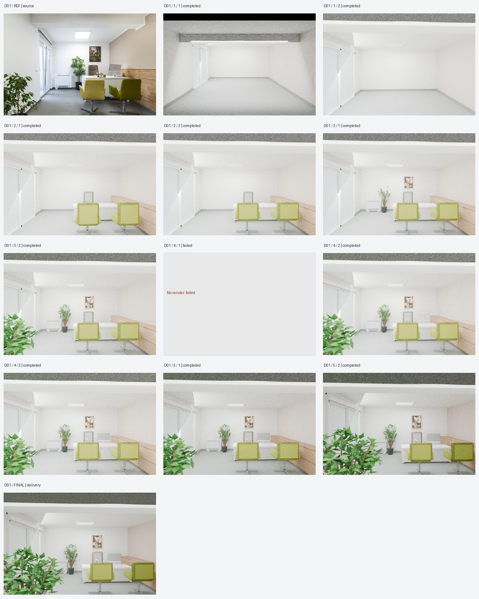
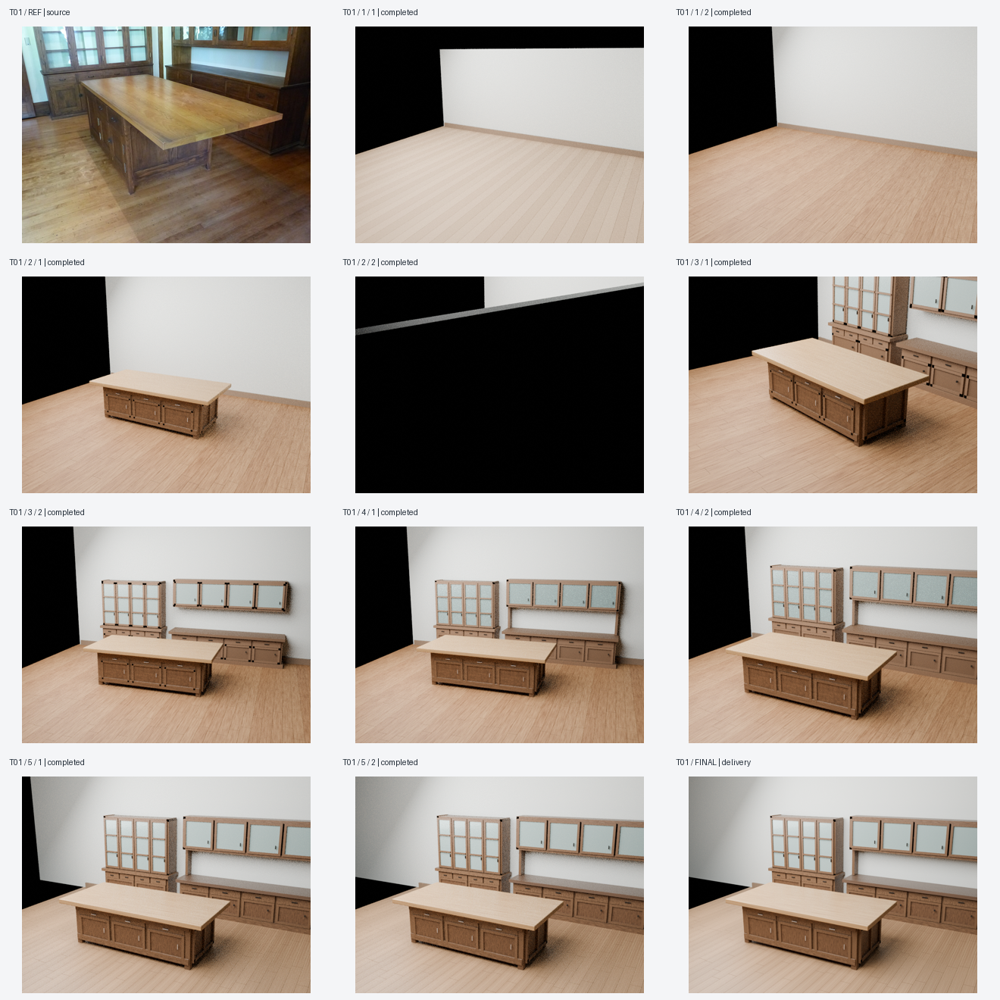

**实际结果和负面证据：** D01教师让学生修改相机、椅子支杆、植物可见性和显示器对比，最后仍有裁切及遮挡。T01第二阶段相机修订导致近黑图，学生复核识别了退化；第三阶段关闭右墙的渲染可见性后才恢复。最后仍有黑边、视角和外观差异。学生两次声称图像宽高比不同，但原图1280×960、预览768×576均为4:3；这些错误原文保留。R6要求保留问题，实际结构化历史只传给同阶段复核，跨阶段问题记忆未实现。

学生 `gpt-6.1-terra / medium`；开发教师及提炼 `gpt-6-astra / medium`。模型侧英文、用户说明中文。测试 Astra/教师调用 **0**，冻结入口执行10次；日志可见内部工具调用0。实际路由、底层精确请求数与费用未知。可见输入4,643,621、输出42,948 tokens，usage覆盖47/48会话，失败用量不填0。CPU8核/内存上限32GB，单Blender×8，GPU0；叶子进程CPU user/system约1015.62/31.15秒，远端等待计入CLI墙钟。

这是一条在线教学与语言检查策略迁移的可行性轨迹。两图历史已曝光，无同题无教师对照、无独立重复、无自动质量评分或已完成人工验证，不证明泛化更强、权重训练或教师自进化。

完整离线包包含许可允许再分发的两张原图、全部检查点 `.blend`、原始日志、失败及冻结代码。[本轮Release](https://github.com/i025/scene/releases/tag/stagewise-teaching-student-selfcheck-pilot-2026-11-15) · [完整包](https://github.com/i025/scene/releases/download/stagewise-teaching-student-selfcheck-pilot-2026-11-15/stagewise_teaching_student_selfcheck_pilot_full.tar.gz)；**是否已上传以[产物索引](artifacts_index_stagewise.csv)及上传摘要为准**。解压后打开 `stagewise_teaching_student_selfcheck_pilot/reports/index.html`，不要只下载HTML。原图归属和许可见 [SOURCE_ATTRIBUTION](experiments/stagewise_teaching_student_selfcheck_pilot/SOURCE_ATTRIBUTION.md)，没有为第三方材料添加覆盖性新许可。

离线重画：在完整实验目录运行 `python report.py`。已有任务续跑：`python launch.py resume`，完成后不会新增任务或重抽结果。本服务器实际环境路径、迁移说明及恢复记录见[实验README](experiments/stagewise_teaching_student_selfcheck_pilot/README.md)。

以下历史README原文保留，数值不属于这次两个持续场景任务。

---

# 教师 M 一次自修改：固定学生，人工看图

本分支 `research/teacher-self-evolution-human-pilot` 完成一次教师共享程序修改：4项开发后产生M1，再进行8项比较。固定学生、4张原图、12/12技术交付；没有新增H演化或自动质量评分。

[中文报告](experiments/teacher_self_evolution_human_pilot/reports/REPORT_ZH.md) · [离线HTML](experiments/teacher_self_evolution_human_pilot/reports/index.html) · [审查索引](docs/TEACHER_HUMAN_REVIEW_INDEX.md) · [逐项状态](experiments/teacher_self_evolution_human_pilot/metrics/tasks.csv) · [教师变化](experiments/teacher_self_evolution_human_pilot/reports/M_SELF_MODIFICATION_REVIEW_ZH.md) · [Release](https://github.com/i025/scene/releases/tag/teacher-self-evolution-human-pilot-2026-11-15)

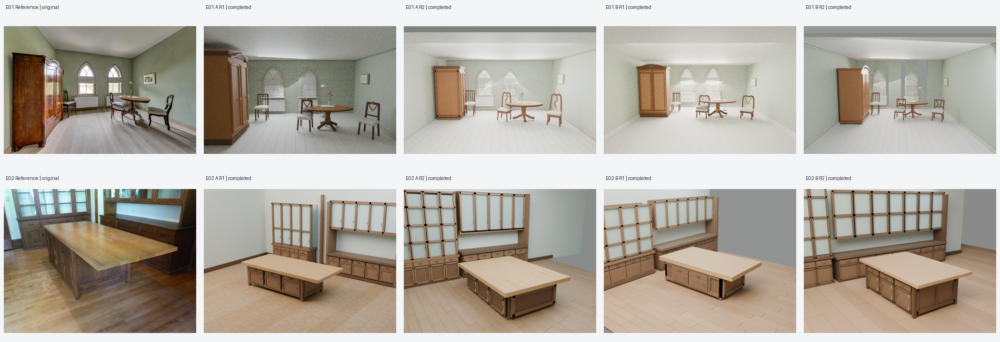
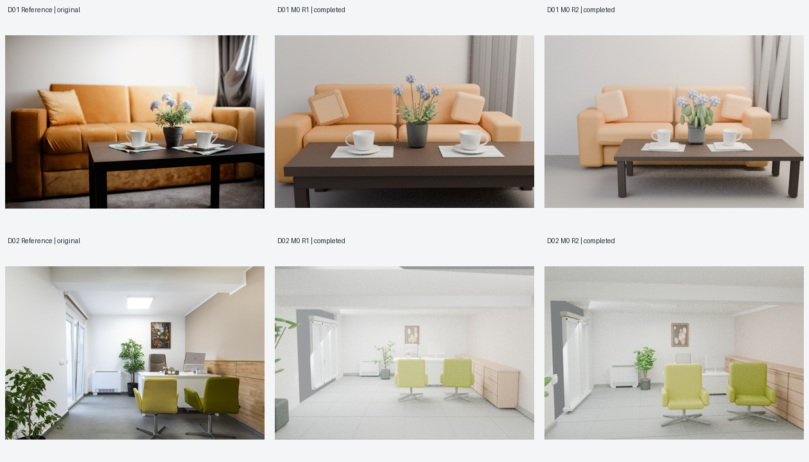

24次内部构建、5次内部错误均保留；7/12项学生实际收到中间渲染，其余首建失败后按既定额度修复。最终工程可交付，不代表内容正确。M1实际改的是共享提示策略，已用于4次比较指导，质量仍待人工判断；没有普遍元能力提升结论。

实际CLI 37/60：学生gpt-6.1-terra/medium，教师gpt-6-astra/medium；可见输入566,940、输出117,152 tokens，费用和实际路由未知。CPU8核/32GB、GPU0。完整离线资源包含原图、所有渲染与.blend；解压后打开 `teacher_self_evolution_human_pilot/reports/index.html`。页面支持放大、同步原图、展开Hint和内部版本、揭示A/B、导出可选人工意见。

[完整附件](https://github.com/i025/scene/releases/download/teacher-self-evolution-human-pilot-2026-11-15/teacher_self_evolution_human_pilot_full.tar.gz) · [上传摘要](UPLOAD_SUMMARY_TEACHER_HUMAN.md)。上传是否完成以摘要与远端收据为准。图片许可与历史暴露见本轮manifest；不冒称全新盲测。

以下旧README原样保留，数值不属于本次教师先导实验。

---

# Scene-RSI V3：十轮连续演化的实际状态

[最终审查附记：完整终测、M07与回放预算](docs/V3_FINAL_AUDIT_APPENDIX_ZH.md)

本区依据保存的运行与候选记录整理；不把退出码0、会话结束或旧state单独当成全部实验完成。
[完整收尾摘要](UPLOAD_SUMMARY_V3.md) · [审查索引](docs/V3_REVIEW_INDEX.md) · [中文报告](experiments/scene_rsi_v3/reports/REPORT_ZH.md) · [离线HTML](experiments/scene_rsi_v3/reports/index.html)

监看的真实launch终态：completed，退出码 0；state阶段：all_scheduled_terminal。
保存终态研发回合 10/10；H接受 2 次，M接受 1 个。失败、拒绝和unchanged保留，不能称十次成功升级。
各轮状态：{"completed": 10}。后代版本作为后续轮次父代：['M07']；这个版本关系不证明改动内容真正执行。

H请求模型 gpt-6.1-terra / medium；M与共享编码 gpt-6-astra / medium；独立judge gpt-6-astra。
全部通过Codex CLI。observed_model与请求模型分开；没有元数据则unknown，本地费用未知，不宣称降本。
CPU 8，内存上限 32 GB，Blender 1×8线程，CPU-only，未使用GPU（数量0）。
H整场3600秒、CLI900秒、build1200秒、render600秒。进程树RSS为采样下界，阶段时长不相加作总墙钟。

独立来源配对：6/6 来源、10 对双方成功且已评分的生成；来源等权条件BW差 -0.0130。全预定来源的端到端BW效用差 -1.0182；完整效用覆盖 6/6。重复和视角不作为独立场景。

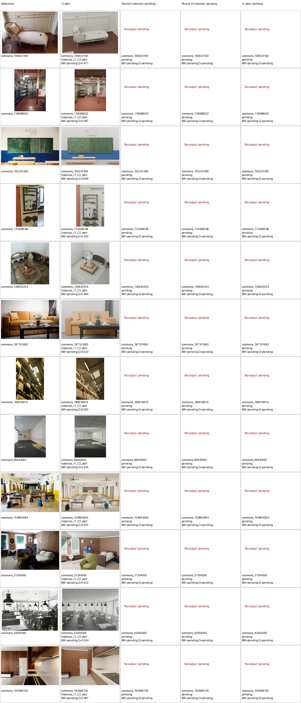
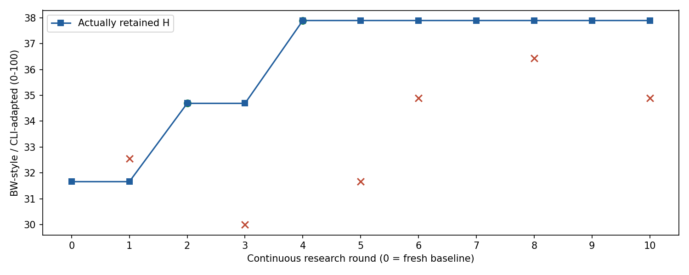
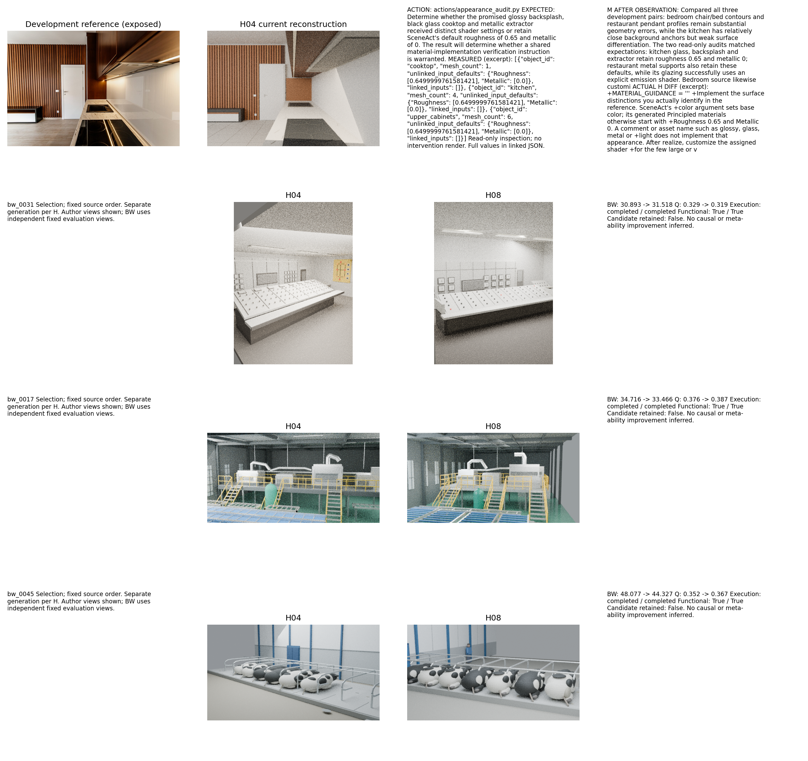
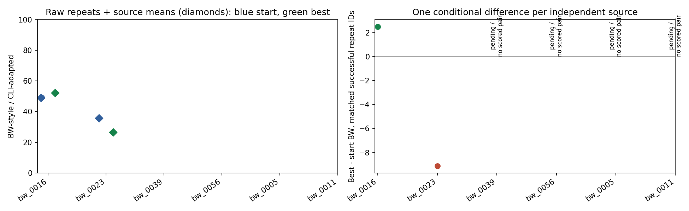
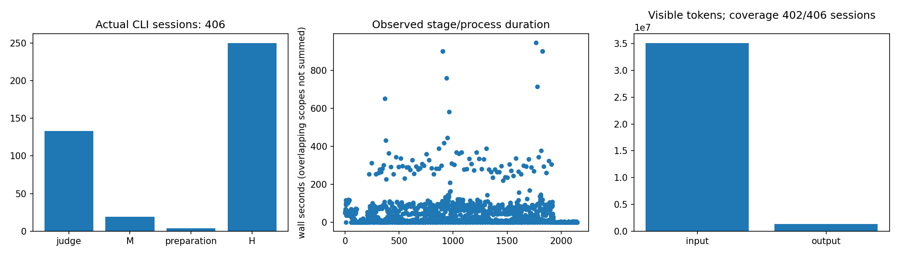
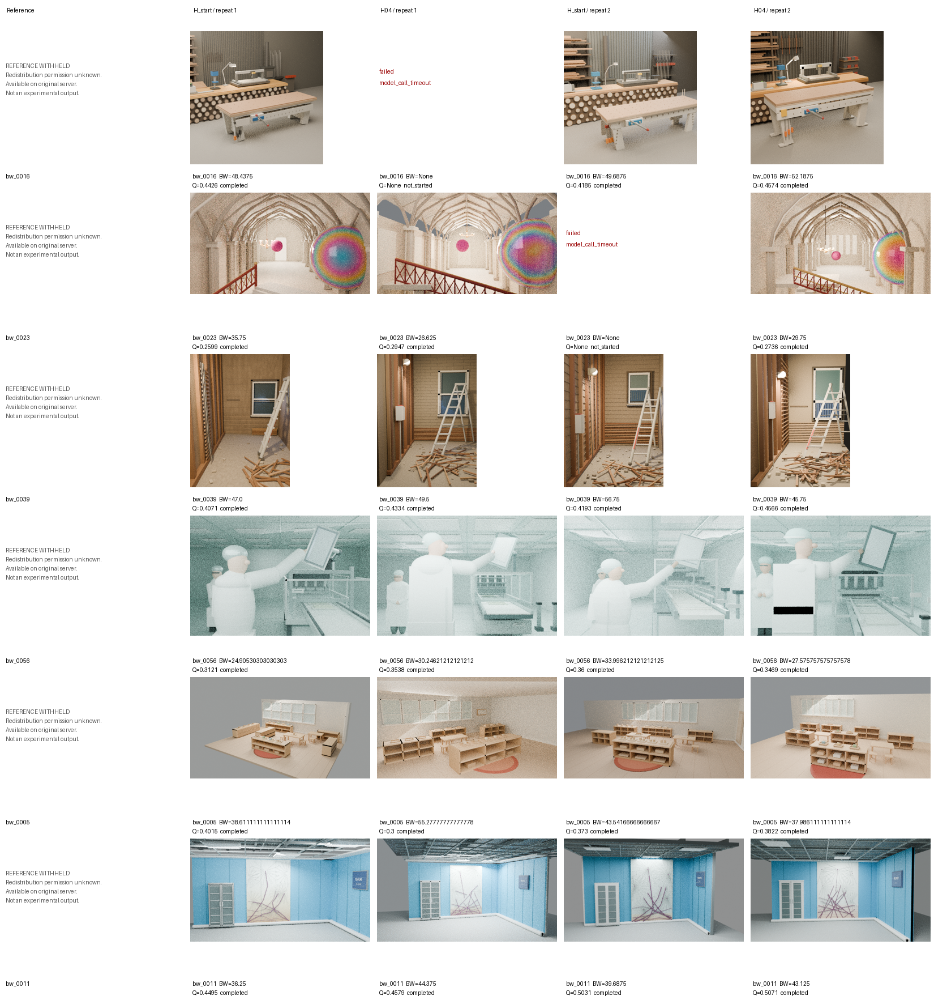
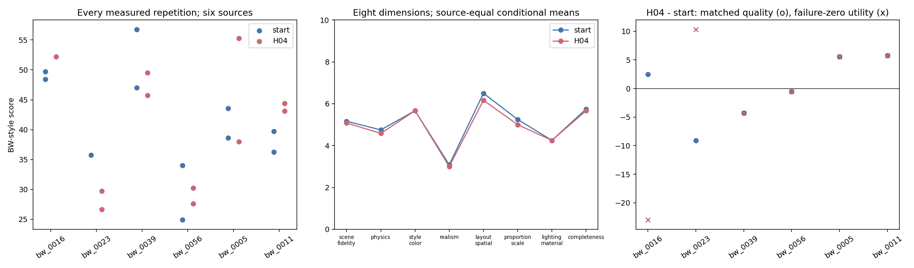
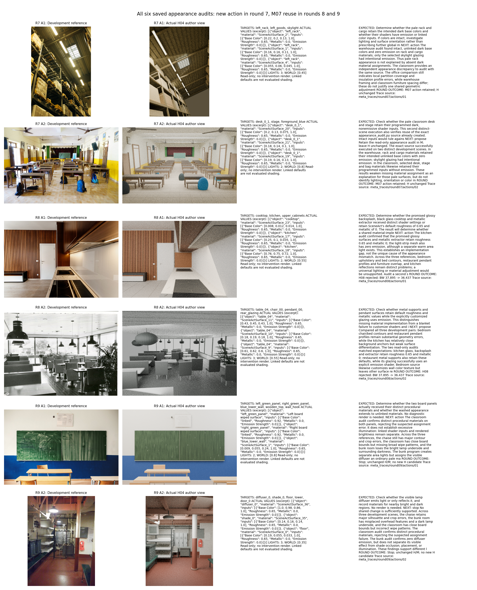

[终测专项统计](experiments/scene_rsi_v3/reports/FINAL_TEST_SUMMARY_ZH.md) · [M07深入审查](experiments/scene_rsi_v3/reports/M07_REVIEW_ZH.md)。公开BW参考列因许可未确认而留空；含真实参考的完整联系表仅保留本地。

BW-style / CLI-adapted，不是官方榜单。开发历史图为研发已暴露数据；失败、服务故障、缺测与pending分开。没有真实冻结元回放就不宣称元能力提升。
以下V2.4原文逐字保留，其数值不属于V3。

---
# Scene-RSI V2.4：自然图像共享 H 诊断与修复先导实验

研究问题：三维主动实验的真实观测是否帮助修改跨图像复用的重建流程，而不仅是修好某张图的 P？

分支：`research/scene-rsi-v2.4`。完整四包 Release 已有远端资产列表确认；提交链接由主任务核对。

归档提交：[4f23a8ba4513dc199f113f66b8ce969dd067b17c](https://github.com/i025/scene/commit/4f23a8ba4513dc199f113f66b8ce969dd067b17c)。

已完成范围：2 个自然图像研发任务 × 3 种方法 × 1 个 H 提案，计划 16 个新重建任务；所有真实成功、失败、拒绝与未选候选均保留。

## 实际结果

|方法|执行成功/预定|功能通过/预定|失败/未执行|真实提案/预定|源条件 Q (n)|迁移条件 Q (n)|严格有效修复|
|---|---|---|---|---|---|---|---|
|新 H_start|4/4|4/4|0/0|N/A|0.3488 (2)|0.3235 (2)|N/A|
|Fixed|4/4|4/4|0/0|2/2|0.3911 (2)|0.5149 (2)|2/2|
|Structured|4/4|4/4|0/0|2/2|0.3725 (2)|0.4955 (2)|2/2|
|Active|4/4|4/4|0/0|2/2|0.3640 (2)|0.4873 (2)|1/2|

|方法|选后 Test ΔQ（双方执行成功）|有效配对 n / 全预定|全预定失败效用差均值|
|---|---|---|---|
|Fixed|0.1914|2/2|0.1914|
|Structured|0.1721|2/2|0.1721|
|Active|0.1398|2/2|0.1398|

选后 ΔQ 按实际 selection_freeze 选择计算；原始候选迁移另见 candidates.csv。条件 ΔQ 不包含任何填零的视觉测量，全预定效用差则保留执行失败分母。

## 四个问题的证据回答

**1. 为什么H0失败？哪些属于模型调用，哪些属于构造程序与执行复杂度，哪些尚不能确定？**

历史审计中 H0 共 20 次，失败类别 {"total_budget_exceeded": 7, "blender_build_error": 2, "model_call_timeout": 2, "blender_build_timeout": 3}。另有 r1/C2 的两次明确 CLI 路由/服务错误，不能算作 H0 的程序错误。原始日志区分连接故障、生成参数/World 错误，以及共享 600 秒预算截断；仅有 build_started 的超时不能定位为布尔重载或 GPU 问题。远端纯推理/排队、V2.1 具体 Blender 子阶段及增加预算后的可恢复性仍未知。

**2. 主动三维诊断是否被真正执行？是否形成了有区分性的观测？**

Active 正式完成 2 次探测；第二阶段 unresolved 2/2，启发式权重比 [1.048708021229195, 1.142104784555224]。实际观测进入可执行 M，但执行探测不等于区分原因。自然图像无故障真值，SSIM 敏感性和软兼容分数不是因果识别或后验概率。

**3. 这种观测是否改善了共享重建H的研发？是否比固定诊断更有效？**

严格有效修复为 Active 1/2、Fixed 2/2、Structured 2/2。保留全部点、功能与成本；每方法只有两个研发任务，重建使用独立远端采样，不能把这一小样本差异证明为可靠的主动诊断优势或普遍研发能力提升。

**4. 是否存在真实的跨场景收益？需要哪些进一步实验才能支持论文贡献？**

实际 Selection 选后迁移的条件质量差异和全预定失败效用差异见下表；它们只支持这些历史已暴露的房间及本次采样。需增加独立未暴露来源、独立选择集、匹配实际探测成本、重复模型采样、可识别的干预与结构/编辑回归，再验证下游共享 H 收益；本轮没有自动 M 后代或冻结元回放。

## 方法与结论边界

- 本轮从 V2.1 r1/C2 的共享 H_start 出发；`fixed_h/H0` 仅保存原始起点源码，没有作为本轮新评估对照。三组是 Scene-RSI 内部机制对照，不是重跑 SceneEvolve/Hyperagents 的 RSI 基线。
- 源图先用于诊断和编码，再作为名为 Selection 的同图研发/筛选；不属于独立验证。另一房间 transfer 在候选与选择冻结后新执行，但图像曾在 V2.2 暴露，不能称全新盲测。
- 冻结文字要求源 Q 提升 >0.01；实际 runner 在 H_start 功能资格失败时接受任意合格候选，即使 H_start 有有效 Q。保留实际选择，`selection_strict_gain_disagreement` 记录偏离，不事后改选。严格有效修复的额外派生条件仍为：源合格且 ΔQ>0.01，迁移合格且 ΔQ≥-0.01。
- 每种方法只有两个研发任务，每个 H/图仅一次新重建，模型远端采样未被本地种子控制，也未量化其波动。各组初诊独立采样，不把质量差异唯一归因于探测。条件质量均值只含成功案例，执行失败且没有测量时 Q 保持 null，失败效用单独记零并保留全部预定分母；多视角不是独立重复。
- 报告整理时目视可见 task01 新 H_start 的厨房迁移图近乎全黑，Q 约 0.195，仍执行成功且机械功能合规。原图和分数保留，不重采样；这个低基线放大了该场景的配对增益，限制均值的普遍解释。目视标注不改变评分或选择规则。
- M 是工程修订，无自动后代、无跨代能力提升或陌生 H 起点冻结元回放。全部最终编辑为机械操作，不存在文字指令编辑能力结果。
- 最早烟测在修正对象 ID 契约之前的完整源码快照未保存，无法逐字确认；其真实请求、响应和错误记录保留。smoke_initial_menu 快照形成于该修正后，不冒充修正前版本。正式冻结代码与六个候选保存完整，并已核对候选源码等于实际编码响应。
- 实际模型角色由 calls.csv 决定：initial_diagnosis/shared_H_patch 使用 gpt-6-astra medium，student 使用 gpt-6.1-sol medium。record.model_roles 中 editor/judge 是沿用但未执行的元数据，不能计为实际编辑器或独立视觉评审。
- 元诊断/共享修改 CLI 单次 600 秒；student 单次至多 300 秒且受内层剩余时间限制；内层总计 600 秒、最多 3 次调用/2 次执行。数值指标与外层功能检查在内层期限外另行执行，不把全部耗时误写为 600 秒以内。
- M 的平均归一化残差 ≤3 是软兼容阈值，不要求严格区间命中；指数权重比不是后验概率。所有假设的软残差均超阈值时保留 unresolved，不把 Q 或 SSIM 改善当唯一原因。

## 真实可视化

统计单位是研发任务或新重建任务；源/迁移图按固定顺序展示全部输出，空白是真实缺失，不用历史图替代新 H_start。

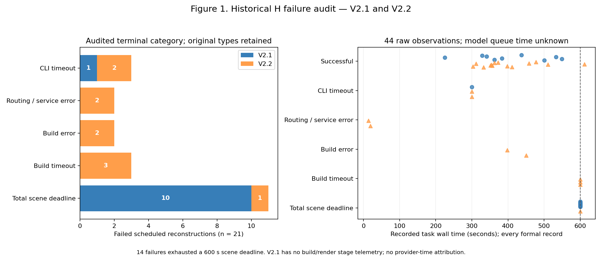

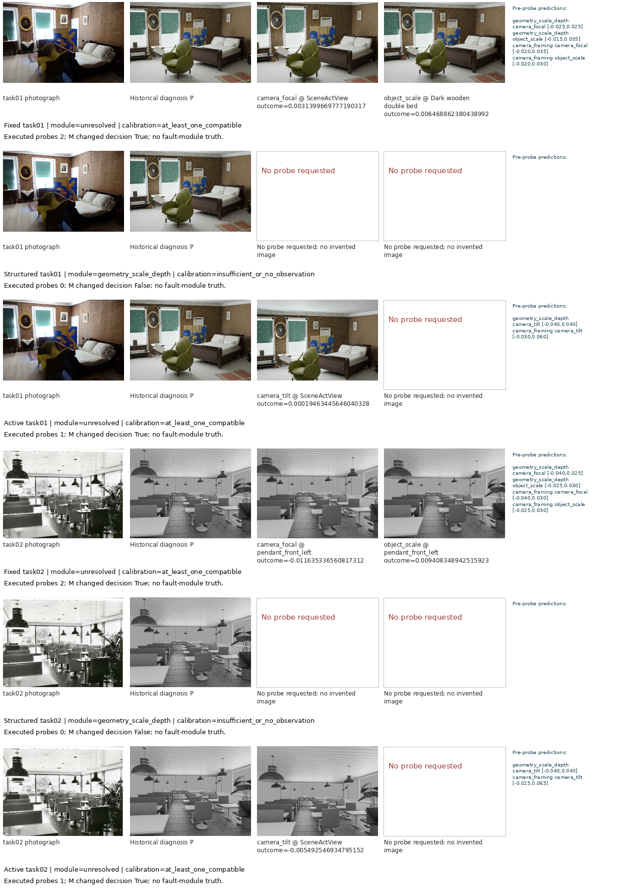

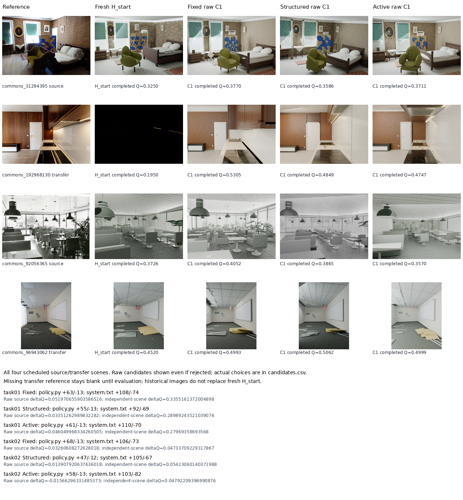

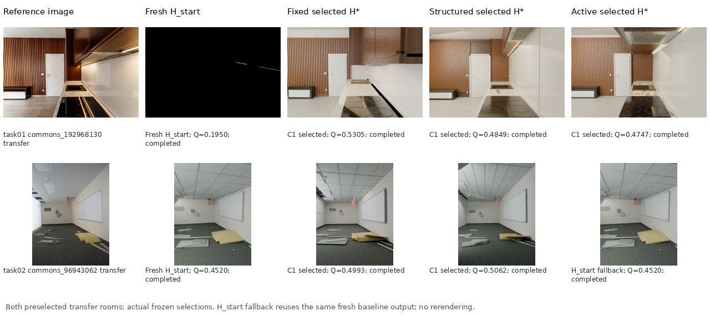

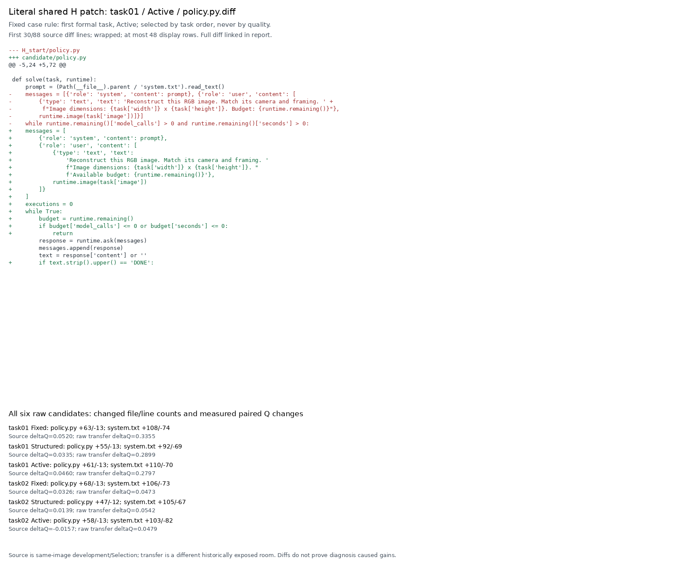

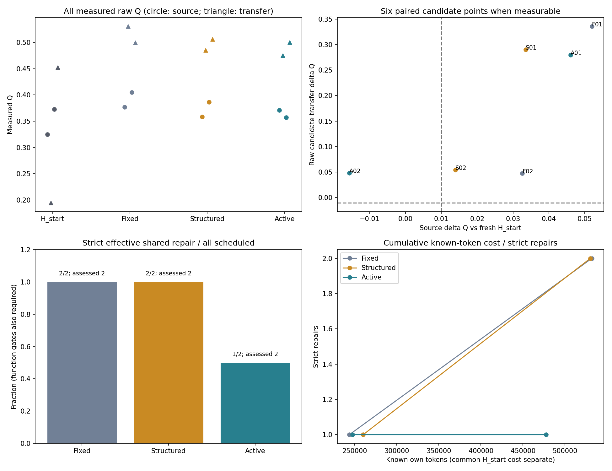

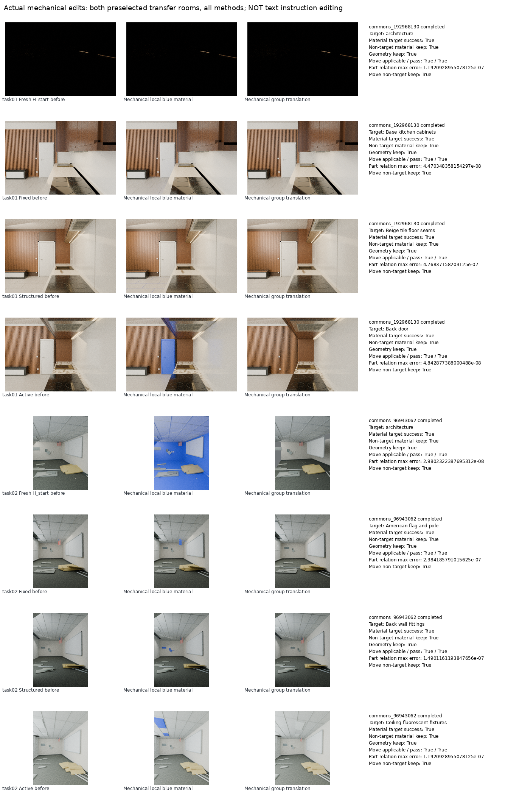

源图诊断输入与旧 V2.2 渲染单独见 [Figure 2](experiments/scene_rsi_v2_4/figures/figure2_natural_diagnosis_inputs.png)；它们不是本轮新 H_start 的数值结果。已知结构错误检测见 [Figure 6](experiments/scene_rsi_v2_4/figures/figure6_structural_calibration.png)。

## 成本与原始证据

本轮新增 CLI 54/80；已知输入 2040784、输出 252990 token；usage 缺失 0。渲染尝试上界 101/240，完成 100。CPU 两线程、单重任务、GPU 0。新增全局预算和调用总数包含全部 10 次准备/烟测调用；每方法正式曲线不含这些共同准备费用及新 H_start，二者另表单列。历史复制日志不计新增。外层工程对话和固定模型服务基础设施成本不可观测、未定价，不声称各方法总研发实耗相等。模型、流水线与 Blender wall time 互有包含，不相加或据此声称算法速度优势；美元费用未知。

|成本组|CLI 会话|已知输入/输出 token|usage 缺失|探测 Blender 秒|重建流水线秒|
|---|---|---|---|---|---|
|fixed|12|475535/56258|0|45.0786|1635.6549|
|structured|12|465528/64495|0|0|1670.5621|
|active|12|425161/52286|0|22.5116|1245.6472|
|common_H_start|8|196992/46119|0|0|1475.7934|
|smoke|10|477568/33832|0|11.4820|728.2418|
|preparation|0|0/0|0|0|0|

- [中文报告](experiments/scene_rsi_v2_4/reports/REPORT_ZH.md) / [离线 HTML](experiments/scene_rsi_v2_4/reports/index.html)
- [逐场景原始指标](experiments/scene_rsi_v2_4/metrics/scene_metrics.csv) / [六候选](experiments/scene_rsi_v2_4/metrics/candidates.csv) / [调用](experiments/scene_rsi_v2_4/metrics/calls.csv)
- [分阶段模型成本](experiments/scene_rsi_v2_4/metrics/costs_by_phase.csv)：共享 H 研发、源图重建、迁移推理和准备烟测分别列出。迁移成本包含预定的原始未选候选评价。
- [事前预测](experiments/scene_rsi_v2_4/metrics/forecasts.csv) / [实际观测](experiments/scene_rsi_v2_4/metrics/probe_observations.json) / [图表来源](experiments/scene_rsi_v2_4/metrics/figure_sources.json)
- [事后审查索引](docs/REVIEW_INDEX_V2_4.md) / [as-run protocol](docs/AS_RUN_PROTOCOL_V2_4.md) / [离线命令](docs/COMMANDS_V2_4.md)

代表工程按固定 task01、task02；H_start、Fixed、Structured、Active 顺序选择首个实际完成且文件存在的迁移输出，不挑赢家：`experiments/scene_rsi_v2_4/results/task01/reference/H_start/test/commons_192968130/scene.blend`；对应 [场景程序](experiments/scene_rsi_v2_4/results/task01/reference/H_start/test/commons_192968130/build.py)。`.blend` 在完整 Release 包中，解压后可打开。

## 完整附件

- [active.tar.gz](https://github.com/i025/scene/releases/download/scene-rsi-v2.4-2026-11-06/active.tar.gz)，63897749 bytes
- [fixed.tar.gz](https://github.com/i025/scene/releases/download/scene-rsi-v2.4-2026-11-06/fixed.tar.gz)，67437377 bytes
- [shared-evidence.tar.gz](https://github.com/i025/scene/releases/download/scene-rsi-v2.4-2026-11-06/shared-evidence.tar.gz)，66406921 bytes
- [structured.tar.gz](https://github.com/i025/scene/releases/download/scene-rsi-v2.4-2026-11-06/structured.tar.gz)，56431924 bytes

全部路径与附件状态见 [artifacts_index_v2_4.csv](artifacts_index_v2_4.csv)。完整 stdout/JSONL、全部 `.blend`、大几何 JSON 按四包保留；普通 Git 提供关键代码、配置、原始表和真实图片。

旧版入口：[V2.3 原提交 README](https://github.com/i025/scene/blob/d72817b0d90e9ecc5e156344128bacf76317e25e/README.md)；未经改写的本地文本另存 `docs/README_V2_3_CHECKPOINT_d72817b.md`，其相对链接仍以原仓库根为基准。V1/V2/V2.1/V2.2/V2.3 的实验和原始分数保持原样。未为第三方代码、Commons 图片或模型另加覆盖性许可证。
