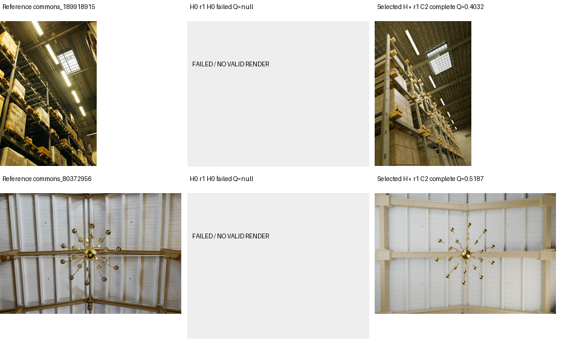
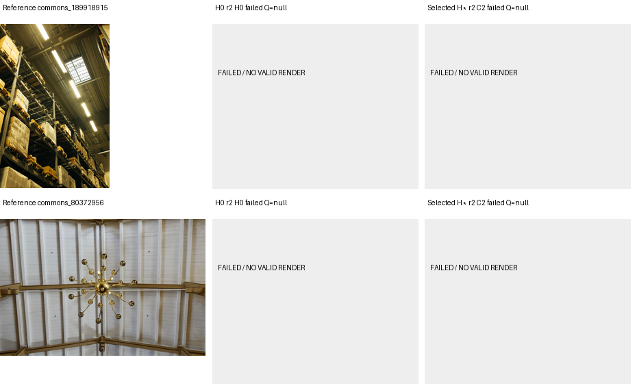
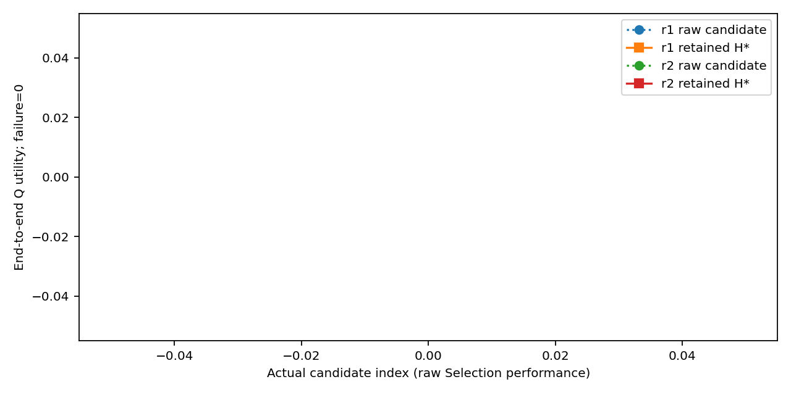
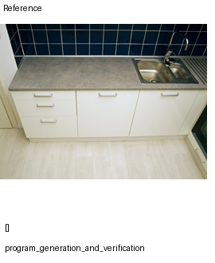
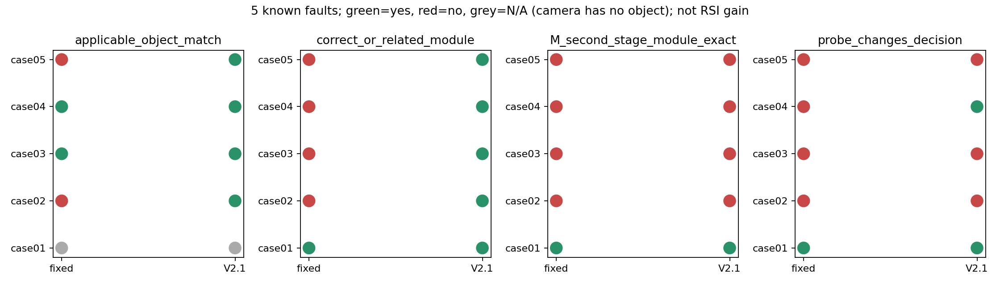
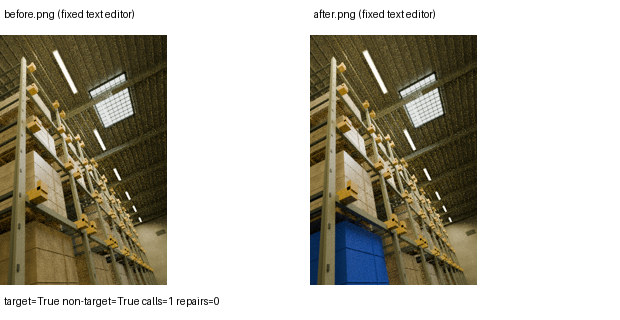
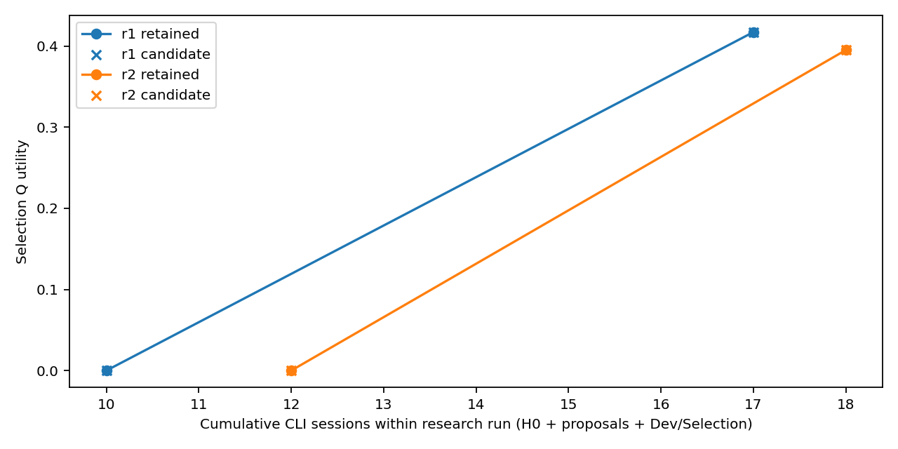

# Scene-RSI V2.1：可编辑三维场景重建的演化实验

研究共享重建流程 **H** 与元策略程序 **M** 的改进，单张图生成的场景程序记为 **P**。本轮修复候选资格、失败诊断、真实对象定位与缺测统计，只运行 Scene-RSI 与 H0 内部参照，没有重跑 SceneEvolve 或 Generic。

**两个研发运行、每次 K=2 已完成。4 个真实候选都是 H-only；两个 C2 通过 Selection；没有实际修改 M 的后代，也没有元能力提升证据。**

|终测方法|成功 / 全部预定|成功样本条件 Q|失败效用单列为零的任务效用|必要功能通过|
|---|---:|---:|---:|---:|
|共享 H0|0/4|null|0|0/4|
|选中 H*|2/4|0.460959|0.230479|2/4|

单位是“来源图像 × 研发运行”，实际只有 **2 个 Test 来源组**，其中一个是仓库场景，一个是吊灯/屋顶细节，不能描述为四个独立场景或两个完整房间重建。没有双方均成功的配对，**无法计算配对视觉质量增益**。r1 的任务效用差为 +0.460959，r2 为 0；结果主要反映有限预算下的可执行性，不能推出普遍重建优势。数据为 exploratory，历史曝光无法排除。





Selection 的 r1/r2 C2 条件 Q 分别为 **0.417323 / 0.395204**，必要功能均通过。H0 的两次 Selection 都未在预算内成功；它仍是安全回退，但没有放宽候选的绝对功能门槛。[原始选择记录](experiments/scene_rsi_v2_1/selection_freeze.json) · [逐场景指标](experiments/scene_rsi_v2_1/metrics/scene_metrics_flat.csv) · [候选与接受原因](experiments/scene_rsi_v2_1/metrics/candidates.csv)。



M 的两阶段接口实际运行：`plan_probes → Blender 探测/回归 → plan_patch`。定位读取参考、渲染与真实对象投影，不能默认归因到最大 Mesh 或首个对象。无有效 blend 时读取失败轨迹，不执行几何探测。[首个正式诊断原始 stage2](experiments/scene_rsi_v2_1/candidates/r1/scene_rsi_v2_1/C1/stage2.json)（大记录随附件） · [真实 H diff](experiments/scene_rsi_v2_1/candidates/r1/scene_rsi_v2_1/C1/changes.diff)。下图是失败案例，不能用定位结果解释为重建改善。



五个已知故障夹具中，有四个涉及指定对象，固定启发式 / V2.1 的适用对象或相关部件命中为 **2/4 / 4/4**；相机故障无需对象，双方均请求了相机探测。图像定位或相关模块命中为 **1/5 / 5/5**，但 **M 第二阶段最终模块精确命中双方均为 1/5**。V2.1 多用了 5 次图像定位调用，不是等实际计算量对照。辅助共享 helper 的迁移修复双方均通过 5/5，API 契约给出了提示；这不等于自然图像重建 H 改善。旧宽泛对象计数及包含相机空目标的3/5、5/5字段保留；适用对象命中在独立衍生列中说明。




结构校准覆盖脱离部件、缺失部件、破坏支撑、共享材质误改、安全局部编辑、组合移动及三角表面相交。支撑为归一化 AABB 近似；表面相交不等于不合理 Mesh 碰撞。自然图像没有三维真值。两个有效 Test 产物分别通过一次固定 sol 文字编辑，目标修改和非目标保持都通过；失败任务无可编辑产物，不能形成配对编辑收益。机械操作另列。



开发质量也并非单调改善：r1 的 H0 Q=0.465523，C2 为0.457698；r2 的 H0 为0.482103，C2 为0.481942。完整正式记录为 H0 8次任务（2成功、6失败），Scene-RSI 4候选共12次任务（7成功、5失败）；另有4次模型提交前的超包失败，均保留。

**成本与资源：** 共 65 次新 CLI，会话返回的已知 input/output tokens 为 3,007,308 / 164,797，1 会话 usage 未知；渲染尝试上界 117、完成 103，冻结预算 160 / 600。CPU 单重任务、2 线程，GPU 0 张。sol medium 负责重建/固定编辑；astra medium 负责定位/提案/独立评审。CLI 未独立报告实际模型标识的字段保持 unknown，费用与远端模型轮数不估造。[全部调用](experiments/scene_rsi_v2_1/metrics/calls.csv) · [分阶段成本](experiments/scene_rsi_v2_1/metrics/cost_by_phase.csv)。



本地冻结之后发生过证据包超过 600KB 的 runner 故障，四次模型提交前失败完整保留。修复压缩对象详情后，统一重做候选阶段，H0/M0/数据/门槛/总预算未变。一个 H0 Test 生成提前提交，新的选择冻结后才评价，未回流研发。这是明确记录的 **as-run 偏离**，不宣称严格盲测。[运行修订](experiments/scene_rsi_v2_1/configs/payload_evidence_fix1.json)。吊灯任务组合检查最初是可选项，实际测得通过，但不事后改写为必需。

审查入口：[AS-RUN 协议](docs/AS_RUN_PROTOCOL_V2_1.md) · [主张—代码—数据审查索引](docs/REVIEW_INDEX_V2_1.md) · [中文完整报告](experiments/scene_rsi_v2_1/reports/REPORT_ZH.md) · [离线 HTML](experiments/scene_rsi_v2_1/reports/index.html) · [上传摘要与状态](UPLOAD_SUMMARY_V2_1.md)。

核心数据：[Test 汇总](experiments/scene_rsi_v2_1/metrics/terminal_overview.csv) · [所有预定任务](experiments/scene_rsi_v2_1/metrics/scheduled_slots.csv) · [全部候选尝试](experiments/scene_rsi_v2_1/metrics/candidate_attempts.csv) · [逐检查 required/applicable/measured/gate](experiments/scene_rsi_v2_1/metrics/functional_checks.csv) · [失败阶段](experiments/scene_rsi_v2_1/metrics/failure_stages.csv) · [事后范围敏感性](experiments/scene_rsi_v2_1/metrics/posthoc_scope_sensitivity.csv) · [M 使用情况](experiments/scene_rsi_v2_1/metrics/meta_participation.csv)。

源码：[实验入口](experiments/scene_rsi_v2_1/README.md) · [依赖与许可](docs/DEPENDENCIES_V2_1.md) · [共同 H0](experiments/scene_rsi_v2_1/backend/harnesses/baseline) · [实际 M0](experiments/scene_rsi_v2_1/initial_meta/scene_rsi_v2_1/meta.py) · [候选源码与 diff](experiments/scene_rsi_v2_1/candidates) · [实际版本快照](experiments/scene_rsi_v2_1/code_snapshots)。

完整日志、全部现有 blend/渲染/场景程序按运行分包，覆盖失败与未选候选。[附件索引](artifacts_index_v2_1.csv) 只在上传确认后填写下载 URL；本次推送因GitHub 401及凭据缓存为空而失败，分支和Release尚未上传；状态以该表及上传摘要为准。解压所有附件到仓库根后可离线重画，不下载权重、不调用模型、不渲染：

```bash
OMP_NUM_THREADS=2 OPENBLAS_NUM_THREADS=2 MKL_NUM_THREADS=2 CUDA_VISIBLE_DEVICES= python scripts/offline_v2_1.py --experiment experiments/scene_rsi_v2_1 --output derived/v2_1_replot
```

以上 python 是已满足依赖的 Python 3.11；环境说明见依赖文档。服务器上的唯一实验续跑入口为 `python outputs/scene_rsi_v2_1/resume.py`；当前 `supplement_complete` 状态下只重画报告，没有新模型或重建任务。不要把已公开 Test 再称为新的盲测。

旧记录完整保留：[V1](docs/README_V1.md) · [V2 原检查点](docs/README_V2_CHECKPOINT.md) · [V2.1 早期检查点](docs/README_V2_1_CHECKPOINT_797ea6b.md)。开始前核对到 V2 有 13 条正式记录、0 个正式候选、Test 未启动；旧 running_scene 是残留状态而非活进程。V2 原分数与报告不按 V2.1 规则回写。
