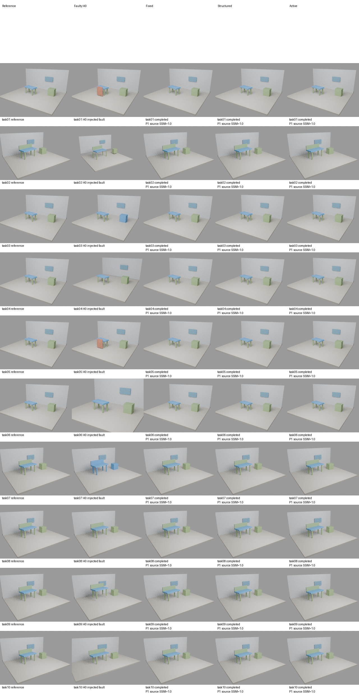
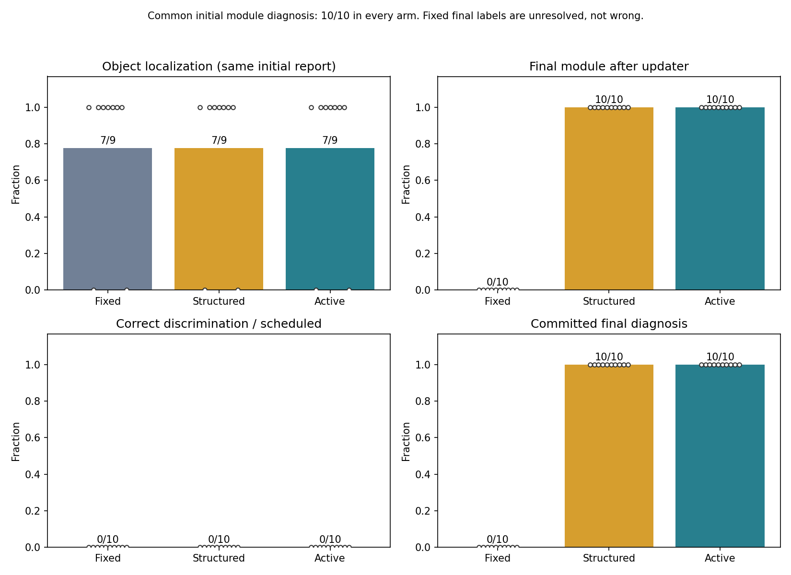
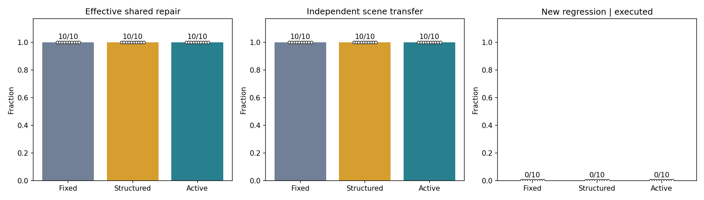
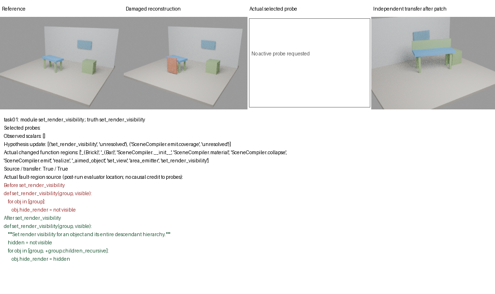
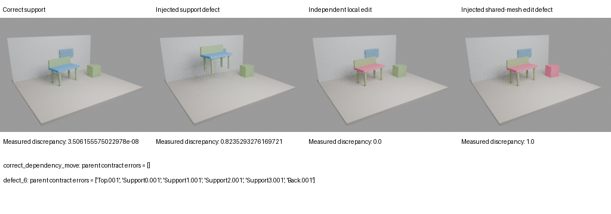
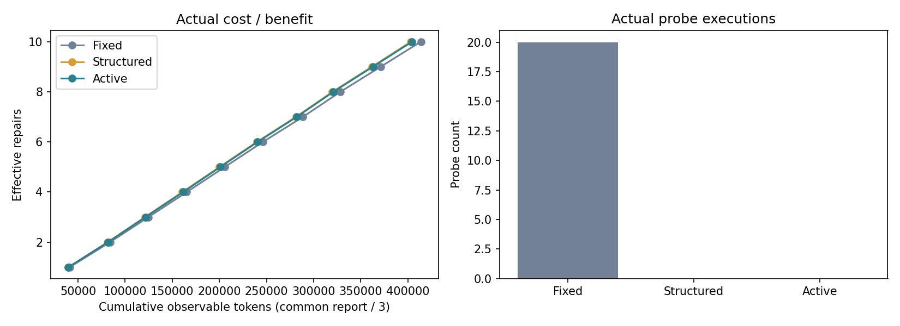

# Scene-RSI V2.3：主动三维诊断与共享程序修复

研究问题：在相同模型、原始证据和共享修改预算下，主动三维实验是否比固定探测或结构化证据更能修复跨场景复用的程序？

本轮已实际运行 **10个故障配置 × 3种诊断策略 × 每组一次共享修复**，并在另一模板/资产组合上验证。共享H来自实际SceneAct Blender编译器，附少量支撑/可见性/编辑接口。三组从每个任务相同H0出发。未重跑SceneEvolve、Hyperagents或多代RSI。

代码与结果已推送，4个完整附件已上传并远端读取确认。

分支：`research/scene-rsi-v2.3`；实验归档提交：https://github.com/i025/scene/commit/4ad6e675a066072a976ce99aef77ee3e9536e14f。

## 实际结果

|方法|完成/预定|真实候选|精确模块命中|有效共享修复|迁移修复|新增回归（执行后）|
|---|---|---|---|---|---|---|
|Fixed Diagnosis|10/10|10|0/10|10/10|10/10|0/10|
|Structured Evidence|10/10|10|10/10|10/10|10/10|0/10|
|Active Diagnosis|10/10|10|10/10|10/10|10/10|0/10|

Active正式请求探测 **0次**；Fixed固定20次；Structured不探测。三组每任务共享一次真实图像+源码初诊，实际仅调用一次，成本分摊1/3，对象定位因此相同。Frozen规则允许Active在无预测分歧时不探测。

**本轮不能支持“主动诊断带来可靠共享研发优势”的论文贡献一。** 当前完整源码和公共三维SceneAct参数已暴露多数契约错误，竞争解释往往给出相同预测；Active退化为无探测路径。修复成功不能归因于主动诊断。多个解释符合探测时Fixed更新器写unresolved，无观测路径可保留高置信初诊，故最终模块标签差异也不能直接解释为定位能力优势。

本轮使用了两种参数化家具模板；10个注入配置不是10个独立自然房间。迁移换模板、尺寸、相机、非均匀缩放、旋转、命名和部件组合，但未证明自然图像整体重建的泛化。只覆盖box为主的场景，未做全部SceneAct primitive/Boolean能力回归。

M为工程实现，未自动进化，没有冻结陌生H起点上的MetaImp回放；不声称跨代元能力提升。P为确定性场景实例，H为共享编译/编辑子程序，M为探测选择与观测更新策略，三者分别存档。

## 真实可视化

以下全部来自本轮Blender渲染和原始表，没有概念房间图或假设上涨曲线。













## 原始证据和复核

- [中文完整报告](experiments/scene_rsi_v2_3/reports/REPORT_ZH.md)、[本地HTML](experiments/scene_rsi_v2_3/reports/index.html)。HTML下载后本地打开，无外部CDN。
- [冻结协议](docs/AS_RUN_PROTOCOL_V2_3.md)、[主张→代码→数据审查索引](docs/REVIEW_INDEX_V2_3.md)、[实际适配与未达成目标](docs/ADAPTATIONS_AND_LIMITS_V2_3.md)。
- [逐任务原始CSV](experiments/scene_rsi_v2_3/metrics/scene_metrics.csv)、[候选表](experiments/scene_rsi_v2_3/metrics/candidates.csv)、[全部初诊/编码调用](experiments/scene_rsi_v2_3/metrics/calls.csv)、[事前预测与实际观测](experiments/scene_rsi_v2_3/metrics/probe_predictions.csv)、[原始汇总](experiments/scene_rsi_v2_3/metrics/summary.json)。
- [全部大产物索引](artifacts_index_v2_3.csv)、[完整Release：4个包，覆盖全部三组、烟测、失败和工程记录](https://github.com/i025/scene/releases/tag/scene-rsi-v2.3-2026-11-06)。所有.blend、完整prompts/JSONL/stderr和场景程序均保留，不只存赢家。
- 每张图的数据和脚本映射见 [figure_sources.json](experiments/scene_rsi_v2_3/metrics/figure_sources.json)。

执行成本：新增 **49/180 CLI会话**，已知输入token 1310660、输出 90982；usage未知会话 0。渲染尝试 **153/600**、完成 153。只有CPU，单重任务2线程，GPU使用0；远端模型轮数和美元费用unknown，不能把一次CLI当一次底层推理。等待与模型计算时间无法完全拆分，不作算法速度结论。

确定性校准：2合法场景+10注入错误、7个正确H探测基准+10个故障响应、2个额外相机姿态/材质退化检查全部通过；2烟测×3方法的6提案也通过最终检查。正式失败与准备失败分开；准备阶段2个真实工程错误保留日志。机械编辑/父子关系保持不是文字指令编辑；AABB支撑不是真实Mesh碰撞；没有自然图像三维恢复真值。

## 离线重算

使用Python3.11和已有依赖：

```bash
OMP_NUM_THREADS=2 OPENBLAS_NUM_THREADS=2 MKL_NUM_THREADS=2 python scripts/offline_v2_3.py --experiment experiments/scene_rsi_v2_3 --output /tmp/scene-rsi-v23-review
```

输出目录必须不存在；核心Git数据可重画主图，完整媒体从4个Release包解压到仓库根。命令不调用模型或Blender，也不覆盖原始数据。依赖/实际运行入口见[DEPENDENCIES](docs/DEPENDENCIES_V2_3.md)、[COMMANDS](docs/COMMANDS_V2_3.md)。

旧轮次：[V2.2真实报告](experiments/scene_rsi_v2_2/reports/REPORT_ZH.md)、[V2.1](experiments/scene_rsi_v2_1/reports/REPORT_ZH.md)、[V2](experiments/scene_rsi_v2/reports/REPORT_ZH.md)、[V1](experiments/scene_rsi_pilot/reports/report.md)。旧源码、结果与Release保留；新公开过的任务不能再称未来盲测。
