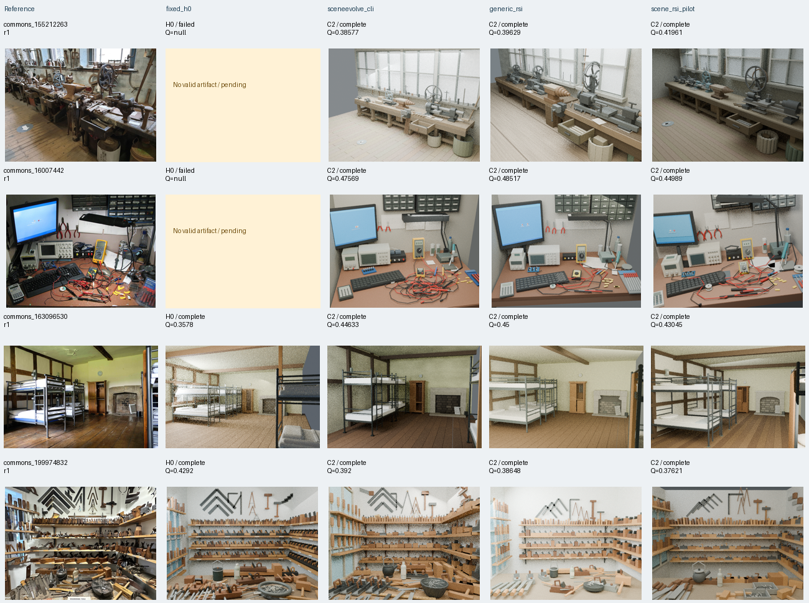
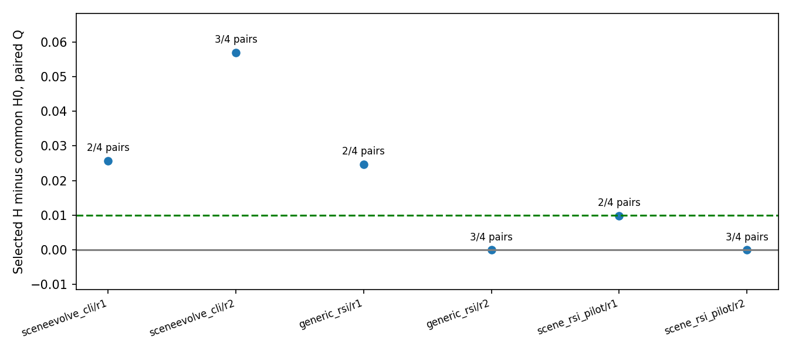
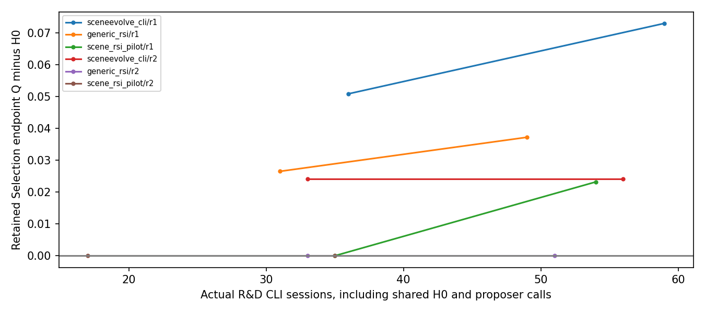
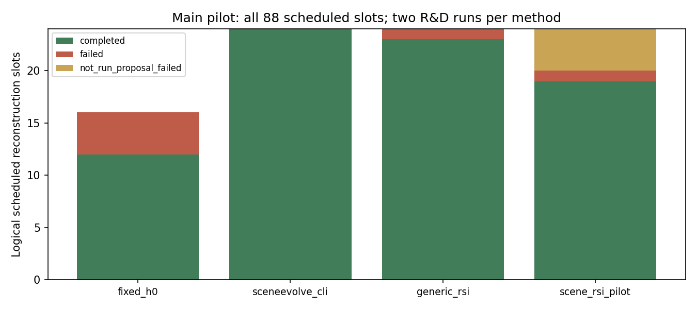
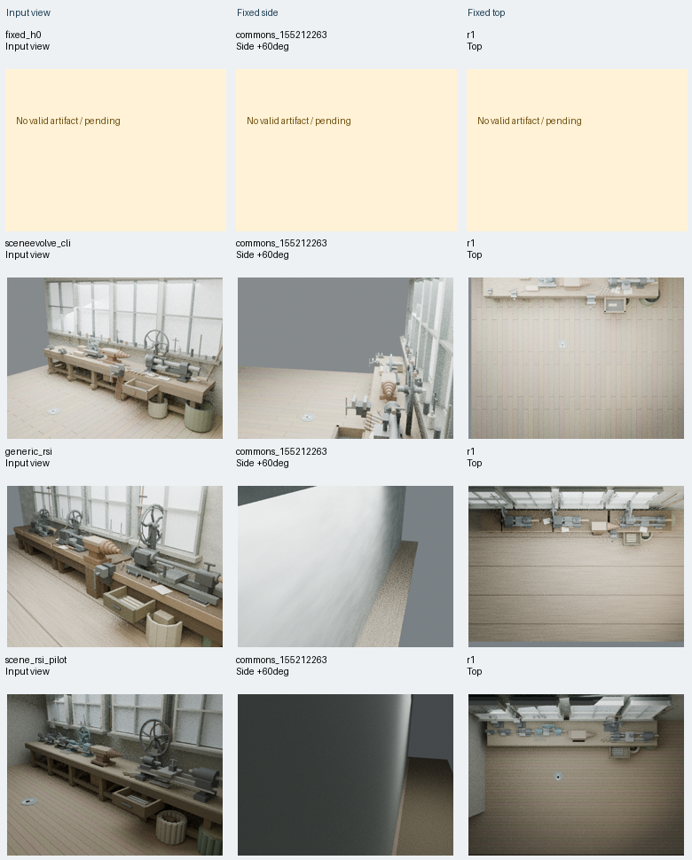
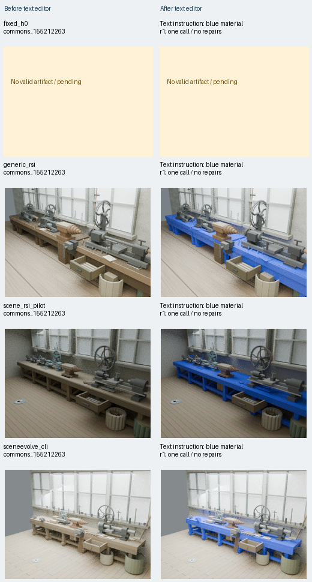
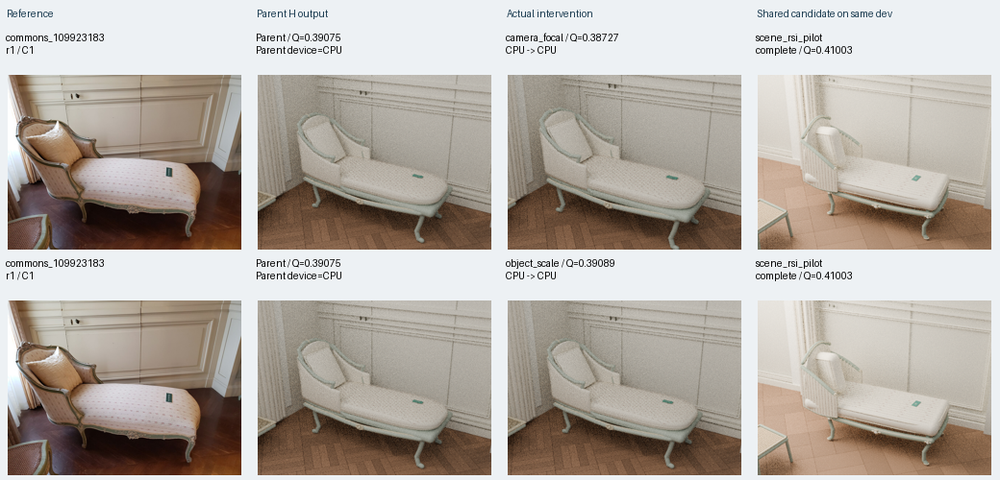
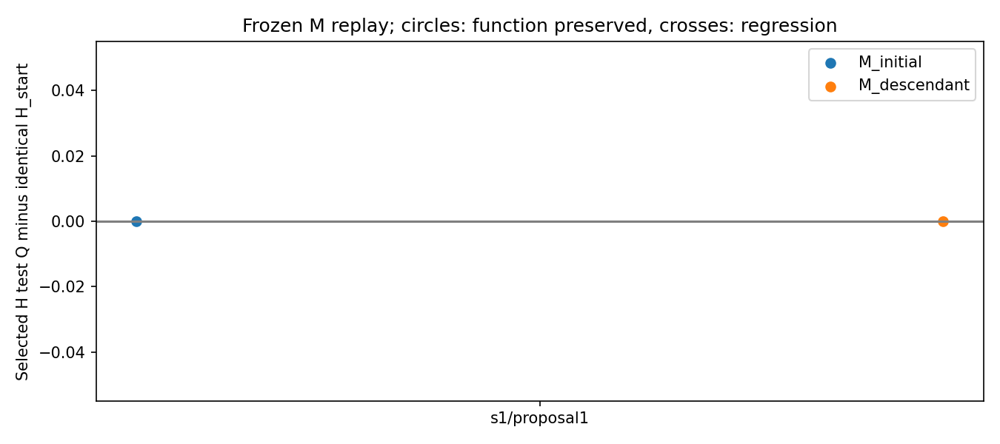
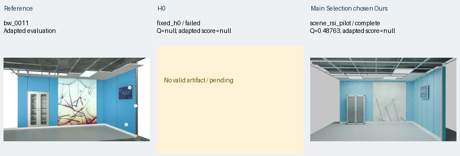

# scene_rsi_pilot：首轮真实实验归档

**上传受阻（GitHub403）**：本地归档和提交已完成，远端仍为空，Release未创建，27个分包当前仅保留本机。现有fine-grained PAT没有通过该仓库的实际写入；详见[上传记录](docs/UPLOAD_ATTEMPTS.json)与[本地分包清单](docs/LOCAL_ARTIFACTS.csv)。不把本地提交当作成功上传。

研究问题是：如何跨图像改进“参考图像 → 可编辑3D场景程序与Blender工程”的共享流程 **H**，以及负责诊断、提案与修改H的策略程序 **M**。单场景程序 **P** 的修复另记，不把漂亮单例当成新共享算法。

这是2026-11-02至11-04在共享服务器上实际执行的小规模、探索性先导实验。**没有证据支持普遍优势或元能力单调提高。** 本仓库归档已有实验；本次整理新增模型调用0、重建/终测/渲染0，没有使用GPU。真实源码、失败、拒绝、未选中候选和完整大产物均保留。

[审查索引](docs/REVIEW_INDEX.md) · [事后as-run协议](docs/AS_RUN_PROTOCOL.md) · [中文完整报告](experiments/scene_rsi_pilot/reports/report.md) · [离线HTML](experiments/scene_rsi_pilot/reports/index.html) · [全部产物索引](artifacts_index.csv) · [本地完整附件（尚未上传）](docs/LOCAL_ARTIFACTS.csv) · [上传摘要](UPLOAD_SUMMARY.md)

## 实际跑了什么

共同起点为本地复现中未演化的SceneEvolve初始H0，统一SceneAct、Blender4.2.10、模型角色、内层机会和外部评分。正式2开发/2选择/4测试、两次独立研发、最多K=2共享候选。以下是**全部预定主实验逻辑槽**，含复用H0，不是独立场景数量。

|方法|研发运行|候选记录/通过源码验证|场景执行完成/计划|失败|提案拒绝未运行|
|---|---:|---:|---:|---:|---:|
|fixed_h0|2|0/0|12/16|4|0|
|sceneevolve_cli|2|4/4|24/24|0|0|
|generic_rsi_cli_adapted|2|4/4|23/24|1|0|
|scene_rsi_pilot|2|4/3|19/24|1|4|

[逐运行表](experiments/scene_rsi_pilot/metrics/runs.csv) · [主候选表](experiments/scene_rsi_pilot/metrics/candidates.csv) · [全部历史提案与准备目录](experiments/scene_rsi_pilot/metrics/all_candidate_attempts.csv) · [逐场景指标](experiments/scene_rsi_pilot/metrics/scene_metrics.csv)

额外阶段：三消融各1研发重复、K1，终测10/12成功、2路由失败；冻结M回放7次新物理重建成功，但初始/后代M均选回相同H_start，测试增益均0；BlenderWorld两独立阶段共4个重建槽，3成功、1程序失败，两个阶段均缺完整独立评审配对。两个smoke为1成功1失败，永久排除正式终测。

总计 **596/600 CLI会话，660帧完成渲染，715/1500尝试上界**。594份会话日志中508完成、86失败；另2次初始失败原日志未保存且仍计入预算。87会话usage未知，费用unknown。模型请求：sol负责重建/固定文字编辑、astra负责提案/M修改/独立评审，均medium；实际后端路由unknown。正式阶段无隐藏模型工具调用。原始失败分母与恢复后任务结果分别保存。

## 同场景真实比较与失败

按预先清单顺序展示r1全部4个测试场景及全部方法，空格保留失败；未挑赢家。图中task_id、候选、状态与Q均来自本轮记录。



[r1逐格来源](experiments/scene_rsi_pilot/reports/comparison_r1.json) · [r2全部比较](experiments/scene_rsi_pilot/reports/comparison_r2.png) · [r2来源](experiments/scene_rsi_pilot/reports/comparison_r2.json)

## 质量、完整有效改进与成本

相对同重复H0的配对Q差：SceneEvolve r1 **+0.02567**、r2 **+0.05691**；Generic **+0.02474**、**0**；Ours **+0.00983**、**0**。有效配对分别仅2/4、3/4；两次重复展示全部点。六个完整有效改进标志均未通过，不能把缺完整配对解释为质量全面变差，也不能跨不同有效集合直接比较均值。



[来源CSV](experiments/scene_rsi_pilot/reports/effective_improvement.csv) · [逐场景配对](experiments/scene_rsi_pilot/reports/paired.csv) · [生成脚本](experiments/scene_rsi_pilot/analyze.py)



[成本源数据](experiments/scene_rsi_pilot/reports/rd_cost_gain.csv) · [完整有效改进率](experiments/scene_rsi_pilot/reports/complete_improvement_rate.png) / [CSV](experiments/scene_rsi_pilot/reports/complete_improvement_rate.csv)



[完成状态源表](experiments/scene_rsi_pilot/metrics/method_completion.csv) · [归档绘图脚本](scripts/archive_tables.py)。统计单位是逻辑执行槽；多视角、复用别名不是独立重复。

## 结构、文字编辑与诊断

固定侧视/俯视按预定首测试场景统一生成，可能出现墙面遮挡，不按方法美化视角。多视角只能支持结构检查，不是真实新视角或不可见结构真值。



[逐格来源](experiments/scene_rsi_pilot/reports/multiview_r1.json) · [结构/机械保持数据](experiments/scene_rsi_pilot/reports/functional.csv)

真实固定文字编辑器读取同一“工作台/工作桌表面改蓝、保持其他对象”指令，一次调用无修复；计划16例、执行14例、功能通过11例（端到端11/16，执行条件11/14）。它与预定义机械材质操作分别统计。



[文字编辑逐例数据](experiments/scene_rsi_pilot/reports/text_edit.csv) · [图格来源](experiments/scene_rsi_pilot/reports/text_edit_r1_commons_155212263.json) · [机械编辑展示](experiments/scene_rsi_pilot/reports/development_mechanical_edits.png)

诊断板取保存的r1/Ours/C1真实探测、观测、提案与diff；C1未被Selection保留。相机/尺度/遮挡敏感性不是充分因果归因。A/B部分实现，主动接触干预和按模块自动选回归子集未实现，不能称已验证创新。



[观测](experiments/scene_rsi_pilot/candidates/r1/scene_rsi_pilot/C1/diagnostic_observations.json) · [实际diff](experiments/scene_rsi_pilot/candidates/r1/scene_rsi_pilot/C1/changes.diff) · [板来源](experiments/scene_rsi_pilot/reports/diagnostic_r1_scene_rsi_pilot_C1.json)

## 元回放与外部测试的负结果

冻结M回放有真实数据：双方同一个陌生H起点、每M一次提案、同记忆访问，均选择H_start，测试增益0。仅一个独立测试场景，不作元能力提升结论。



[回放CSV](experiments/scene_rsi_pilot/reports/frozen_meta_replay.csv) · [配对差](experiments/scene_rsi_pilot/reports/frozen_meta_paired.csv) · [相同H起点与实际选择图](experiments/scene_rsi_pilot/reports/frozen_meta_comparison.png)

BlenderWorld为adapted evaluation、非官方榜单：bw_0005两重建Q为H0 **0.28543**、Ours **0.31289**；H0评审失败，Ours适配评分54.7222。独立后续bw_0011中H0程序失败，Ours Q **0.48763**且机械功能通过，但评审路由失败。缺测保留null，没有完整评分配对；不宣称外部优势。



[bw0005数据](experiments/scene_rsi_pilot/reports/blenderworld_adapted.csv) · [bw0011数据](experiments/scene_rsi_pilot/reports/blenderworld_followup_adapted.csv)

## 完整附件、许可与离线使用

27个待上传分包覆盖全部已有运行，包括历史服务失败、全部.blend、逐次程序、原始尺寸渲染/编辑图、大几何JSON、prompt/附件、stdout JSONL、stderr、退出码与usage。普通Git保留可直接审查的关键代码/表格/PNG，完整HTML的部分大文件链接在解压附件后可用。上传状态/大小以[产物索引](artifacts_index.csv)为准。

当前附件在原服务器 `work/scene_archive/bundles/`，尚无实际下载URL。取得这27个分包并放入本地 `release-assets/` 后，在仓库根执行：

```bash
for file in release-assets/*.tar.gz; do tar -xzf "$file"; done
python scripts/offline_report.py --output derived/offline_01
python scripts/archive_tables.py
```

离线汇总在新目录重算/重画；不运行模型、Blender或指标前向，不覆盖保存的历史报告。实际验证见[OFFLINE_VERIFICATION](docs/OFFLINE_VERIFICATION.json)。[依赖及版本](docs/DEPENDENCIES.md)、[源图署名](docs/DATA_ATTRIBUTIONS.csv)、[脱敏清单](docs/REDACTIONS.json)说明外部资源与公开边界。没有上传模型权重、环境、缓存或未使用的5条预留数据，没有新设覆盖第三方代码/图片的整仓库许可证。

代表工程在附件解压后：`experiments/scene_rsi_pilot/results/external_followup/scene_rsi_pilot/selected/external_followup/bw_0011/{scene.blend,build.py,final.png}`；主实验与其他方法的工程同样完整保留。源图作者/CC BY或CC BY-SA以及BlenderWorld声明MIT许可分别保留。

实验续跑另列：在原服务器、原实验工作区运行 `bash outputs/scene_rsi_pilot/run.sh resume`。**归档任务没有执行此命令**；它依ID复用现有完成/失败，不自动重开失败任务或扩大预算。更大元回放、完整A/B、严格新盲测、视频仍未完成，需要另立阶段，不能由归档补写。
