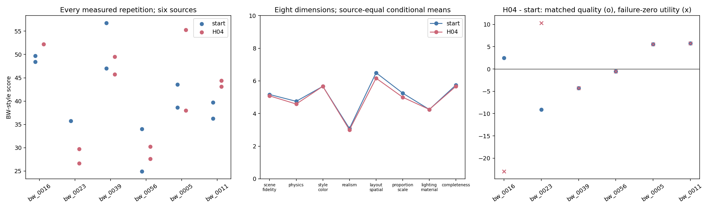

# V3最终审查附记（归档后离线整理）

记录时间：2026-11-11T22:34:34+08:00（北京时间）。不新增模型、Blender或研究动作，不改H/M、原分数、Selection选择或24项计划。以下是事后审查，不补写成预注册。

24项均有终态：22项生成并评分成功，2项保留原调用超时。双方各11/12交付；成功产物必要功能门槛各11/11通过。旧两次超时的stderr有Connection refused，不能据此归为已执行的几何算法错误。缺测原分为null。

## 终测与选择

六来源匹配BW差（H04-start）为−0.012995分，描述性95%来源bootstrap区间[−4.434870,4.068024]。Selection从31.659382到37.895230（+6.235847）的增益未在终测复现。区间不能证明等效或普遍退化。

| 指标 | H_start | H04 |
|---|---:|---:|
| 交付成功/12 | 11 | 11 |
| 实测BW数/12 | 11 | 11 |
| 条件BW：来源等权 | 40.8639 | 41.2155 |
| 条件BW：全部成功任务等权 | 41.3288 | 40.2180 |
| Rubric：来源等权 | 31.2070 | 33.1601 |
| 八维折算分：来源等权 | 50.5208 | 49.2708 |
| 失败零BW效用：全预定分母 | 37.8847 | 36.8665 |
| Q：来源等权 | 0.3839 | 0.3934 |
| PSNR：来源等权 | 11.0148 | 10.9842 |
| SSIM：来源等权 | 0.2127 | 0.2166 |
| LPIPS：来源等权，低为好 | 0.8240 | 0.7851 |
| DINO：来源等权 | 0.5258 | 0.4977 |

匹配公式：每来源先对同一repeat中双方生成与评价均成功的BW差取平均，再对六来源等权平均，共10个匹配成功生成对。端点条件均值各含11个成功结果，含未匹配的成功结果，所以端点均值相减不等于匹配差。两种口径均保留，不挑有利口径。失败零效用差−1.018203，来源区间[−10.563920,6.337384]，也包含调用基础设施造成的交付损失。

Bootstrap对六来源重采样10,000次，本地种子20261111不控制远端模型采样。小样本、单条连续演化轨迹，不作普遍优势或显著性结论。

| 来源 | start r1 | H04 r1 | start r2 | H04 r2 |
|---|---:|---:|---:|---:|
| bw_0016 | 48.4375 | 调用超时；BW=null | 49.6875 | 52.1875 |
| bw_0023 | 35.7500 | 26.6250 | 调用超时；BW=null | 29.7500 |
| bw_0039 | 47.0000 | 49.5000 | 56.7500 | 45.7500 |
| bw_0056 | 24.9053 | 30.2462 | 33.9962 | 27.5758 |
| bw_0005 | 38.6111 | 55.2778 | 43.5417 | 37.9861 |
| bw_0011 | 36.2500 | 44.3750 | 39.6875 | 43.1250 |

[24项原始表](../experiments/scene_rsi_v3/metrics/final_test_raw.csv) · [六来源与重复波动](../experiments/scene_rsi_v3/metrics/final_test_sources.csv) · [八维、全部指标与成本JSON](../experiments/scene_rsi_v3/metrics/final_test_summary.json) · [生成脚本](../experiments/scene_rsi_v3/final_statistics.py)。



## M07与实际H修改

M07新增39行actions/appearance_audit.py及索引注册；meta.py与初始提示未变。它读取指定对象及Mesh后代的材质槽、Shader默认值/链接标志、灯光、World和色彩配置。组内材质槽计数不等于全场景material.users，默认值不等于链接节点最终输出；它不渲染、不测量亮度或唯一原因。

第7轮创建后在两开发图执行；第8、9轮实际复用四次，共六次只读检查、零额外诊断渲染。观测进入后续M决策。H08共享材质指导的Selection为36.4369，父H04为37.8952，拒绝；第9轮停止、unchanged，没有新H或验证拒绝事件。H10也被拒绝。M07后没有H更新被保留。H04第4轮产生，早于第7轮M07，不能把H04结果归因于M07。

H02改变参考图与渲染反馈数据流；H04增加投影计算示例和相机指导，没有新增外部强制执行的投影校准器；H08也主要是共享生成/修复指导。不能把提示内代码示例写成独立算法已执行。

[M07完整源码/执行审查](../experiments/scene_rsi_v3/reports/M07_REVIEW_ZH.md) · [逐动作证据](../experiments/scene_rsi_v3/metrics/M07_action_review.csv) · [动作源码](../experiments/scene_rsi_v3/candidates/C07/M/actions/appearance_audit.py)。

## A07公共编辑执行器恢复

四项已完成原唯一一次Terra调用及外层校验，但Blender重复校验误导入模型适配器后缺少yaml。A07移除冗余导入，外层原校验保留，原edit.py、目标、原blend不变，各共同重放一次。原失败与恢复都保存，每项累计两次Blender执行，零新模型/模型修复。恢复后机械检查4/4通过；中心家具语义身份未独立验证，不能写成语义编辑准确率100%。这是工程修复，不是H/M自动演化收益。

[修订](../experiments/scene_rsi_v3/PROTOCOL_AMENDMENT_07.md) · [真实恢复收据](../experiments/scene_rsi_v3/A07_EDIT_RECOVERY.json) · [编辑前后图](../experiments/scene_rsi_v3/figures/semantic_edit_results.png)。

## 实际模型与成本

正式H/固定编辑器请求gpt-6.1-terra/medium，M/judge请求gpt-6-astra/medium，CLI 0.163.0。observed_model没有可靠返回元数据时为unknown。费用不可见，不宣称已降低本地账单。

| 角色 | CLI会话 | 已知输入token | 已知输出token | usage已知会话 |
|---|---:|---:|---:|---:|
| H | 250 | 9062653 | 1055869 | 248 |
| M | 19 | 2792086 | 20917 | 19 |
| judge | 133 | 23186902 | 225747 | 132 |
| preparation | 4 | 53341 | 11228 | 3 |

累计406会话、usage已知402/406，可见输入35,094,982、输出1,313,761 token。本次新增70会话，已知输入新增5,800,236、输出新增241,158。CLI可见工具为0，六次Blender研究动作由runner执行另记；未观察到绕过H执行，不等于完全观测到底层请求。一条exec不等于一次裸模型推理。

CPU上限8核、32GB，1个Blender进程×8线程，GPU 0。正式BW视图1024×1024、64 samples、Cycles；开发preview与辅助指标另列。累计实测Blender叶进程CPU约46.1471小时，叶作用域墙钟累加约7.1352小时，不可加到父作用域当总墙钟。渲染预算扣额1125包含保守预扣，精确实际全局帧数unknown。远端等待与推理无法准确拆分。旧耗时汇总漏读*_timing.json已修正，旧版保留，null耗时不填0；没有改质量分或选择。

[角色成本](../experiments/scene_rsi_v3/metrics/final_cost_by_role.csv) · [收尾增量](../experiments/scene_rsi_v3/metrics/final_completion_cost_delta.csv) · [原始时序](../experiments/scene_rsi_v3/metrics/timing.csv)。

## 冻结元回放未运行

终测与归档完成后才做离线prepare。后代参与和陌生H起点条件满足；但冻结输入token上限4000万，剩4,905,018，按既定每角色历史最大单会话用量×完整计划调用数估计需求28,876,596。该估计保守，不是实测；预算检查不允许，所以没有运行、没有MetaImp，也不提高上限制造结果。

[当前就绪记录](V3_META_REPLAY_FINAL_READINESS.json) · [完整入口记录](archive_tools_v3/replay_stage/entry.json) · [回放程序](archive_tools_v3/replay_stage/frozen_replay.py)。

## 数据与结论边界

历史本地图像的自定义探索性切分，不是新盲测或官方BlenderWorld训练/验证划分。归档后联系表可见手机/AR界面和信息图拼图等复合参考，六来源不能统称六间自然摄影房间。这是事后视觉格式观察，不据此认定其他源图是实拍还是CG，也不用于过滤数据、换指标或调阈值，所有六来源按原计划保留。

没有真实三维/新视角真值，多视角和机械保持不证明不可见几何正确，AABB近似不是真Mesh碰撞。BW-style / CLI-adapted不是官方榜单分数；judge与M同模型，新会话不等于独立人类验证。10轮是一个连续轨迹，不是10次独立研究重复。

成立：共享H曾按Selection被保留、动作代码被自动创建并后续执行、完整测试与成本可审查。尚未成立：稳定终测收益、主动干预的因果研发优势、M07能力增强、优于其他方法或普遍递归变强。

## 归档与保留项

基础13包和A07两个更新包已核对uploaded状态、大小和公开下载URL；21个关键Git文件/图片已读回，PNG已解码。科学数据提交：e54d0a42cacce486b4be0475615ba08f47408643；完整读取确认提交：f2e8e2e650799abcaf165011b76eb925073f753b。本附记只补审查元数据。

[基础13包Release](https://github.com/i025/scene/releases/tag/scene-rsi-v3-10rounds-S20261111T034024Z) · [最终两个更新包Release](https://github.com/i025/scene/releases/tag/scene-rsi-v3-10rounds-S20261111T141701Z_final)。解压基础包后再解压更新包。

S20261111T135531Z_final中间Git提交保留，其Release遗留starter附件不算完整，不删除覆盖。旧取消压缩包是重复中间归档，不补传；允许公开的科学源均在有效包中。许可未确认的BW原参考/附件、含真实参考的完整联系表保留原服务器；权重/环境/缓存不上传。没有哈希验证。

## 入口

激活已有NumPy/Matplotlib/Pillow环境，在仓库根目录离线重画（新输出目录不得已存在）：
```bash
python docs/archive_tools_v3/offline_v3.py --experiment experiments/scene_rsi_v3 --output derived/v3_final_review_02
```

原服务器终测续跑入口，仅补缺、复用成功及终态失败，不启动第11轮；本次归档后未执行：
```bash
python outputs/scene_rsi_v3/launch.py finish_test
```

回放prepare本次只做离线检查；当前预算不允许run，不得把入口当成已完成的结果。
