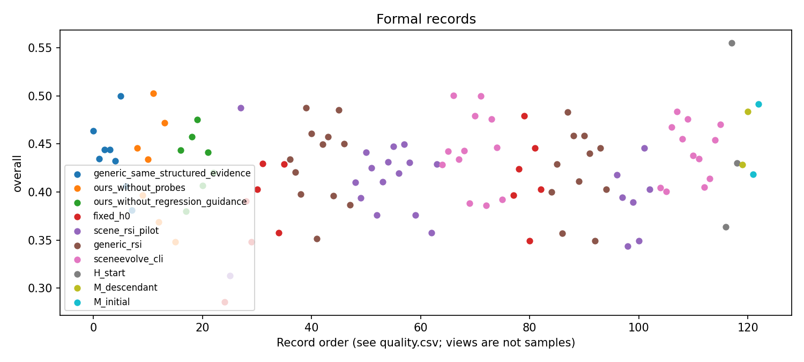
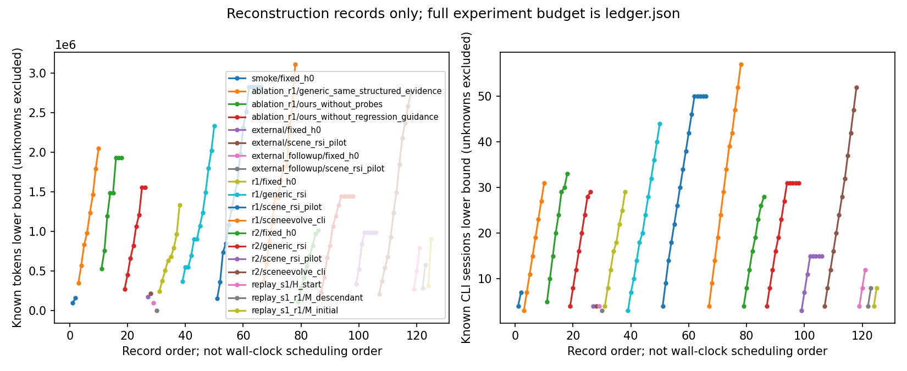
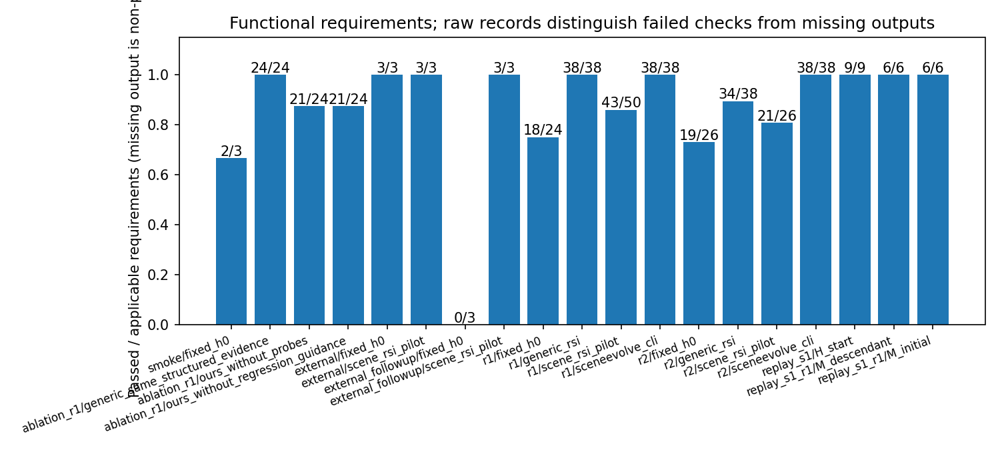
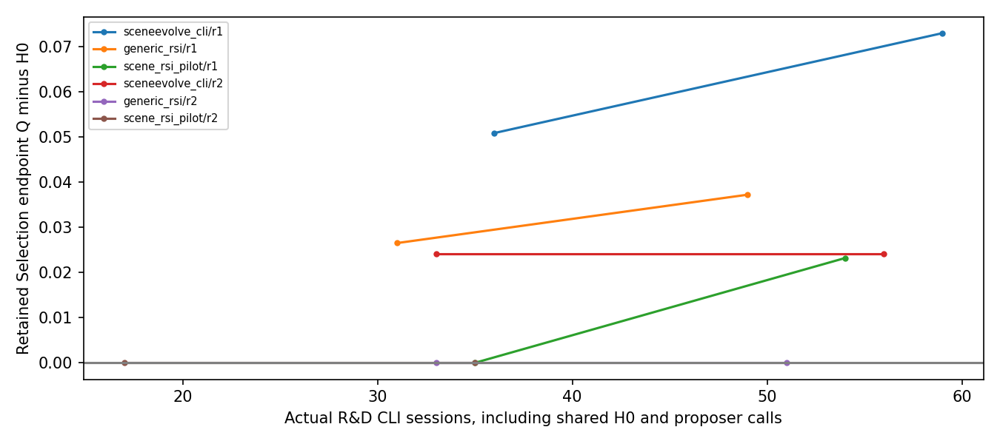
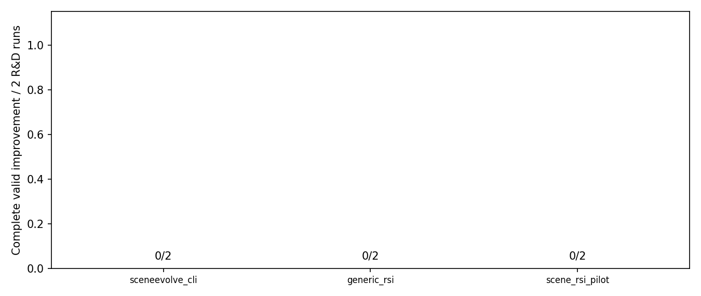
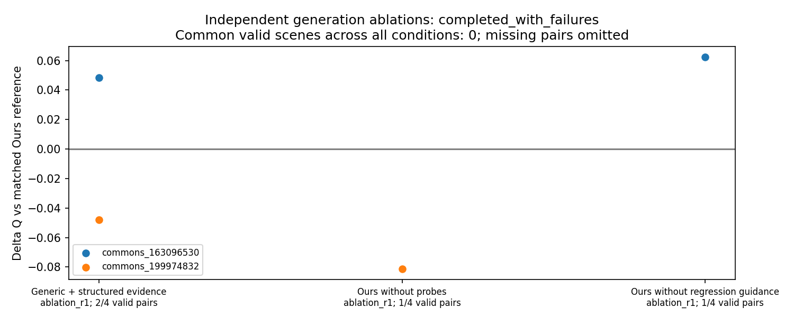
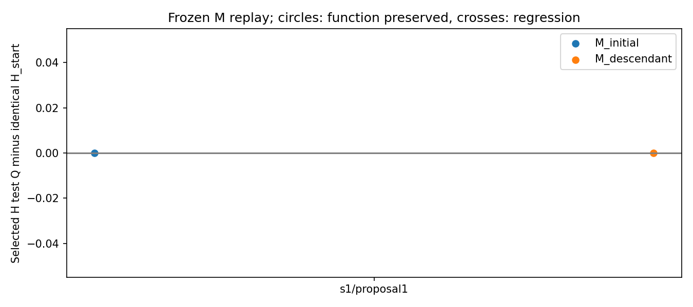

# scene_rsi_pilot 中文实验报告

本报告只汇总本轮已保存的 record.json；历史结果不作为同条件结果。

**累计596/600会话；最近一次CLI路由失败仍保留。** 各阶段遍历完成与实验成功分开记录；消融终测10成功、2失败、0待运行；元回放状态complete，外部任务状态complete，独立外部后续状态complete。

[最近一次服务错误及原始会话](../service_pause.json) · [373→529的156次会话逐项对账](../quota_restored_20261103/session_jump_373_to_529.json)

正式记录：123；smoke：2；完成：113；状态：{"complete": 113, "failed": 12}。
主对照登记的 all_scheduled：88；消融、元回放与外部任务的计划另列，不能用完成数冒充计划分母。

[本地可视化](index.html) · [逐场景 CSV](scenes.csv) · [汇总与完整账本](summary.json)

研究对象分为单场景程序P、跨图像共享流程H、以及可执行改进策略M。四组共同从本地SceneEvolve初始H0出发；Codex CLI的外层agent循环不是被研究的H。生成/固定编辑器请求gpt-6.1-sol，提案/独立匿名评审请求gpt-6-astra，均为medium。CLI未独立返回实际模型路由，不能用模型自报身份验证。

正式规模为2个Development、2个Selection、4个Test，两次独立研发、每次最多K=2共享候选。原4/4/8规模按最多5次内层调用估计已超过600会话上限，因此在正式结果产生前统一缩小。选择保留H0，先满足执行/功能不退化，再要求Selection端到端Q提升超过0.01；该实用阈值不是统计显著性界限。

## 真实测量

|重复|方法|候选|划分|记录分母|完成|失败|端到端成功|条件主指标均值|指标有效样本|
|---|---|---|---|---:|---:|---:|---:|---:|---:|
|smoke|fixed_h0|H0|smoke|2|1|1|1/2|0.52813|1|
|ablation_r1|generic_same_structured_evidence|C1|development|2|2|0|2/2|0.44912|2|
|ablation_r1|generic_same_structured_evidence|C1|selection|2|2|0|2/2|0.44418|2|
|ablation_r1|generic_same_structured_evidence|C1|test|4|4|0|4/4|0.4299|4|
|ablation_r1|ours_without_probes|C1|development|2|2|0|2/2|0.42111|2|
|ablation_r1|ours_without_probes|C1|selection|2|2|0|2/2|0.4683|2|
|ablation_r1|ours_without_probes|C1|test|4|3|1|3/4|0.39615|3|
|ablation_r1|ours_without_regression_guidance|C1|development|2|2|0|2/2|0.41175|2|
|ablation_r1|ours_without_regression_guidance|C1|selection|2|2|0|2/2|0.46641|2|
|ablation_r1|ours_without_regression_guidance|C1|test|4|3|1|3/4|0.42273|3|
|external|fixed_h0|selected|external|1|1|0|1/1|0.28543|1|
|external|scene_rsi_pilot|selected|external|1|1|0|1/1|0.31289|1|
|external_followup|fixed_h0|selected|external_followup|1|0|1|0/1|null|0|
|external_followup|scene_rsi_pilot|selected|external_followup|1|1|0|1/1|0.48763|1|
|r1|fixed_h0|H0|development|2|2|0|2/2|0.36936|2|
|r1|fixed_h0|H0|selection|2|2|0|2/2|0.41637|2|
|r1|fixed_h0|H0|test|4|2|2|2/4|0.3935|2|
|r1|generic_rsi|C1|development|2|2|0|2/2|0.42736|2|
|r1|generic_rsi|C1|selection|2|2|0|2/2|0.44287|2|
|r1|generic_rsi|C2|development|2|2|0|2/2|0.40611|2|
|r1|generic_rsi|C2|selection|2|2|0|2/2|0.45357|2|
|r1|generic_rsi|C2|test|4|4|0|4/4|0.42949|4|
|r1|scene_rsi_pilot|C1|development|2|2|0|2/2|0.40207|2|
|r1|scene_rsi_pilot|C1|selection|2|2|0|2/2|0.43338|2|
|r1|scene_rsi_pilot|C2|development|2|2|0|2/2|0.39331|2|
|r1|scene_rsi_pilot|C2|selection|2|2|0|2/2|0.43955|2|
|r1|scene_rsi_pilot|C2|test|4|4|0|4/4|0.41904|4|
|r1|scene_rsi_pilot|H0|test|4|2|2|2/4|0.3935|2|
|r1|sceneevolve_cli|C1|development|2|2|0|2/2|0.43541|2|
|r1|sceneevolve_cli|C1|selection|2|2|0|2/2|0.46722|2|
|r1|sceneevolve_cli|C2|development|2|2|0|2/2|0.4157|2|
|r1|sceneevolve_cli|C2|selection|2|2|0|2/2|0.48933|2|
|r1|sceneevolve_cli|C2|test|4|4|0|4/4|0.42495|4|
|r2|fixed_h0|H0|development|2|1|1|1/2|0.39655|1|
|r2|fixed_h0|H0|selection|2|2|0|2/2|0.45158|2|
|r2|fixed_h0|H0|test|4|3|1|3/4|0.39935|3|
|r2|generic_rsi|C1|development|2|2|0|2/2|0.41439|2|
|r2|generic_rsi|C1|selection|2|2|0|2/2|0.41988|2|
|r2|generic_rsi|C2|development|2|2|0|2/2|0.43487|2|
|r2|generic_rsi|C2|selection|2|2|0|2/2|0.44939|2|
|r2|generic_rsi|H0|test|4|3|1|3/4|0.39935|3|
|r2|scene_rsi_pilot|C2|development|2|2|0|2/2|0.40628|2|
|r2|scene_rsi_pilot|C2|selection|2|2|0|2/2|0.36674|2|
|r2|scene_rsi_pilot|H0|test|4|3|1|3/4|0.39935|3|
|r2|sceneevolve_cli|C1|development|2|2|0|2/2|0.40248|2|
|r2|sceneevolve_cli|C1|selection|2|2|0|2/2|0.47565|2|
|r2|sceneevolve_cli|C1|test|4|4|0|4/4|0.45086|4|
|r2|sceneevolve_cli|C2|development|2|2|0|2/2|0.40954|2|
|r2|sceneevolve_cli|C2|selection|2|2|0|2/2|0.46211|2|
|replay_s1|H_start|H_start|replay_development|1|1|0|1/1|0.3635|1|
|replay_s1|H_start|H_start|replay_selection|1|1|0|1/1|0.55495|1|
|replay_s1|H_start|H_start|replay_test|1|1|0|1/1|0.43036|1|
|replay_s1_r1|M_descendant|C1|replay_development|1|1|0|1/1|0.42819|1|
|replay_s1_r1|M_descendant|C1|replay_selection|1|1|0|1/1|0.4835|1|
|replay_s1_r1|M_initial|C1|replay_development|1|1|0|1/1|0.4183|1|
|replay_s1_r1|M_initial|C1|replay_selection|1|1|0|1/1|0.49155|1|

## 所选系统终测 .blend 可打开率

以 Blender 实际载入记录计数；未检查不冒充打不开。确认可打开数除以全部计划场景给出下界，已检查场景的条件比例另报。全部未检查时比例为 null。

|重复|方法|候选|确认可打开/计划|未检查|已检查条件比例|
|---|---|---|---:|---:|---:|
|r1|sceneevolve_cli|C2|4/4|0|1|
|r1|generic_rsi|C2|4/4|0|1|
|r1|scene_rsi_pilot|C2|4/4|0|1|
|r2|sceneevolve_cli|C1|4/4|0|1|
|r2|generic_rsi|H0|3/4|1|1|
|r2|scene_rsi_pilot|H0|3/4|1|1|
|r1|fixed_h0|H0|2/4|2|1|
|r2|fixed_h0|H0|3/4|1|1|

[逐项来源](geometry_relations.csv) · [比例源数据](blend_open_rates.csv)

重建执行失败分类：{"blender_timeout": 24, "program_or_blender_execution_error": 24}。单位为执行尝试，不含smoke、诊断probe和机械检查；一个场景可有多种失败，不能当独立场景数。来源 [execution_attempts.csv](execution_attempts.csv)。


主对照登记计划：88；逐状态计数：{"complete": 78, "failed": 6, "not_run_proposal_failed": 4}。来源为 [main_scheduled.csv](main_scheduled.csv)，包括失败、待运行与提案拒绝后未运行的槽位；额外阶段另计。


主视觉指标字段：`overall`。缺失值不填零；失败保留在端到端分母中，条件质量另列。


[源数据](quality.csv)


[源数据](cost.csv)


[源数据](functional.csv)

## 选择、有效改进与元回放

选择结果与原始候选档案原样保存在 summary.json；报告不根据 Test 重新选择。完整有效改进和有效配对数需要已冻结选择及对应 H0/候选功能和终测记录；当前脚本不从单个视觉分数推断。没有元回放实测数据时不绘跨代收益曲线。

## 资源与复用

资源策略：{"policy": "cpu_if_busy", "user_authorized_idle_gpu": true, "authorization": "2026-11-02 user permits idle GPU; 2026-11-03 GPU0 busy, GPU1 verified idle; one experiment GPU at a time", "gpu_allowlist": ["GPU-f099fdbd-adf2-6157-3462-4145bc2a8359", "GPU-c6683db1-d2aa-97b9-c1b4-e497bd7ff0c5", "GPU-158426a4-6684-7863-8cbe-ed6595f97683", "GPU-6deac1db-e8b2-558c-0285-ff9639a06a43"], "max_gpus": 1, "cpu_threads": 2, "heavy_concurrency": 1, "scheduler_observation": "No scheduler commands or allocation context found at GPU switch", "gpu_backend": "CUDA", "metrics_device": "cpu", "per_job_idle_check": true, "gpu_kernel_root": "__EXPERIMENT_ROOT__/gpu_kernel", "gpu_kernel_label": "local_a100_cuda122_v1"}；渲染配置：{"engine": "CYCLES", "samples": 16, "seed": 42, "device": "CPU", "threads": 2, "view_transform": "AgX", "look": "None", "exposure": 0, "gamma": 1, "denoise": false}；CPU 配置：2。实际逐记录设备保存在 scenes.csv，等待与执行成本以原账本字段为准。

[复用清单](../reuse_inventory.md) · [基线映射及独立消融适配](../baseline_mapping.md) · [运行入口](../README.md) · [外部任务与未运行的严格盲测方案](../external_test_plan.md)。复用配置完整保存在 [config.json](../config.json)；数据来源保存在 [manifest.json](../manifest.json)。旧 scenespec M0–M3 为已知米尺度布局策略，不直接证明图像重建或本轮元策略改进。

[最终推理成本](final_inference_cost.csv)同时列实际新增调用和同一H0产物对应的原始推理成本；source_equivalent列只解释成本归属，不重复计费。混合设备时长不用于算法效率比较。

## 局限与待运行


CLI失败分类：{"cli_model_capacity": 1, "cli_usage_limit": 35, "cli_workspace_routing_failure": 47, "timeout": 3}。调用失败与最终场景失败是不同分母；已保存的原始错误在 [calls.csv](calls.csv)，初始两次不可恢复日志的说明另列。

## 主对照配对结果

|方法|重复|有效配对/计划|条件Q差|功能通过数差|完整有效改进|
|---|---|---:|---:|---:|---|
|sceneevolve_cli|r1|2/4|0.025667|2|False|
|sceneevolve_cli|r2|3/4|0.056909|1|False|
|generic_rsi|r1|2/4|0.024742|2|False|
|generic_rsi|r2|3/4|0|0|False|
|scene_rsi_pilot|r1|2/4|0.0098315|2|False|
|scene_rsi_pilot|r2|3/4|0|0|False|

元策略执行证据：`{"generic_rsi": {"executed_strategy_descendant": true, "usable_descendant": true, "label": "generic_rsi_cli_adapted", "note": "后代策略已用于下一次提案且产生可运行H；尚不等于元能力提高"}, "scene_rsi_pilot": {"executed_strategy_descendant": true, "usable_descendant": true, "label": "scene_rsi_pilot", "note": "后代策略已用于下一次提案且产生可运行H；尚不等于元能力提高"}}`。源码发生变化和后代实际用于后续提案仍不证明元能力提高。


[源数据](rd_cost_gain.csv)


[源数据](complete_improvement_rate.csv)

[实际元策略程序参与轨迹](../quota_restored_20261103/meta_program_participation.json)：r1/C1新增的回归计数、依赖审阅和检查菜单由新M实际执行，并进入r1/C2的提案输入；不是仅保存源码。后代M在缺少显式探测余量字段时返回0个自动探测，按原样保留。执行过后代不等于元能力提升。

## 额外阶段实际状态

- supplement: completed_with_failures；[原始状态](../supplement_status.json)。
- ablation: completed_with_failures；[原始状态](../extras_status.json)。
- replay: complete；[原始状态](../replay_status.json)。
- external: complete；[原始状态](../external_status.json)。
- external_followup: complete；[原始状态](../external_followup_status.json)。

文字驱动编辑计划16例，实际14次固定编辑器调用，11例通过目标与非目标功能检查：端到端11/16、已执行条件比例11/14。两例缺少有效原始重建，三例编辑虽执行但未通过功能要求。独立视觉评审实际27次新会话，5例因缺少有效重建未评审；评分仅作补充，不替代几何真值。

[文字编辑逐例数据](text_edit.csv) · [独立评审逐例数据](independent_judgments.csv)

实际统一文字指令：把场景中按共同规则标识的工作台/工作桌组合表面改为蓝色 RGBA=(0.02,0.08,0.8,1)，粗糙度0.45；包括其现有父子结构归属的部件。保持目标几何以及所有非目标对象的几何、材质、变换和依赖关系。

队列09新增13次会话（连接检查1、学生12），在累计546/600时因路由错误停止。消融12个终测槽均已尝试，10成功、2路由服务失败；一次内层学生超时仍保留此前有效产物。未重采样失败场景；当时元回放与外部任务尚未启动。最新状态以各阶段状态文件为准。

[队列09历史停止与13次调用对账](../service_incident_03/closeout.json)

消融各条件均独立生成候选。下表包含全部预定终测槽，未完成或失败的指标保持null；配对差仅在两端有效时计算。本阶段再次使用主实验 Test，不构成新的盲测，服务故障使结果不完整。

|方法|重复|场景|Q|相对H0差|相对匹配Ours差|功能通过|
|---|---|---|---:|---:|---:|---|
|generic_same_structured_evidence|ablation_r1|commons_155212263|0.43247|null|null|True|
|generic_same_structured_evidence|ablation_r1|commons_16007442|0.49957|null|null|True|
|generic_same_structured_evidence|ablation_r1|commons_163096530|0.40632|0.048521|0.048521|True|
|generic_same_structured_evidence|ablation_r1|commons_199974832|0.38123|-0.047965|-0.047965|True|
|ours_without_probes|ablation_r1|commons_155212263|0.36852|null|null|True|
|ours_without_probes|ablation_r1|commons_16007442|0.472|null|null|True|
|ours_without_probes|ablation_r1|commons_163096530|null|null|null|False|
|ours_without_probes|ablation_r1|commons_199974832|0.34791|-0.081287|-0.081287|True|
|ours_without_regression_guidance|ablation_r1|commons_155212263|0.40684|null|null|True|
|ours_without_regression_guidance|ablation_r1|commons_16007442|0.44104|null|null|True|
|ours_without_regression_guidance|ablation_r1|commons_163096530|0.42031|0.062503|0.062503|True|
|ours_without_regression_guidance|ablation_r1|commons_199974832|null|null|null|False|


[源数据](ablation_terminal.csv)

ablation_r1：全部消融条件与匹配参考共同有效的场景数为 0。有效配对集合不同，不能跨条件比较条件均值来宣称机制收益；[配对覆盖数据](ablation_pair_coverage.csv)。

冻结回放比较 M_initial 与 M_descendant 从同一 H_start 研发后的收益；历史图像筛选暴露仍使其属于探索性实验。有限起点和重复不能支持普遍或单调元能力提升。

|M|起点|提案重复|场景|候选|相同H_start上的Q增益|功能不退化|CLI会话（不含共享起点）|
|---|---|---:|---|---|---:|---|---:|
|M_initial|s1|1|commons_52210054|H_start|0|True|9|
|M_descendant|s1|1|commons_52210054|H_start|0|True|9|


[源数据](frozen_meta_replay.csv)

|起点|提案重复|有效配对|后代减初始M的收益差|功能通过差|
|---|---:|---|---:|---:|
|s1|1|True|0|0|

[元回放配对差异源数据](frozen_meta_paired.csv)

BlenderWorld 使用直接读取 .blend、三视角和独立 Codex CLI 评审，保留 rubric 含义但改变评测入口与评审后端。以下是 adapted evaluation，非官方分数。

|方法|场景|重建状态|Q|功能通过|适配评分/100|
|---|---|---|---:|---|---:|
|fixed_h0|bw_0005|complete|0.28543|True|null|
|scene_rsi_pilot|bw_0005|complete|0.31289|True|54.722|

[BlenderWorld 适配评测源数据](blenderworld_adapted.csv)

原外部阶段范围：feasibility_only_one_task；该阶段未纳入任务：["bw_0011"]，是否随后运行见独立后续阶段，不能当作当前全局pending列表。单任务不能支持一般优势；[外部结果前冻结的预算适配](../external_budget_adaptation/preuse_rule.json)。

## 独立外部后续阶段 bw_0011

该阶段在自身任何调用/结果前冻结，仅按剩余12次完整配对预算决定启动，不改变上一外部阶段样本数。相同H0/Ours及模型、渲染、评分；仍是adapted evaluation、非官方分数和非严格盲测。

|方法|场景|重建状态|Q|功能通过|适配评分/100|
|---|---|---|---:|---|---:|
|fixed_h0|bw_0011|failed|null|False|null|
|scene_rsi_pilot|bw_0011|complete|0.48763|True|null|

[后续阶段数据](blenderworld_followup_adapted.csv) · [运行前冻结规则](../external_followup_preuse/rule.json)

## 服务故障与恢复分母

故障期间没有有效主终测图像/指标。恢复前后的失败与成本均保留；当前任务结果与包含旧故障的物理尝试成功率分开报告。

`{"original_service_failed_physical_attempts": 48, "original_service_failed_outcome_slots_including_reuse": 112, "recovery_history": [{"id": "service_incident_01", "physical_failures": 24, "outcome_slots": 62}, {"id": "quota_restored_20261103", "physical_failures": 24, "outcome_slots": 50}], "physical_formal_reconstruction_attempts_including_preserved_failures": 159, "physical_formal_successes": 104, "physical_attempt_success_rate_including_service_failures": 0.6540880503144654, "automatic_retries": 0, "routing_recovery_attempts_allowed": 1, "quota_restoration_user_authorized": true, "valid_test_outputs_before_each_recovery": 0, "interpretation": "Task outcome rates and physical attempt rates including both preserved failure waves are different denominators; all CLI failures remain in calls.csv and ledger."}`

[全部场景尝试及原记录](service_attempts.csv) · [故障恢复清单](../service_incident_01/recovery_prepared.json)

## 局限

- 没有三维真值，未估计真实三维恢复精度；多视角仅供结构检查。
- 缺失指标保持 null；质量均值仅在 valid 且有数值的记录上计算。
- 功能图的单位是检查项，不能当独立场景样本；遗漏检查不算通过。
- 重建成本图不包括未记录在 scene record 中的提案、评审、诊断和重试；总预算以 ledger 为准。
- 前段使用CPU；用户随后授权空闲GPU，后续Blender按逐次占用检查使用一张获准空闲卡，早期GPU0、额度恢复后GPU1；它们被其他任务占用后，从已核对授权的0–3候选池逐次选一张空闲卡，具体实际设备见逐产物actual_device.json，全部忙时继续CPU，质量设置不变。混合设备耗时不能解释为算法效率差异；1200秒期限也可能带来不同执行机会，属于本轮限制。CLI内部服务排队不可观测，service_queue_seconds为null，CLI耗时与重建总耗时互有包含。
- 图像已在历史联系表/人物审阅中暴露，本轮是 exploratory。
- 主对照仅两次独立研发重复；展示全部点与配对差异，不作普遍优势或元能力单调提高的结论。
- CLI只记录请求模型，未独立返回可验证的实际路由；远端模型采样种子不可控。清单顺序和Cycles种子固定；runner未统一预置生成程序的Python/random/numpy随机状态，程序自身随机设置以保存源码为准。
- 机械操作仅检验可操作性；文本编辑只有真实独立编辑器执行证据才报告。
- 机械编辑目标按固定名称/层级规则选取，实测可能选中Architecture等建筑组合；文本测试另按预定工作台类别匹配。名称匹配不等于语义真值，不能据此证明应有对象完整。
- 机制A提供固定目标的焦距、尺度与隔离探测；空间支撑证据目前是被动AABB近似和组合移动检查，主动接触干预、任意语义对象定位尚未实现，未知映射不作归因。
- 机制B实际执行共同的完整三项检查菜单，Ours使用回归证据和提示优先级；按修改模块自动选择回归子集尚未实现。
- 共同候选导入白名单未完整列入提案提示。三份跨组提案触发ast误拒绝后，在Test前统一修复验证器并复验全部原始回答；两份恢复资格并补跑完整评价，没有模型重采样或人工改写H/M。旧规则/失败/源码保留在validation_correction_v2。这是正式开发开始后的工程修复，不能冒充原始预注册规则；r2/Ours/C1的getattr限制仍导致拒绝。
- 有效改进、配对数和元回放无完整证据时不推断，不预绘提升曲线。
- 出现集中CLI路由故障后，原始32个主终测槽均无输出；冻结选择和失败档案保留，对无输出服务失败统一开放一次恢复，研发完成后重冻选择。原始失败不能当算法退化，恢复也不能抹去失败分母；service_attempts.csv单列全部物理尝试。恢复后消融规模按原预算阶梯重新冻结，属于显式协议补充。
- 共同检查器在终测前修正type(exc).__name__日志的误拒绝，统一复核12份原始提案，仅Generic r2/C2新增合格并补跑相同Dev/Selection；没有重新采样或人工改H/M。原规则、失败、源码和diff见validation_correction_v3；这是研发后工程适配。
- 一次外层终端进程以143退出，来源未知；存活的内层场景按原预算完成后，从同一ID缓存续接外部评价，没有重新生成。有限实验随后在独立进程会话继续，执行记录见quota_restored_20261103/execution_08.json；总预算与评价规则不变。
- 初始两次隔离环境CLI失败的原始日志被第二次准备尝试误覆盖；只保留当时终端错误说明，不能补造原始日志、耗时或usage。两次仍计入600会话预算，token保持未知，详见cli_checks/initial_sandbox_failures.json。
- 保留最近一次workspace routing discovery failed停止标记及原始会话路径；它表示一次实际服务错误，不表示所有后续阶段均未运行，也不证明当前服务持续不可用。完成状态与失败分母以各阶段记录为准，不自动重试失败任务。
- 用户在获知533/600及剩余任务后明确要求继续，新增一次已计费的sol/medium连接检查通过，随后仅运行尚未执行的槽位；原路由失败场景保留，没有重新采样。服务恢复检查不算研究方法的改进。实际阶段结果以状态文件和逐场景记录为准。
- 消融缓存续跑曾重写选择冻结文件的时间戳，三个所选C1均与停止前档案一致，选择代码未读取Test。最早时间戳未独立保留，不补造；现已改为比较选择一致性并保留现有冻结时间，不改模型、H/M、评分或结果。详见service_incident_02/ablation_freeze_resume_audit.json。
- 队列09新增13次会话：连接检查1次、学生12次；其中1次学生调用超时但保留有效场景，最后1次学生调用路由失败。消融12个终测槽已全部尝试，10成功、2服务失败；没有重采样。累计546/600时曾再次停止，当时冻结元回放与BlenderWorld尚未启动；这一历史停止状态不代表服务当前仍故障，最新阶段状态另列。
- 在既有继续授权下复查连接，一次sol/medium检查通过并计入预算，队列10继续未启动的元回放，已有失败不重采样。元回放按当时53次剩余预算选择预声明的单陌生起点、每个冻结M一次提案、1dev/1selection/1test最小可行性范围，不能据此宣称普遍元能力提升。
- 外部阶段原计划2任务、至少预留24次CLI；在外部调用/结果均为0且元回放Test尚未冻结前，公开增加独立阶段预算适配：余额≥24仍2任务，12–23仅固定顺序首任务bw_0005，两方法同规模，<12待运行。总上限、模型、H选择、内层预算、渲染和评分均不改；这是非原始预注册的预算适配。单任务只属可行性，原第二任务若未跑单列pending。
- 为利用首外部阶段结束后的完整配对余额，对原预留bw_0011单独冻结后续阶段：仅余额≥12时运行相同H0/Ours、相同模型与5调用/3执行/1200秒上限、相同评分；不足则pending。规则在该任务任何调用/结果前记录，不根据bw_0005胜负决定，结果单独列，不冒充原预注册两任务阶段或严格盲测。总600不扩大。
- 队列10已完成冻结M回放；随后bw_0005的H0匿名评分遇路由故障，分数保留null。故障04仅做一次连接检查，队列11完成尚未提交的Ours重建和评分；没有重试H0评分或重采样失败场景。历史停止快照不代表当前服务状态。
- bw_0005的实际参考是带标题、人物和课堂照片的拼贴图；按共同预处理保留完整参考，没有事后裁剪。该任务的全图Q同时受不可由三维场景表达的文字与人物影响，不能解释为几何恢复精度。
- 独立bw_0011阶段已遍历两方法：H0生成程序失败；Ours保留第二次有效渲染，第三次学生调用600秒超时，随后独立评分路由失败。两种失败均保留，不额外重试；该任务没有有效Q配对或完整适配评分配对。队列12以0退出只表示流程正常收尾，不表示所有实验成功。
- 用户在2026-11-03明确告知CLI额度已恢复并要求补完；两个模型真实图片核验成功后，统一补无输出额度失败。此前35次额度失败和43次路由失败均保留，48次历史物理重建失败仍进入尝试分母。已有33条有效产物（包括被服务打断但保有有效场景的记录）不重新采样。恢复前没有有效主Test反馈，随后重新冻结选择。该恢复属于公开协议补充。

## 重建报告

```bash
bash '__EXPERIMENT_ROOT__/run.sh' report
```

此命令使用已验证的本地Python环境，只重建数据表、图和报告，不启动模型、Blender 或补跑实验；实验续跑入口由 runner README 给出。
