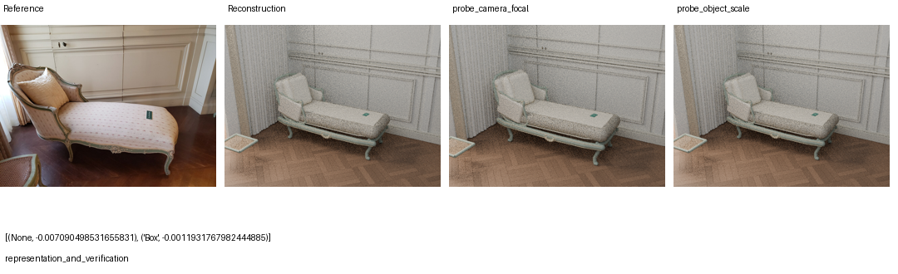
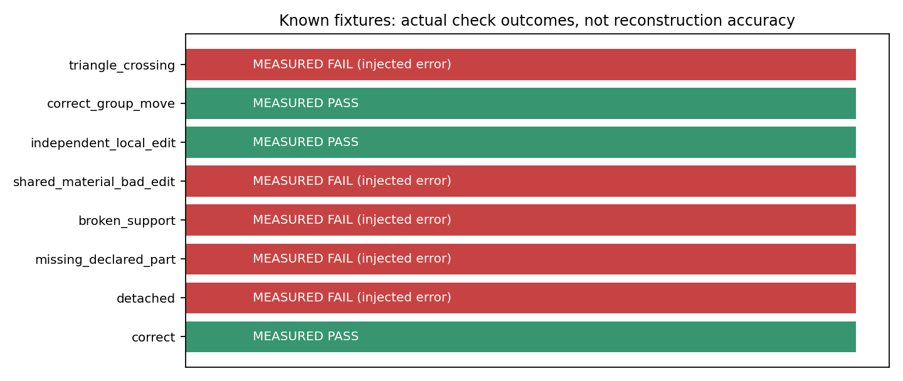
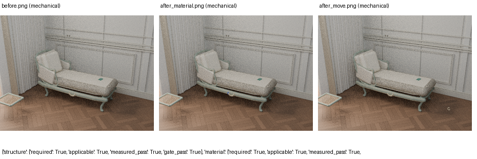
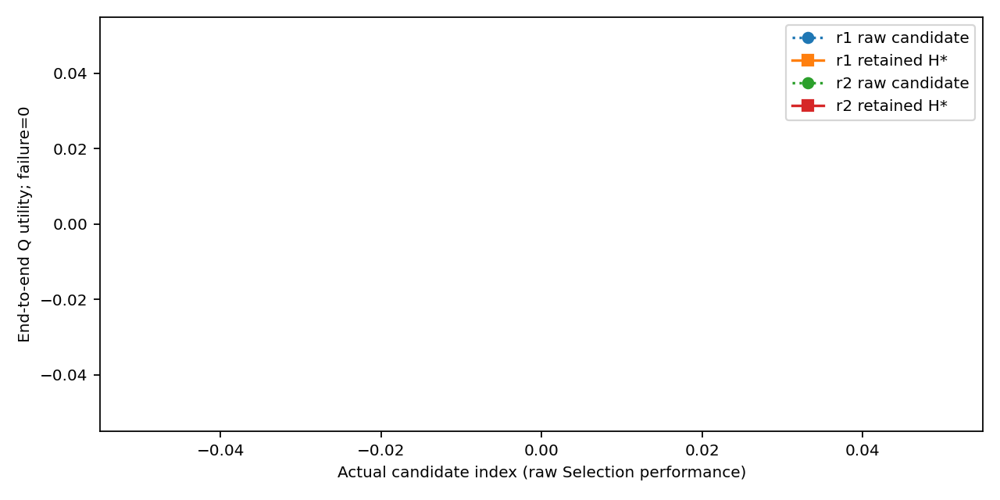
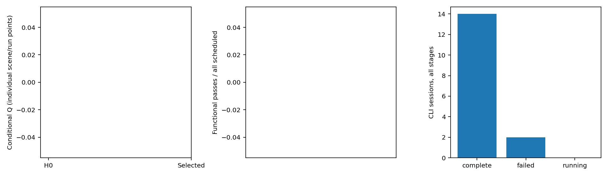

# Scene-RSI V2 中文实验报告

本轮只比较共享 H0 与 Scene-RSI V2，不重跑其他方法。数据为 exploratory，历史联系表曝光，不能宣称严格盲测。

## 实际状态与结果

```json
{
  "state": {
    "phase": "running_scene",
    "method": "fixed_h0",
    "run_id": "r1",
    "candidate_id": "H0",
    "scene_id": "commons_129095630",
    "split": "development",
    "folder": "__EXPERIMENT_ROOT__/results/r1/fixed_h0/H0/development/commons_129095630"
  },
  "summary": [
    {
      "run_id": "r1",
      "method": "fixed_h0",
      "scheduled": 6,
      "recorded": 0,
      "completed": 0,
      "execution_success_rate": 0.0,
      "conditional_Q": null,
      "task_utility_v2": null,
      "functional_passes": 0,
      "failed": 0,
      "not_run": 6
    },
    {
      "run_id": "r1",
      "method": "scene_rsi_v2",
      "scheduled": 6,
      "recorded": 0,
      "completed": 0,
      "execution_success_rate": 0.0,
      "conditional_Q": null,
      "task_utility_v2": null,
      "functional_passes": 0,
      "failed": 0,
      "not_run": 6
    },
    {
      "run_id": "r2",
      "method": "fixed_h0",
      "scheduled": 6,
      "recorded": 0,
      "completed": 0,
      "execution_success_rate": 0.0,
      "conditional_Q": null,
      "task_utility_v2": null,
      "functional_passes": 0,
      "failed": 0,
      "not_run": 6
    },
    {
      "run_id": "r2",
      "method": "scene_rsi_v2",
      "scheduled": 6,
      "recorded": 0,
      "completed": 0,
      "execution_success_rate": 0.0,
      "conditional_Q": null,
      "task_utility_v2": null,
      "functional_passes": 0,
      "failed": 0,
      "not_run": 6
    }
  ],
  "ledger": {
    "cli_sessions": 16,
    "initial_sandbox_failures": 0,
    "observable_cli_turns": 16,
    "observable_model_rounds": null,
    "tool_calls": 0,
    "known_input_tokens": 397248,
    "known_output_tokens": 59391,
    "usage_unknown_sessions": 2,
    "render_attempts_upper_bound": 19,
    "renders_completed": 12,
    "device": "CPU+GPU",
    "device_mapping_record_counts": {
      "CPU": 12,
      "GPU": 2
    },
    "max_cli_sessions": 420,
    "max_render_frames": 1500
  }
}
```

## 机制证据与边界

M 的 plan_probes 选择真实对象和测试，runner 执行，真实观测进入 M.plan_patch。见 candidates 下 stage1/stage2、observations、changes.diff。M-only 不计 H 改善；M 被执行不证明元能力提高。

结构校准涵盖正确组合、脱离父对象、破坏支撑、共享材质误改、独立编辑和表面相交。自然图像无三维真值；声明部件完整性不等于参考对象完整性。支撑是归一化 AABB 近似，Mesh BVH 仅测三角表面相交，不能判断所有穿插、包含或合理接缝。

主 Q 沿用 V1 公式；未测量指标为 null，失败效用单独为零。条件质量与全分母效用分别报告；多视角不计独立样本。只有 2 个研发重复，不作普遍优势或显著性结论。机械编辑与文字编辑分别保留，文字编辑只按预定少量终测场景执行。

## 图与数据

每张图由 analyze.py 从 metrics/scene_metrics.csv、candidates.csv、paired_test.csv、calls.csv、meta_participation.csv 与原始 JSON 重画。Figure1 按冻结顺序纳入全部测试场景；Figure2 采用按路径排序的首个正式诊断，无成功筛选；Figure3 采用首个有机械渲染的终测场景。











