# Scene-RSI V2.1 中文实验报告

本轮只比较共享 H0 与 Scene-RSI V2.1，不重跑其他方法。数据为 exploratory，历史联系表曝光，不能宣称严格盲测。

两个研发已完成，四个真实候选均为H-only；两个C2通过Selection，M源码均未改变。Test选中流程成功2/4、H0成功0/4；选中流程条件Q为0.4609588253，但双方成功的配对数为0，无法测量配对视觉质量增益。失败效用另计零时，全分母任务效用为0.2304794127对0；这主要包含可执行性收益，不能解释成纯视觉提升。两次研发的效用差分别为+0.4609588253和0。上述数值见terminal_overview.csv、paired_test.csv。

## 事后任务范围核对

仓库commons_189918915是场景图；commons_80372956主要是吊灯、天花与屋顶细节，属于物体占主导的建筑细节。冻结清单的全任务结果照常保留，但不能将其描述为两个完整房间重建。仅仓库的事后敏感性表为选中流程1/2成功、H0为0/2；该表不是新主指标，见metrics/posthoc_scope_sensitivity.csv及configs/posthoc_scope_review.json。

吊灯任务预先expected_composite=False，组合移动和声明部件测试不是硬门槛。这一适用性假设不够准确；r1选中产物的两项可选测试均实际测得通过，不能事后将它们包装成预先必需项。冻结required标志与旧分数不回写。原record.json的M_version为null；实际使用M0由候选stage1与proposal_result确认，未补造原始字段。

## 实际状态与结果

```json
{
  "state": {
    "phase": "supplement_complete",
    "ledger": {
      "cli_sessions": 65,
      "initial_sandbox_failures": 0,
      "observable_cli_turns": 65,
      "observable_model_rounds": null,
      "tool_calls": 0,
      "known_input_tokens": 3007308,
      "known_output_tokens": 164797,
      "usage_unknown_sessions": 1,
      "render_attempts_upper_bound": 117,
      "renders_completed": 103,
      "device": "CPU",
      "device_mapping_record_counts": {
        "CPU": 171
      },
      "max_cli_sessions": 160,
      "max_render_frames": 600
    }
  },
  "summary": [
    {
      "run_id": "r1",
      "method": "fixed_h0",
      "scheduled": 2,
      "recorded": 2,
      "completed": 2,
      "succeeded": 0,
      "status": "completed",
      "execution_success_rate": 0.0,
      "observed_success_rate": 0.0,
      "conditional_Q": null,
      "task_utility_v2": 0.0,
      "functional_passes": 0,
      "functional_compliance_rate": 0.0,
      "failed": 0,
      "timeout": 2,
      "not_run": 0,
      "unscored_generations": 0
    },
    {
      "run_id": "r1",
      "method": "scene_rsi_v2_1",
      "scheduled": 2,
      "recorded": 2,
      "completed": 2,
      "succeeded": 2,
      "status": "completed",
      "execution_success_rate": 1.0,
      "observed_success_rate": 1.0,
      "conditional_Q": 0.4609588253436397,
      "task_utility_v2": 0.4609588253436397,
      "functional_passes": 2,
      "functional_compliance_rate": 1.0,
      "failed": 0,
      "timeout": 0,
      "not_run": 0,
      "unscored_generations": 0
    },
    {
      "run_id": "r2",
      "method": "fixed_h0",
      "scheduled": 2,
      "recorded": 2,
      "completed": 2,
      "succeeded": 0,
      "status": "completed",
      "execution_success_rate": 0.0,
      "observed_success_rate": 0.0,
      "conditional_Q": null,
      "task_utility_v2": 0.0,
      "functional_passes": 0,
      "functional_compliance_rate": 0.0,
      "failed": 0,
      "timeout": 2,
      "not_run": 0,
      "unscored_generations": 0
    },
    {
      "run_id": "r2",
      "method": "scene_rsi_v2_1",
      "scheduled": 2,
      "recorded": 2,
      "completed": 2,
      "succeeded": 0,
      "status": "completed",
      "execution_success_rate": 0.0,
      "observed_success_rate": 0.0,
      "conditional_Q": null,
      "task_utility_v2": 0.0,
      "functional_passes": 0,
      "functional_compliance_rate": 0.0,
      "failed": 0,
      "timeout": 2,
      "not_run": 0,
      "unscored_generations": 0
    }
  ],
  "ledger": {
    "cli_sessions": 65,
    "initial_sandbox_failures": 0,
    "observable_cli_turns": 65,
    "observable_model_rounds": null,
    "tool_calls": 0,
    "known_input_tokens": 3007308,
    "known_output_tokens": 164797,
    "usage_unknown_sessions": 1,
    "render_attempts_upper_bound": 117,
    "renders_completed": 103,
    "device": "CPU",
    "device_mapping_record_counts": {
      "CPU": 171
    },
    "max_cli_sessions": 160,
    "max_render_frames": 600
  }
}
```

## 实际候选和 Selection

|研发|候选|类型|开发成功/预定|Selection成功/预定|绝对资格|Selection条件Q|选择保留|M源码改变|
|---|---|---|---|---|---|---|---|---|
|r1|C1|H-only|0/1|0/1|False|None|False|False|
|r2|C1|H-only|1/1|0/1|False|None|False|False|
|r1|C2|H-only|1/1|1/1|True|0.4173230039975933|True|False|
|r2|C2|H-only|1/1|1/1|True|0.3952040292567605|True|False|

条件Q缺测为None/null，不等于0。H0失败不放宽候选资格；不合格H0仅为fallback。未选候选没有终测，不能称其终测联合通过。

## 选中版本的逐场景 Test

|研发|方法|版本|场景|状态|实测Q|独立任务效用|功能通过|设备|
|---|---|---|---|---|---|---|---|---|
|r1|fixed_h0|H0|commons_189918915|timeout|None|0.0|False|CPU|
|r1|fixed_h0|H0|commons_80372956|timeout|None|0.0|False|CPU|
|r1|scene_rsi_v2_1|C2|commons_189918915|completed|0.40317078867799094|0.40317078867799094|True|CPU|
|r1|scene_rsi_v2_1|C2|commons_80372956|completed|0.5187468620092884|0.5187468620092884|True|CPU|
|r2|fixed_h0|H0|commons_189918915|timeout|None|0.0|False|CPU|
|r2|fixed_h0|H0|commons_80372956|timeout|None|0.0|False|CPU|
|r2|scene_rsi_v2_1|C2|commons_189918915|timeout|None|0.0|False|CPU|
|r2|scene_rsi_v2_1|C2|commons_80372956|timeout|None|0.0|False|CPU|

完整配对差见metrics/paired_test.csv。失败Q保留null；失败效用0是另一个字段。仅双方成功时计算条件Q差。joint_improvement.csv单位为选中流程的scene/run配对，不是所有原始候选的终测改进率。两次研发复用同两个Test来源组，不是四个独立场景。

## H 与 M 实际变化

实际产生 4 个正式共享候选，其中 M 源码变化 0 个。本轮没有新 M 参与后续提案，未发生元级程序自修改；不能报告元能力提升。

单图P保存在results各scene.py/build.py与steps；共享H/M在candidates保存完整源码和diff。外层工程师的runner修复不是M自修改。

## 运行偏离与成本

四次原提案在模型提交前触发600KB限制，未生成H/M候选，原始失败与旧选择保存在attempt_archive/payload_cap_failure。payload_fix1保留全部ID并限制128份数值详情，真实包回归测试通过；这些额外诊断全部计入同一个160 CLI/600帧预算。一个H0 Test生成曾提前提交，未查看媒体/代码/质量、未回流研发，只在新的选择冻结后评价并明确复用。该项属于事后as-run修订，不宣称严格盲测。见protocol.md和configs/payload_evidence_fix1.json。

成本按实际CLI调用、CLI返回usage、渲染和设备记录，见metrics/cost_by_phase.csv、calls.csv及ledger.json。CLI会话不等于一次底层模型推理；缺失usage、实际返回模型、费用、服务排队时间保持unknown/null。CPU两线程单重任务，无GPU；网络等待和CAD计算混在端到端时间中，不据此宣称算法速度优势。

## 机制证据与边界

M 的 plan_probes 选择真实对象和测试，runner 执行，真实观测进入 M.plan_patch。见 candidates 下 stage1/stage2、observations、changes.diff。M-only 不计 H 改善；M 被执行不证明元能力提高。

结构校准涵盖正确组合、脱离父对象、破坏支撑、共享材质误改、独立编辑和表面相交。自然图像无三维真值；声明部件完整性不等于参考对象完整性。支撑是归一化 AABB 近似，Mesh BVH 仅测三角表面相交，不能判断所有穿插、包含或合理接缝。

主 Q 沿用 V1 公式；未测量指标为 null，执行失败效用单独为零，此Q效用不包含全部功能要求，功能合规另报。条件质量与全分母效用分别报告；多视角不计独立样本。只有 2 个研发重复，不作普遍优势或显著性结论。机械编辑与文字编辑分别保留，文字编辑只按预定少量终测场景执行。

## 可控诊断比较

五个夹具，绿色/红色分别是已执行测试中的命中/未命中；目标组或相关部件命中不等于精准视觉定位。对象计数按材质非目标方块修正，旧宽泛字段保留，见configs/diagnostic_object_count_correction.json。图像定位模块命中和M第二阶段最终模块精确命中单列，后者双方均仅1/5。V2.1新增5次定位调用，双方辅助共享程序各1次修复调用，实际成本并不相同。源代码API契约本身提供修复提示；辅助helper通过不代表自然图像重建H改进。家具尺度定位正确仍可能没有正向探测效果；隐藏对象的隔离实验不自动恢复可见性。原始来源为 tests/diagnosis/comparison.json、shared_patch_transfer.json，统计表 metrics/diagnostic_comparison.csv、controlled_shared_patch.csv，脚本 tests/diagnose.py 与 analyze.py。

四个适用的对象故障中，固定启发式/V2.1对象或相关部件命中为2/4与4/4；相机故障不需要对象，双方都请求了相机探测。旧corrected target字段把相机null目标也计为命中（3/5与5/5），该字段保留但不当作对象定位率。图像定位或相关模块命中为1/5与5/5；辅助共享程序迁移双方均为5/5，损坏起点为0/5。机制定位表现与RSI最终收益分开报告。

## 验收与未完成项

1. 明确探测预算：确定性契约通过，实际stage1保留剩余及已用额度。
2. 指定对象探测：通过；真实ID、投影和图像证据驱动，未知允许。
3. 观测返回可执行M：通过；stage2保存实际输入。
4. 第二阶段决策：通过；不同观测的stub测试可产生不同决策，真实决策也已执行，但准确性有限。
5. 结构和编辑错误识别：8项真实Blender夹具符合预期，包含正确与故意损坏情况。
6. M选择研发回归：已执行；不能改变最终固定验收。
7. H-only/M-only/H+M：接口与确定性测试通过。
8. 新M后续使用：未获得真实修改M的候选，未发生。
9. 共享H0：从原V2 baseline出发，非历史后代或烟测子代。
10. 新Selection与Test：均完成；保留一次提前生成但冻结后才评价的H0 Test顺序偏离。
11. 实际质量和功能：见逐任务表；终测功能合规2/4对0/4，文字编辑只在两个有效产物上各一次，目标与非目标保持均通过；无H0可编辑产物，不形成配对编辑增益。
12. 新增总成本：65 CLI，已返回input 3007308/output 164797 tokens，1会话usage未知；117渲染尝试上界、103完成，预算160/600。
13. 后代M能力：无真实后代或冻结回放证据，不支持能力改进结论。
14. 产物：真实程序、blend、渲染、原始测量、CSV、PNG与离线HTML均保留；大文件按运行归档。
15. 上传：实际状态以仓库UPLOAD_SUMMARY_V2_1.md及附件索引为准，不把本地提交当上传成功。

## 图与数据

每张图由 analyze.py 从 metrics/scene_metrics.csv、candidates.csv、paired_test.csv、calls.csv、meta_participation.csv 与原始 JSON 重画。Figure1 按冻结顺序纳入全部测试场景；Figure2 采用按路径排序的首个正式诊断，无成功筛选；Figure3 采用首个有机械渲染的终测场景。

实际固定文字编辑指令：`把场景中按共同规则标识的目标对象或组合表面改为蓝色 RGBA=(0.02,0.08,0.8,1)，粗糙度0.45；包括其现有父子结构归属的部件。保持目标几何以及所有非目标对象的几何、材质、变换和依赖关系。`。全部文字编辑及非目标保持对象数见metrics/text_edits.csv；机械操作单列，不当作文字理解结果。

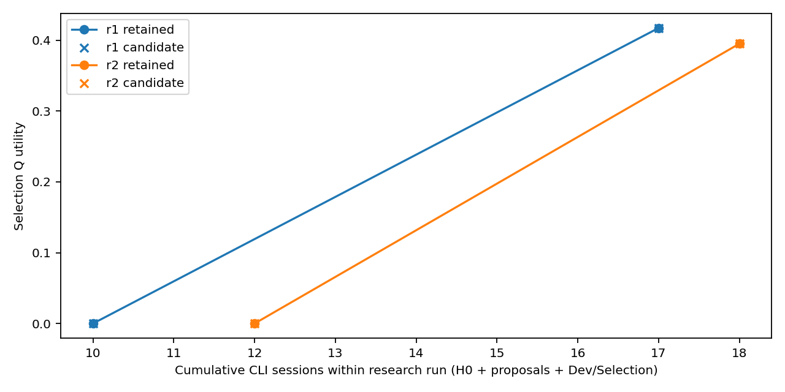

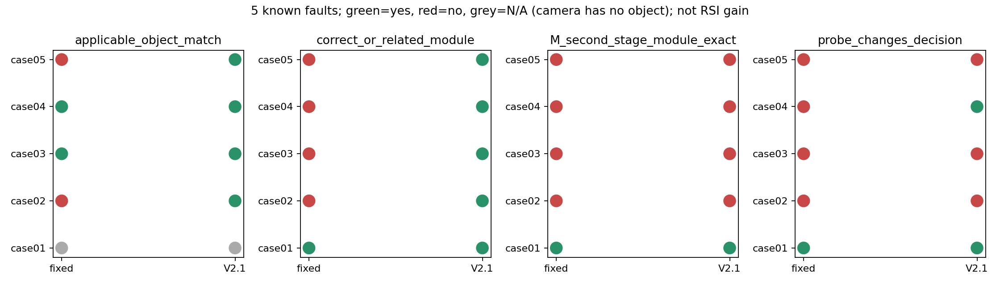

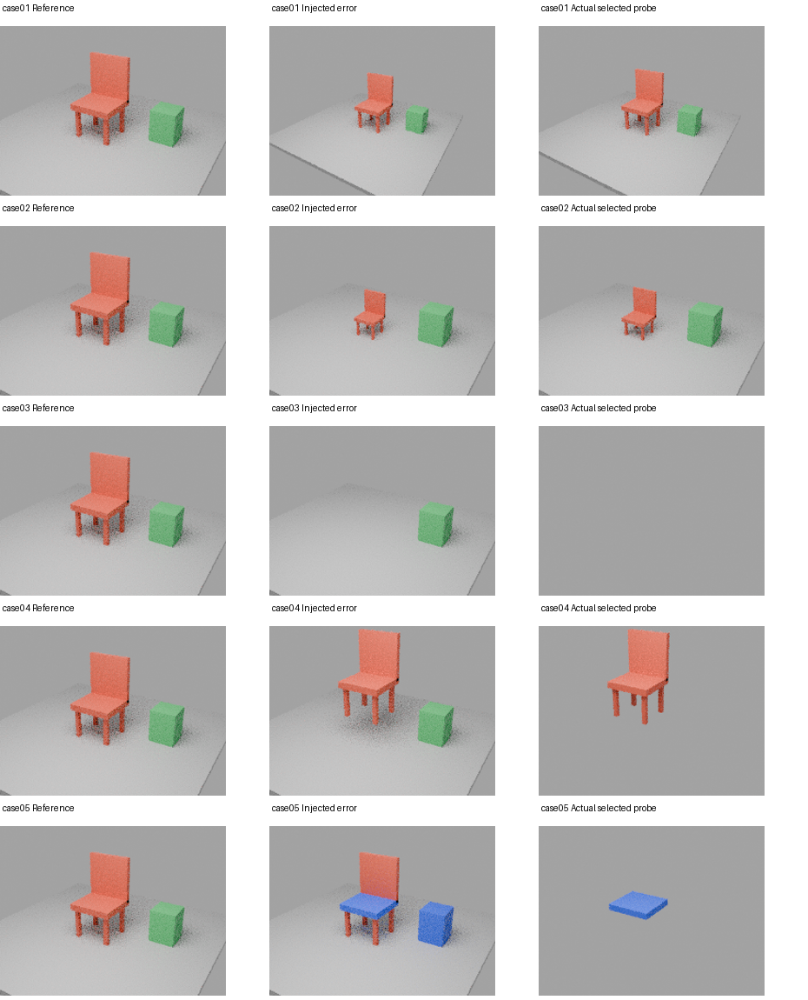

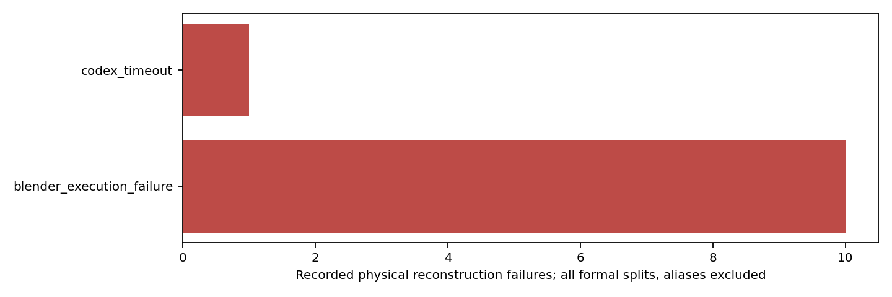

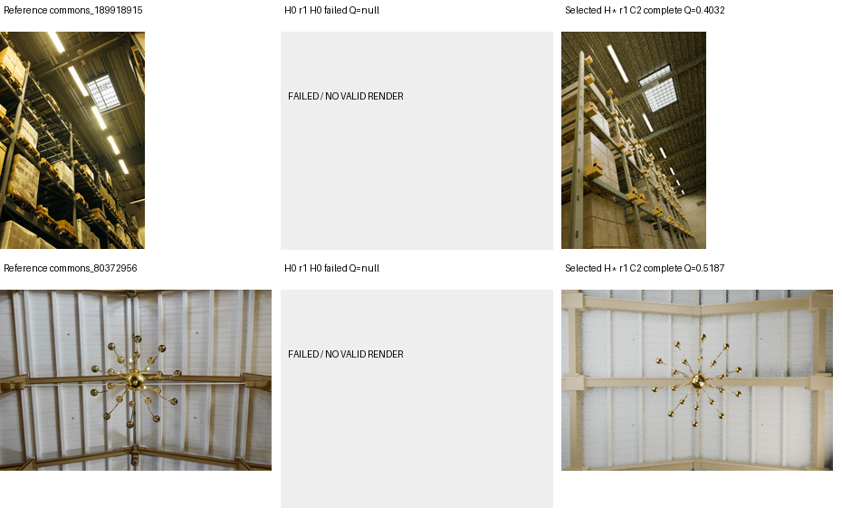

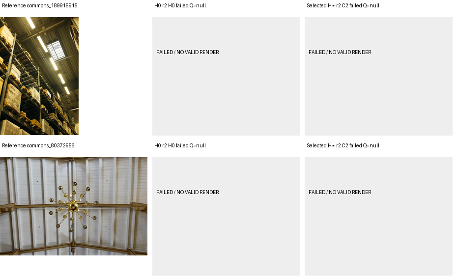

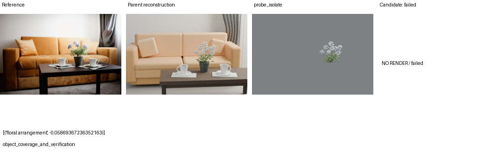

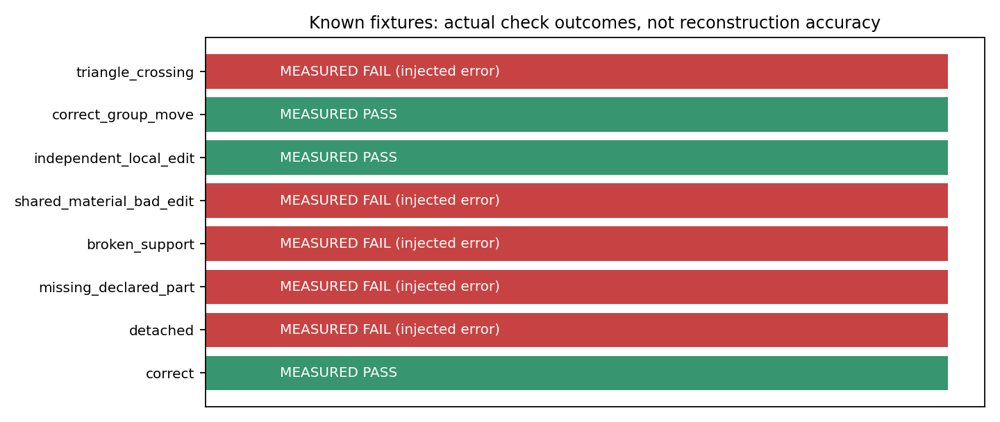

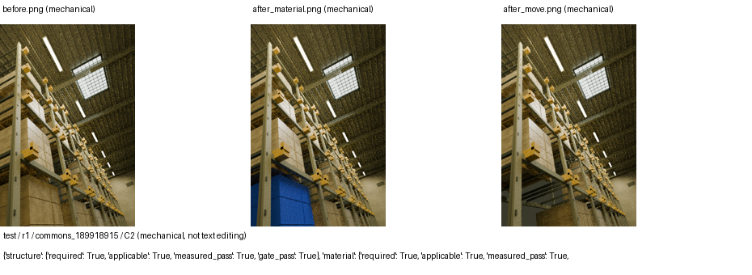

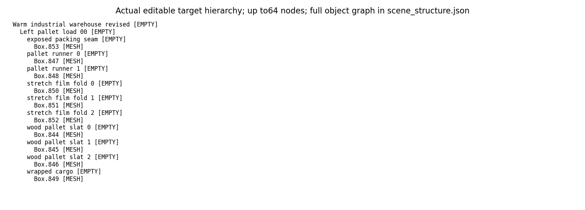

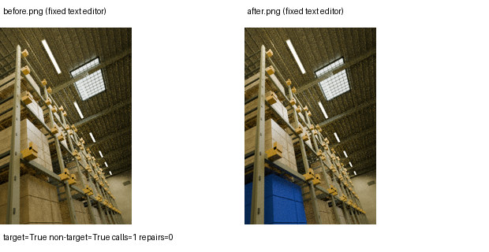

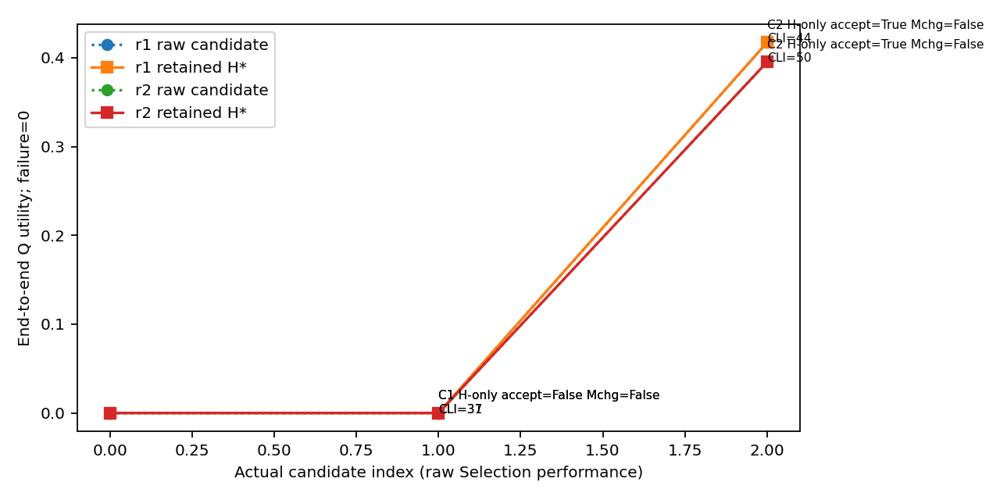


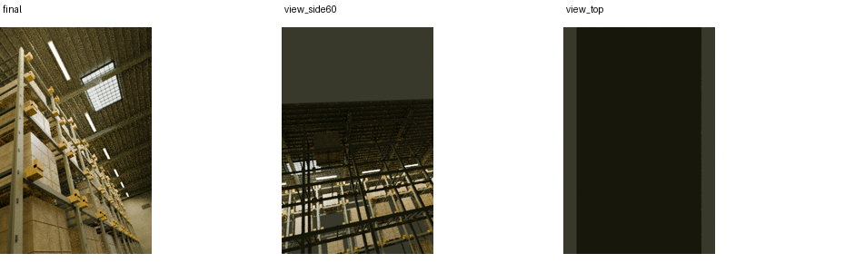

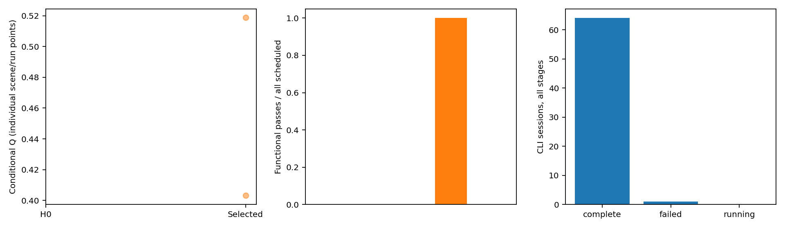
