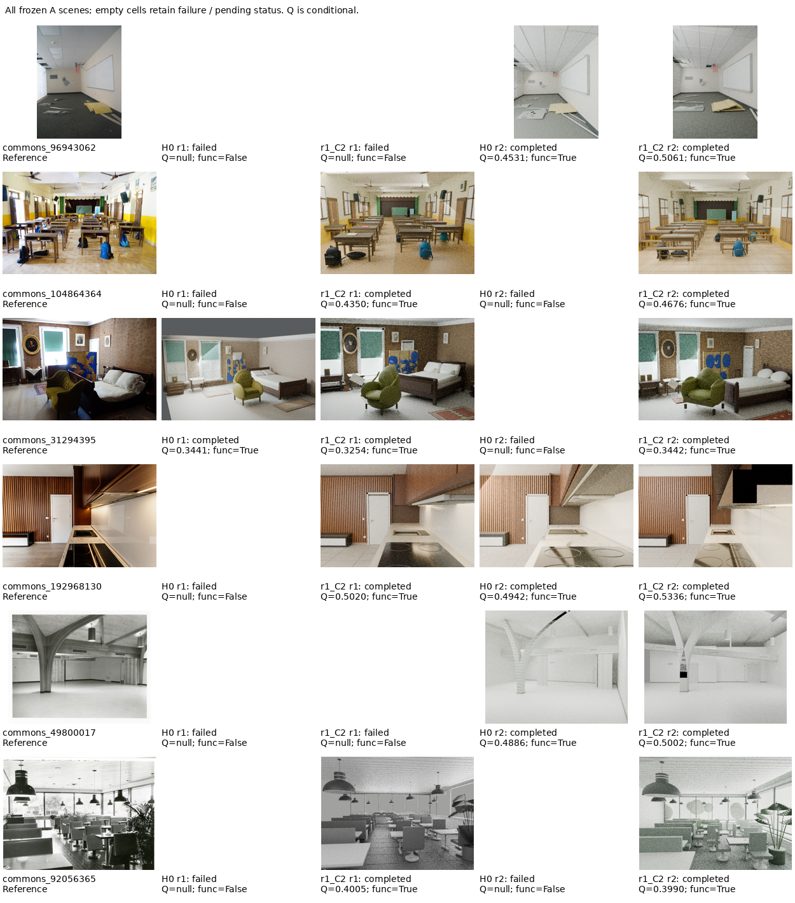
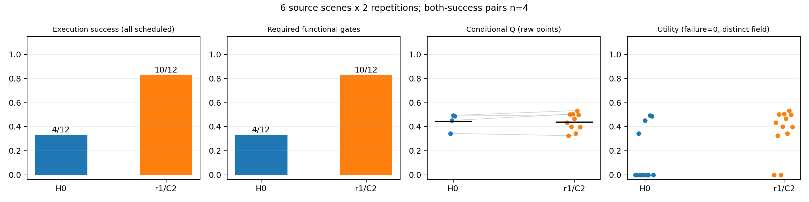
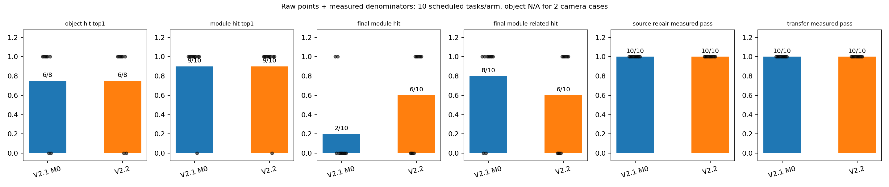
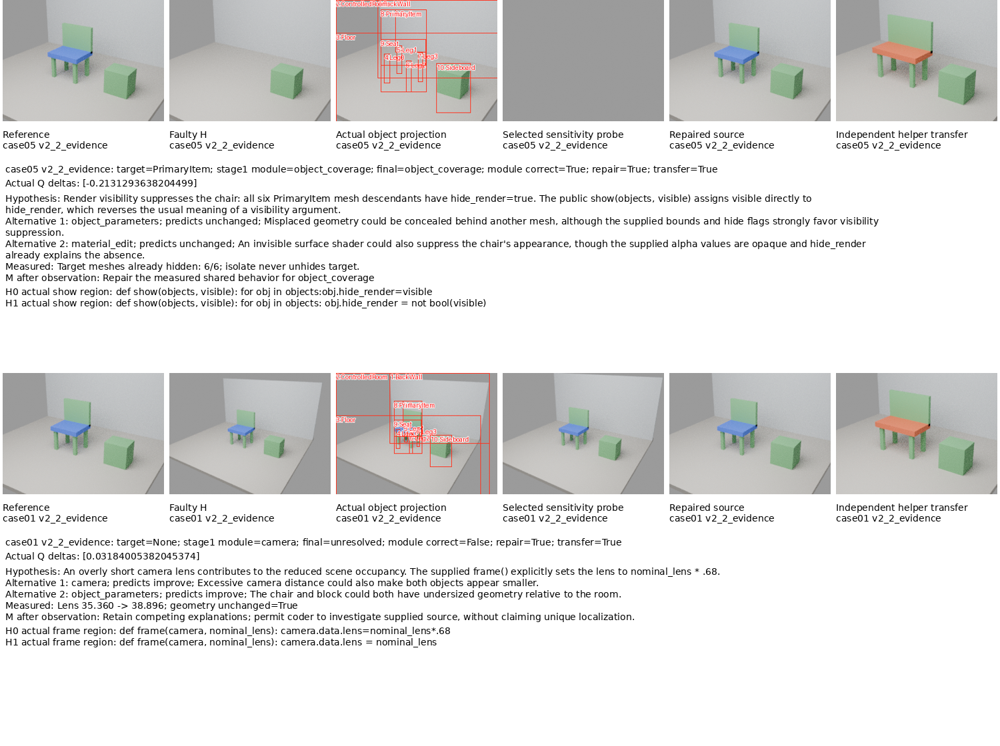
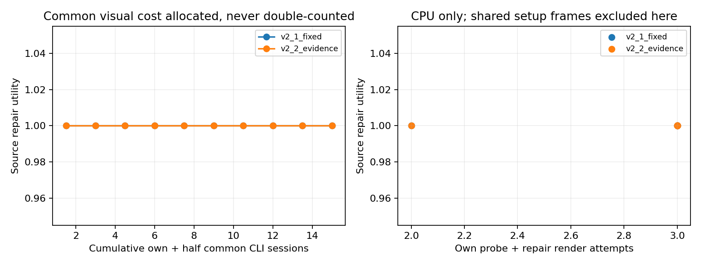
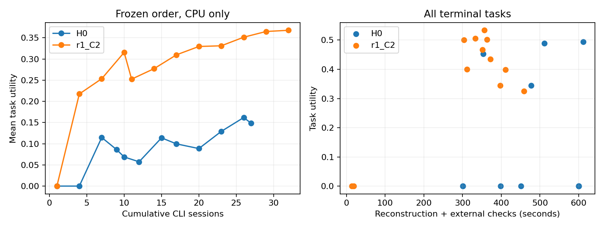

# Scene-RSI V2.2：固定 H 复验与诊断修复机制实验

本轮不继续多代 RSI，不生成新的 M 后代。实验 A 固定 V2.1 原始 H0 与真实 r1/C2；B/C 是工程修复后的诊断机制比较。

## 实验 A：全部预定任务

|H|预定|结束|执行成功|功能通过|成功条件 Q|全任务效用|CLI 会话|
|---|---:|---:|---:|---:|---:|---:|---:|
|H0|12|12|4|4|0.444996|0.148332|27|
|r1_C2|12|12|10|10|0.441361|0.367801|32|

双方成功的配对数：4；配对 Q 差：0.021329。
统计单位为 6 个真实来源场景，每场景 2 次 CLI 随机重复；不能将 12 个重复当成 12 个独立场景。失败原始视觉指标为 null，零只用于独立 utility 字段。
A执行可靠性提高，成功条件Q的总体均值略降；两种均值来自不同成功子集。该固定H多条规则的联合结果不能直接归因于三维诊断或单独复杂度规则。
失败阶段事后按真实日志归类：H0有3次CLI超时、3次构建阶段超时（更细瓶颈未知）、2次构建错误；r1/C2有2次明确路由服务错误。CLI超时本身不能证明服务商故障，也不证明几何问题。原运行failure_type保留。
实际SceneAct Boolean完成事件总数为H0 22、C2 108；成功数和尝试数不同且失败构建被删失，不能据此声称C2减少了布尔操作。配对几何统计见A_complexity_pairs.csv，阶段原始事件保留。
4个双成功配对的Mesh计数均更低（均值645→246.75）；构建时间并非全部更短：卧室13.8→20.6秒，厨房154.7→13.1秒。它们是不同生成程序的观测，不是单独复杂度规则的因果消融。

## 诊断机制与共享修复

实际结果见 [C_summary.json](../metrics/C_summary.json) 与 [逐任务表](../metrics/C_diagnosis.csv)。

|策略|结束/预定|对象top1|初始模块|最终精确模块|最终相关模块|源修复|迁移|自身编码CLI|共同视觉分摊后CLI|自身探测+修复帧|
|---|---:|---:|---:|---:|---:|---:|---:|---:|---:|---:|
|v2_1_fixed|10/10|6/8|9/10|2/10|8/10|10/10|10/10|10|15.0|29|
|v2_2_evidence|10/10|6/8|9/10|6/10|6/10|10/10|10/10|10|15.0|29|

两组对象定位相同（6/8），双方M计划的首个探测模块均9/10。新M最终精确模块6/10，旧M为2/10；但宽泛相关模块新M6/10、旧M8/10，因此不能仅按新标签词汇宣称诊断整体改善。
双方源修复与有限helper迁移都10/10，未观察到共享修复成功率收益；强API契约提示形成明显天花板。新M有4例unresolved，编码器仍可独立从完整源码修复。
两组事前方向预测的区分性均0/5；9/9请求探测执行成功不等于成功区分原因。实际观测使最终模块相对空观测改变6/10（双方相同），证明程序使用观测，不能证明观测提高了研发效果。
C实际仅30次CLI：共同视觉10次、各组编码10次。分摊后每组15次，不把共同10次重复计为20。共同建场20帧另计，双方自身探测+修复各29帧。

## 解释边界

- H0 与 r1/C2 的 policy.py 相同；差异是共享 system.txt 的覆盖检查、复杂度规划和执行验证。本实验不能分离其中单条规则的因果收益。
- 固定 H 复验的结果不能证明 RSI 搜索优于其他框架，也不能把收益归因于三维诊断。
- B/C 源码由工程师修复，不是自动演化出的 M 后代；不存在 MetaImp 或跨代元能力提升结果。
- 新 Commons 页面 ID 在旧收集/实验清单中未命中；本轮适用性接触检查已记录，未做重建驱动样本筛选，不宣称严格盲测。图像本身不提供真实三维几何真值。
- 固定结构/编辑检查是机械操作与已声明部件关系，不等同自然语言编辑能力或自然图像真实三维恢复精度。
- 只有 SceneAct Boolean 的真实开始/结束事件计为已观测操作；缺日志不推测次数。最终残留修饰器不代表已执行布尔次数。
- 全部使用 CPU，两计算线程、单重任务；未使用 GPU。CLI 轮次不能当作底层模型推理轮数，实际返回模型未报告时 unknown。
- A实际CLI为H0 27、C2 32；相同机会/上限不等于相同实际token。C双方自有编码10次、共同视觉10次一次计费，原始usage见calls.csv。

## 审查与重算

A 协议：protocol_A.md、configs/A_freeze.json；真实源版本：configs/source_versions.json；原始场景表：metrics/A_scene_metrics.csv；配对表：metrics/A_paired_metrics.csv。
Figure1 按预先冻结的全部场景顺序和两重复展示，不挑赢家。Figure2/5 的数据源均为 A_scene_metrics.csv，生成脚本为 analyze.py。
离线入口：analyze.py，仅读取现有文件并重算图表；不会调用模型、Blender 或 GPU。归档后的跨机器重算入口见仓库 scripts/offline_v2_2.py。

