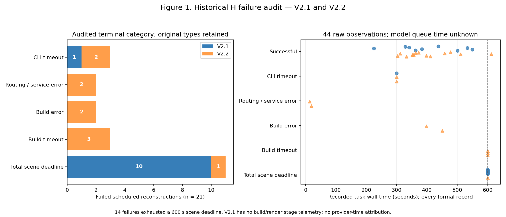

# H_FAILURE_AUDIT：V2.1 / V2.2 的实际失败原因

这是V2.4启动前的事后工程审计。仅重读已有记录和冻结代码，不调用模型、不运行Blender，不修改V2.1/V2.2的failure_type、状态、分数或候选选择。

**主要发现：高失败率不能统一解释为三维几何算法失败。44个预定正式重建全部有终态记录，其中23个成功、21个失败。14个失败耗尽600秒场景总预算；3个触发模型调用超时，其中V2.2的两个有明确连接拒绝/网络等待证据；2个有明确CLI路由服务错误；2个在期限前因生成程序构建错误并用尽两次执行额度结束。**

三项V2.2构建超时同时也是场景总预算耗尽。图中的终态分类将它们记为blender_build_timeout；scene_deadline_limited字段保留这个交叉事实，类别计数不得再次相加。

## 实际覆盖与分母

|实验|预定/记录/终态|重建成功|失败|尚未开始|
|---|---:|---:|---:|---:|
|V2.1|20 / 20 / 20|9|11|0|
|V2.2固定H比较|24 / 24 / 24|14|10|0|

V2.1的Development成功5/6、Selection成功2/6、Test成功2/8；所有Test均确实执行，不存在将未开始的Test计为失败。V2.2为同一固定比较协议下H0与r1/C2各12项：H0成功4/12，r1/C2成功10/12。历史机制实验、烟测和外部编辑不混入44项分母。

## 实际时间与内层预算

两个版本均为gpt-6.1-sol / medium重建，单CLI上限300秒，Blender配置上限600秒，**整个场景Runtime总预算600秒**，最多3次CLI、2次Blender执行，外层610秒，CPU两线程。CLI和Blender的实际超时都取各自上限与剩余场景时间的较小值；这不是每阶段各有600秒。没有独立的构建、渲染或修复时间保留。

- V2.1的10个场景期限失败：CLI正常结束，耗时83.15–283.88秒；首次Blender执行随后获得剩余316.03–516.68秒并耗尽。所有这些执行的stdout/stderr均为空、无阶段遥测、无.blend或final.png。render.py先保存.blend再渲染，因此推测尚未完成渲染前流程，但不能区分启动、生成程序构建、验证、设备设置及保存。主分类为total_budget_exceeded，不强行归咎于几何、Boolean或Cycles。
- V2.1另1个C1/Selection调用在约300秒本地超时，没有生成程序。JSONL只有启动事件和一句开场消息；服务端原因、远端推理时间与排队时间未知。
- V2.2 H0的两个首调用超时约300秒，JSONL明确出现Connection refused和waiting for network。观察到连接故障，不代表已识别远端根因。
- V2.2 H0 r1/commons_192968130先构建422.34秒后因World缺失失败，修复CLI只剩82.246529秒后被场景期限截断；它不是一次独立的300秒模型超时。
- V2.2的三项构建超时，实际子进程额度仅29.734320、390.001982、454.524263秒；有scene_build_started、无scene_build_completed或render_started。没有证据表明它们是Cycles渲染超时。
- V2.2的两个程序错误终态均先出现fillet半径非法、再出现World为None。执行额度已经用尽后，固定policy仍发出第三次CLI并收到完整程序，却不再执行；这是可定位的预算浪费。保持原始失败，不以这份未执行程序宣称重建完成。
- V2.2 r1/C2两个错误为CLI明确报告routing discovery failed、turn.failed并退出1，耗时13.69和19.09秒；无Blender执行，不属于图像难度或几何失败。

本次没有统一增加预算，没有重放或修补失败程序。若后续评估更宽松时限，必须以同一H做单独预算敏感性实验，不能解释为算法改善。模型CLI wall time包含等待与生成；服务排队时间没有单独测量，始终保留null。

## 21项失败逐项索引

|实验 / 重复 / H / 场景|原始failure_type|本次分类|观测阶段|任务秒|
|---|---|---|---|---:|
|V2.1 / r1 / H0 / commons_194983350|budget_or_scene_timeout|total_budget_exceeded|blender_pre_render_inferred_substage_unknown|600.161|
|V2.1 / r1 / H0 / commons_189918915|budget_or_scene_timeout|total_budget_exceeded|blender_pre_render_inferred_substage_unknown|600.035|
|V2.1 / r1 / H0 / commons_80372956|budget_or_scene_timeout|total_budget_exceeded|blender_pre_render_inferred_substage_unknown|600.149|
|V2.1 / r1 / C1 / commons_187101683|budget_or_scene_timeout|total_budget_exceeded|blender_pre_render_inferred_substage_unknown|600.149|
|V2.1 / r1 / C1 / commons_194983350|model_call_timeout|model_call_timeout|model_call|300.335|
|V2.1 / r2 / H0 / commons_194983350|budget_or_scene_timeout|total_budget_exceeded|blender_pre_render_inferred_substage_unknown|600.160|
|V2.1 / r2 / H0 / commons_189918915|budget_or_scene_timeout|total_budget_exceeded|blender_pre_render_inferred_substage_unknown|600.174|
|V2.1 / r2 / H0 / commons_80372956|budget_or_scene_timeout|total_budget_exceeded|blender_pre_render_inferred_substage_unknown|600.149|
|V2.1 / r2 / C1 / commons_194983350|budget_or_scene_timeout|total_budget_exceeded|blender_pre_render_inferred_substage_unknown|600.130|
|V2.1 / r2 / C2 / commons_189918915|budget_or_scene_timeout|total_budget_exceeded|blender_pre_render_inferred_substage_unknown|600.136|
|V2.1 / r2 / C2 / commons_80372956|budget_or_scene_timeout|total_budget_exceeded|blender_pre_render_inferred_substage_unknown|600.180|
|V2.2 / r1 / H0 / commons_104864364|generated_program_or_execution_failure|blender_build_error|scene_build|397.714|
|V2.2 / r1 / H0 / commons_192968130|budget_or_scene_timeout|total_budget_exceeded|repair_model_call|600.270|
|V2.2 / r1 / H0 / commons_49800017|model_call_timeout|model_call_timeout|initial_model_call|300.287|
|V2.2 / r1 / H0 / commons_92056365|budget_or_scene_timeout|blender_build_timeout|scene_build|600.122|
|V2.2 / r1 / H0 / commons_96943062|model_call_timeout|model_call_timeout|initial_model_call|300.301|
|V2.2 / r1 / r1_C2 / commons_49800017|cli_service_or_process_failure_unresolved|model_service_error|initial_model_call|13.837|
|V2.2 / r1 / r1_C2 / commons_96943062|cli_service_or_process_failure_unresolved|model_service_error|initial_model_call|19.247|
|V2.2 / r2 / H0 / commons_104864364|budget_or_scene_timeout|blender_build_timeout|scene_build|600.156|
|V2.2 / r2 / H0 / commons_31294395|generated_program_or_execution_failure|blender_build_error|scene_build|450.731|
|V2.2 / r2 / H0 / commons_92056365|budget_or_scene_timeout|blender_build_timeout|scene_build|600.168|

逐项解释、原始记录路径、CLI时间、Blender时间、原始类型及审计依据见[CSV](metrics/H_failure_audit.csv)与[JSON](metrics/H_failure_audit.json)。完整细阶段证据见[audit_review.json](audit_sources/audit_review.json)、[V2.1审计](audit_sources/v21_audit.json)。原始日志继续保留在其V2.1/V2.2实验目录及既有Release，不将本次归因回写历史指标。

## 图与可重算命令



统计单位为正式重建尝试；同一场景跨H/研发重复的尝试不是新的独立场景。柱图使用终态主分类，右图展示全部44个真实任务耗时点，未筛选案例。原始分数缺测保持null，不生成虚假PSNR、Q或服务等待时间。

```bash
OMP_NUM_THREADS=2 OPENBLAS_NUM_THREADS=2 MKL_NUM_THREADS=2 CUDA_VISIBLE_DEVICES= python audit.py
```

该命令只读取同目录audit_sources中的审计快照，重生成表格、图及本文；无需模型、Blender或GPU。快照为事后审计证据，不冒充实验前冻结协议。

## 可以与不能得出的结论

可确定的是：错误来源混合了连接/路由故障、生成代码的参数/World错误，以及被共享期限截断的构建或修复。14个失败受到总预算限制；H0尤其容易在没有.blend时结束，不能直接进入视觉三维探测。此时应研究程序与执行证据。

尚不能确定的是：V2.1超时的具体Blender子阶段，V2.2三次构建超时的精确慢操作，服务故障的远端根因，以及任何增加时限后的成功率。未运行独立重放，也没有声称所有已生成代码可正确执行。Boolean完成计数不是布尔成本归因；没有三维真值，不推断真实几何精度。

本审计只澄清H的失败分母和执行条件，不是主动诊断有效性或共享H研发收益的证据。
