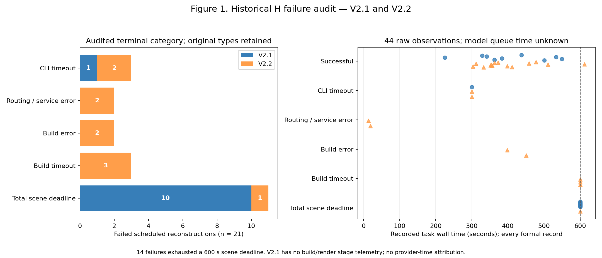
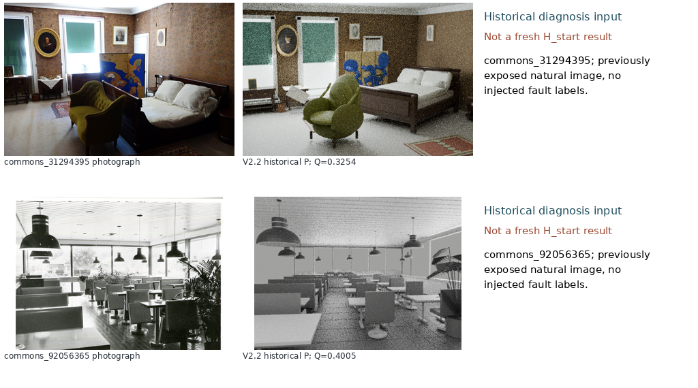
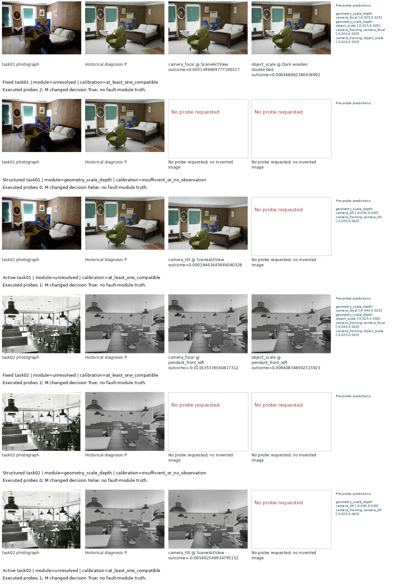
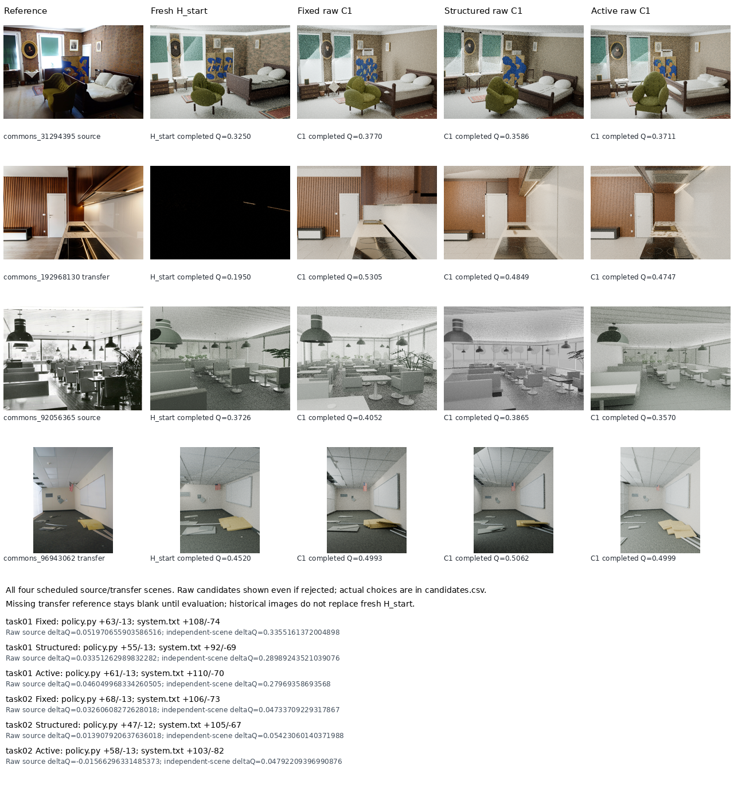
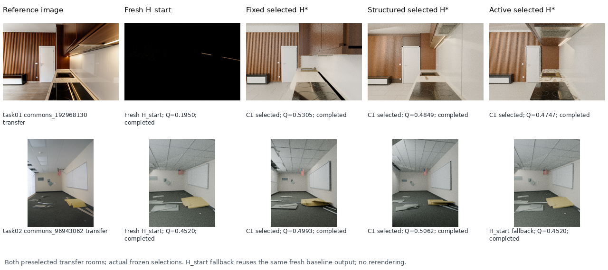
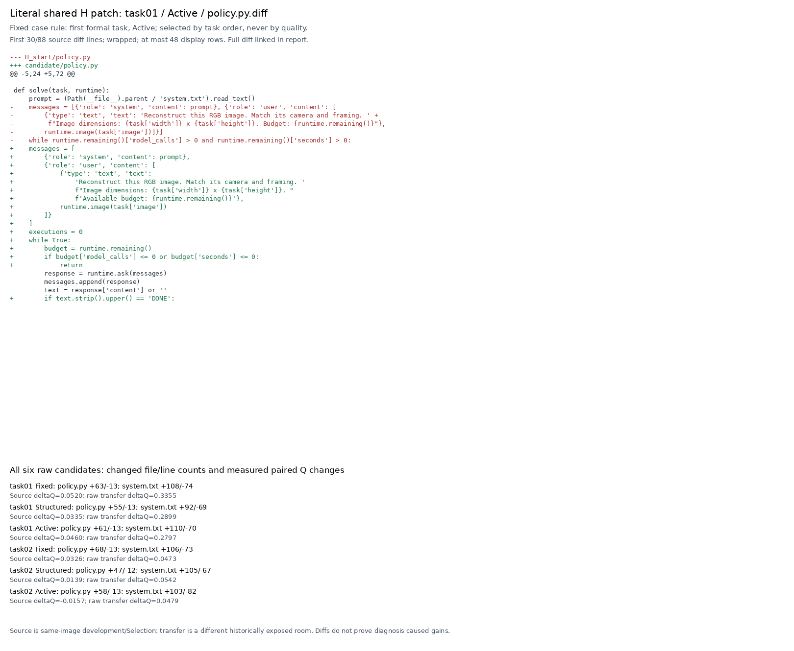
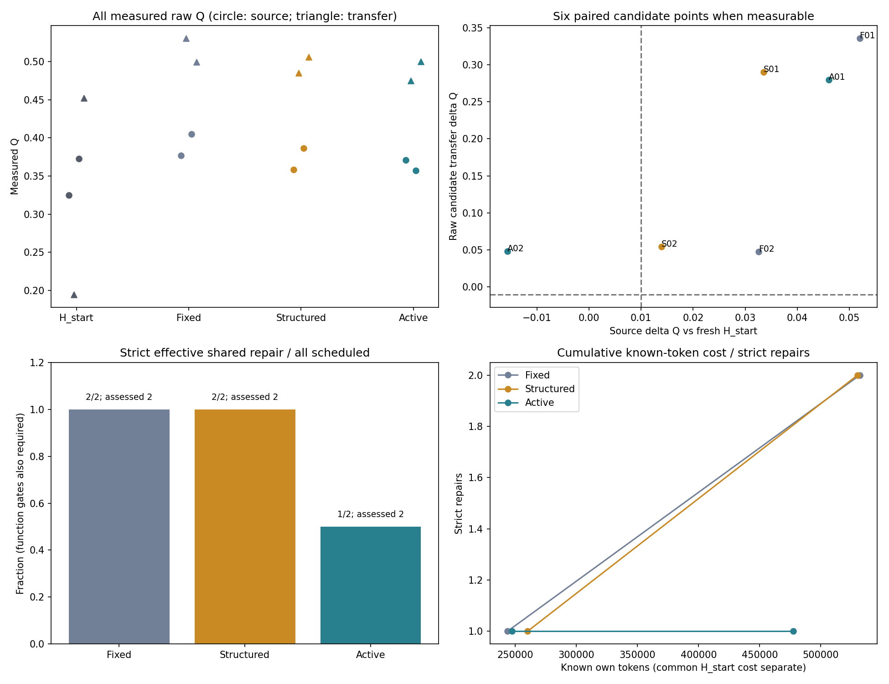
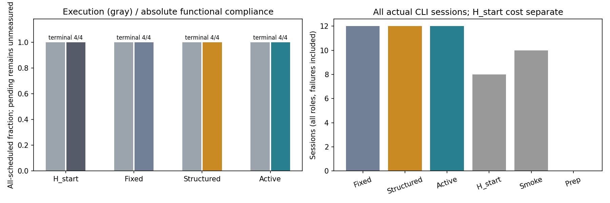
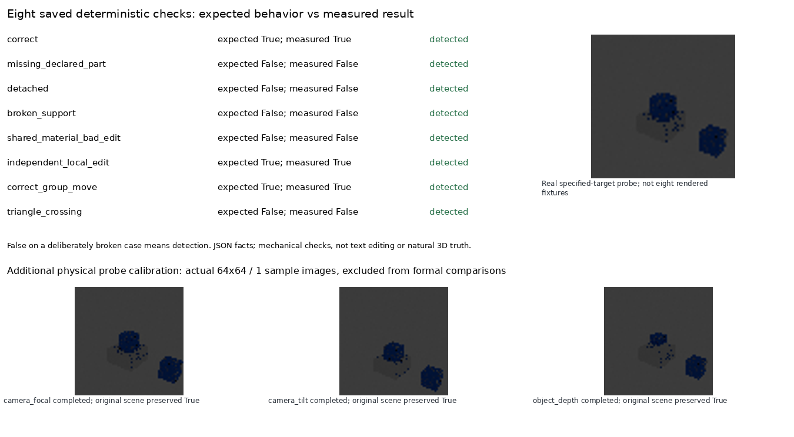
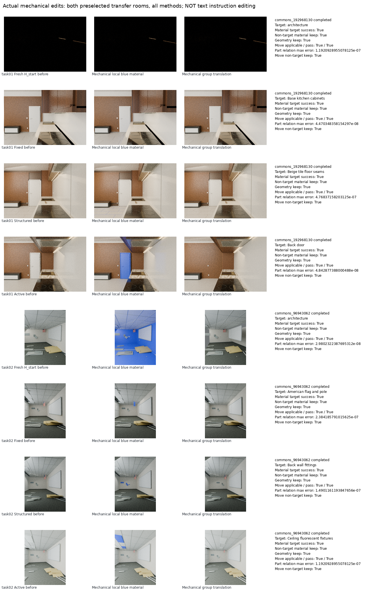

# Scene-RSI V2.4 中文实验报告

本轮研究自然图像重建共享流程 H 的有限诊断与修改。共同起点 H_start 是 V2.1 r1/C2；原始 H0 仅保留源码，并未冒称本轮实际对照起点。M 由工程修订，未自动进化。

## 实际状态

正式计划为 2 个研发任务 × 3 种诊断方法 × 1 个共享 H 提案，共 6 个候选；4 个真实源/迁移场景配置中计划 16 个新重建任务。烟测单列。代码将源图 split 命名为 Selection，但这张图已用于 H 的诊断与编码：这是同图研发/筛选，不是独立验证。另一房间的 transfer 在候选与选择冻结后执行，但图像曾在 V2.2 暴露；本轮探索性，不称新盲测。

|方法|新执行成功 / 预定|功能合规 / 预定|条件 Q（n）|严格有效修复 / 预定候选|实际选中 C1|
|---|---|---|---|---|---|
|Fresh H_start|4/4; pending 0|4/4|0.3362 (4)|N/A|0|
|Fixed|4/4; pending 0|4/4|0.4530 (4)|2/2; pending 0|2|
|Structured|4/4; pending 0|4/4|0.4340 (4)|2/2; pending 0|2|
|Active|4/4; pending 0|4/4|0.4257 (4)|1/2; pending 0|1|

## 六个候选的全部点

|任务 / 方法|提案状态|源 ΔQ|原始候选迁移 ΔQ|实际 Selection 选择|选后迁移 ΔQ|严格有效修复|
|---|---|---|---|---|---|---|
|task01 / Fixed|completed|0.0520|0.3355|C1|0.3355|True|
|task01 / Structured|completed|0.0335|0.2899|C1|0.2899|True|
|task01 / Active|completed|0.0460|0.2797|C1|0.2797|True|
|task02 / Fixed|completed|0.0326|0.0473|C1|0.0473|True|
|task02 / Structured|completed|0.0139|0.0542|C1|0.0542|True|
|task02 / Active|completed|-0.0157|0.0479|H_start|0.0000|False|

严格有效修复：源场景必要功能全部通过，源 Q 相对本轮新 H_start 提升 >0.01；迁移执行/必要功能通过，Q 不下降超过 0.01。更强的迁移提升 >0.01 另存字段。缺少原始 Q 不证明收益。实际选择与此严格收益派生值分开保留，不改写冻结选择。
如实执行规则与冻结文字存在偏离：runner 在 H_start 的绝对功能资格不通过时，接受任意合格候选；即使 H_start 有有效 Q，也不要求候选再提高 >0.01。这里的不合格可能来自功能失败，并不等于没有图像/Q。保留实际 selection_freeze 选择，不事后重新选择；严格视觉增益另作派生分析，selection_strict_gain_disagreement 逐点标记不一致。缺少基线 Q 时不能量出增益，也不把 Q 填零；source_execution_recovery / transfer_execution_recovery 单列执行恢复。执行退化观测不自动等于算法退化，服务错误需结合原始日志解释。

## 真实诊断闭环与结构检查

|方法|请求 / 完成 / 可测探测|M 第二阶段执行|预测校准状态|unresolved|
|---|---|---|---|---|
|Fixed|4 / 4 / 4|2|{"at_least_one_compatible": 2}|2|
|Structured|0 / 0 / 0|2|{"insufficient_or_no_observation": 2}|0|
|Active|2 / 2 / 2|2|{"at_least_one_compatible": 2}|2|

预测表保存所有竞争假设、所有可用探测的事前区间，包括未选择的工具。正式标量为 0.5 × 全图 ΔSSIM + 0.5 × 固定参考 ROI 的 ΔSSIM；三个原始量分别保留，实际标量返回可执行 M.plan_patch。事前区间是模型给出的主观预测，不是统计置信区间。M 的 soft compatibility 以区间中心/半宽加 0.003 计算残差，至少一个假设的平均归一化残差 <=3 才算兼容，并非观测严格落在区间内。exp(-0.5*min(z²,25)) 的权重比是启发式证据分数，不是贝叶斯后验概率；保留程序原字段及 unresolved。自然图像没有故障对象/模块真值，因此定位/模块准确率为 null，不能用文本丰富或 SSIM 上升代替因果定位。
Fixed/Active 同为最多两个探测；实际次数可能不同，不宣称严格实际计算量匹配。各组独立诊断调用及编码调用全部计成本。
准备期保留了无效对象 ID、早期菜单无法形成可区分预测等尝试，列于 preparation_smoke.csv；不得把这些尝试隐藏或并入独立正式样本。最终 refined 烟测与先前尝试分别保存。
八个确定性结构检查：8/8 个与已知预期相符。图 6 显示保存的真实 JSON 测量与一张实际指定对象探测图，不为其他夹具补造渲染。机械材质/移动测试不代表文字指令编辑；支撑 AABB 近似与三角面交叉也不是自然场景三维真值。

## 实际新增成本

CLI 会话 54；已知输入 2040784，输出 252990 token；usage 缺失 0。渲染尝试上界 101，完成 100。CPU 两线程、单重任务，GPU 0。

|成本组|CLI|已知输入 / 输出|usage 缺失|探测 Blender 秒|重建流水线秒|
|---|---|---|---|---|---|
|fixed|12|475535 / 56258|0|45.0786|1635.6549|
|structured|12|465528 / 64495|0|0|1670.5621|
|active|12|425161 / 52286|0|22.5116|1245.6472|
|common_H_start|8|196992 / 46119|0|0|1475.7934|
|smoke|10|477568 / 33832|0|11.4820|728.2418|
|preparation|0|0 / 0|0|0|0|

诊断/共享 H 编码的 gpt-6-astra 单次 CLI 上限为 600 秒；重建 student gpt-6.1-sol 单次上限为 300 秒，且受内层总计 600 秒的剩余时间限制。Blender 同样只能使用该内层剩余时间。内层期限不包括外部数值评价和功能检查。H_start 的共同评估成本单列；新增全局预算和调用总数包含全部 10 次准备/烟测调用，每方法正式曲线不含共同准备及新 H_start 的费用，二者另表列出。外层工程对话和固定模型服务基础设施成本不可观测、未定价，不声称各方法总研发实耗相等。模型 wall time、重建流水线及内层 Blender 是重叠分量，不能相加；共享服务器耗时与未知队列不支持算法速度优势结论。费用美元未知，模型请求名称与真实返回字段分别保留。历史 V2.1/V2.2 复制日志不计入本轮新增调用。record.model_roles 中 editor/judge 只是继承但未使用的元数据；实际发生的角色见 calls.csv，不宣称文字指令编辑或独立视觉评审已经执行。

## 真实图与审查入口

选后图固定覆盖两个迁移场景，并读取实际冻结选择；选为 H_start 时直接复用同一新基线图，明确标注 H_start fallback，不重渲染、不展示被拒候选代替选中结果。[选择与图像路径映射](../metrics/selected_transfer_image_mapping.csv) 保留实际选择、路径和测得 Q；原始 C1 联系表与选后图分开。

代码摘录固定选择第一个正式任务 task01 的 Active policy.py.diff，与 Q 无关；图中截断/换行范围明确，完整文件见 [policy.py.diff](../tasks/task01/active/policy.py.diff)。六候选修改计数与源/原始迁移差值见 [shared_H_diff_summary.csv](../metrics/shared_H_diff_summary.csv)，摘录来源与完整原始行见 [shared_H_diff_excerpt.json](../metrics/shared_H_diff_excerpt.json)。差异展示不能证明探测造成收益。

真实编辑联系表预先覆盖 task01 厨房、task02 便携教室这两个迁移场景的 H_start / Fixed / Structured / Active；没有按分数挑选。before、材质编辑、组合移动图全部读取本轮 functional 原始产物。缺测留空，不适用单列；材料、非目标保持、组合关系与功能门槛的原始值见 [actual_mechanical_preservation.csv](../metrics/actual_mechanical_preservation.csv)。这只是预定义机械操作，不是文字指令编辑。

原始逐场景 [scene_metrics.csv](../metrics/scene_metrics.csv)，六候选 [candidates.csv](../metrics/candidates.csv)，事前预测 [forecasts.csv](../metrics/forecasts.csv)，真实观测 [probe_observations.json](../metrics/probe_observations.json)，调用 [calls.csv](../metrics/calls.csv)，成本 [costs.csv](../metrics/costs.csv)，分阶段模型成本 [costs_by_phase.csv](../metrics/costs_by_phase.csv)，图表来源 [figure_sources.json](../metrics/figure_sources.json)。
分阶段成本将共享 H 诊断/编码、源图重建、最终迁移推理、准备烟测分开。Figure 5 的累计曲线按 task01/task02 档案顺序合计单方法全部已知 token（含终测）；它不是实际研发时间轴，公共 H_start/准备成本另计。
所有图按固定 task01、task02 / fixed、structured、active 顺序展示，未挑赢家。图 2 的旧 V2.2 输出仅为诊断输入；图 4 用本轮新 H_start，与其余方法渲染条件一致。失败无输出留空，pending 不当零质量。

## 科研结论边界

- 当前是否有共享流程收益，以六个真实候选与选后迁移数据为准；pending 不产生结论。负差异、拒绝候选和服务失败完整保留。
- 两个研发任务不是两次独立 RSI 演化；多个渲染视角不是额外场景。本轮没有自动 M 后代、陌生 H 起点冻结元回放或通用 RSI 基线重跑。
- 每个 H/图仅一次新重建，远端模型采样波动未量化；三组初诊独立采样，不能把质量差异唯一归因于探测策略。
- 报告整理时目视可见 task01 新 H_start 的厨房迁移图近乎全黑，Q 约 0.195，仍执行成功且机械功能合规。原图和分数保留，不重采样；这个低基线放大了该场景的配对增益，进一步限制均值的普遍解释。目视标注不改变评分或选择规则。
- 新修复只属于共享 H 的 policy/system；场景 P 的变化来自这些流程的新执行。源码 diff 与编码者的观测使用说明是轨迹，不自动证明诊断因果收益。
- 源图已参与本轮诊断和编码，随后同图研发/筛选不能证明跨图像验证收益；另一房间 transfer 在候选/选择冻结后新执行，但历史图像已暴露。冻结顺序与实际选择另存，不得把这些公开图像称新盲测。
- 保留历史 failure_type 与审计后的预算/阶段解释；不回写历史分数。原始视觉缺测为 null，端到端失败效用单独赋零。

## 离线重画

`python analyze.py` 只读本目录已有输入并更新派生 metrics/figures/reports，不调用模型、Blender 或 GPU。若要保留本次派生报告，请使用归档提供的离线新目录入口。

执行实现与逐臂探测/渲染复核：[implementation_audit.json](../metrics/implementation_audit.json)。这是事后工程审计，不修改实际 M/H 或冻结选择。
