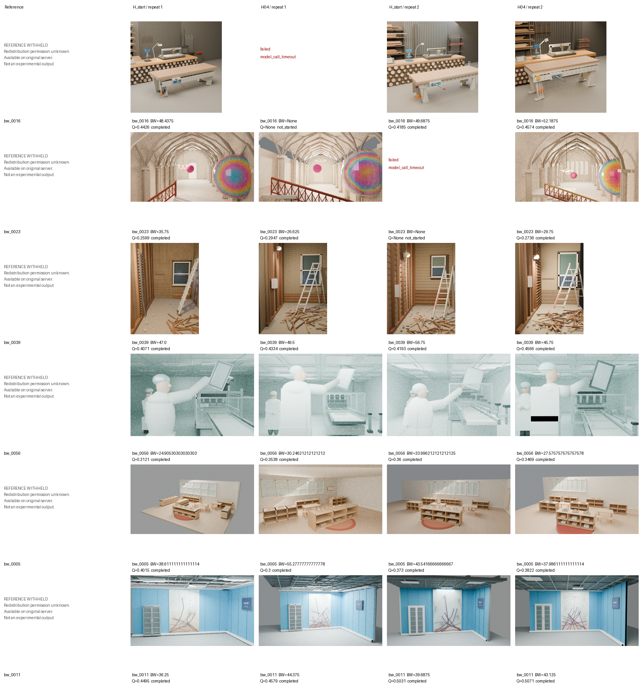
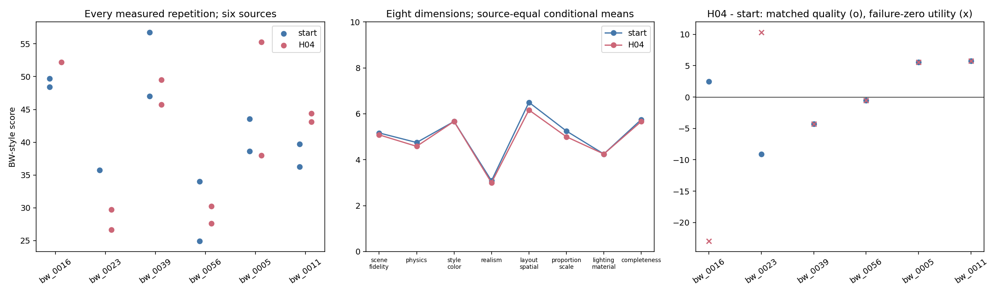

# V3 Final Test：独立来源统计

当前24项中保存终态 24，生成成功 22，BW实测 22。

六个真实来源是统计单位；每来源两次生成先合并。成功条件质量与全部预定任务的失败零效用分列。评价服务失败和未开始项保持null，不算零。没有重新选择H_best。

| endpoint | 全预定 | 生成成功 | BW实测 | 来源等权条件BW | 完成任务条件BW | 全预定BW效用 |
|---|---:|---:|---:|---:|---:|---:|
| historical_r1_C2_start | 12 | 11 | 11 | 40.8639 | 41.3288 | 37.8847 |
| H04 | 12 | 11 | 11 | 41.2155 | 40.2180 | 36.8665 |

| 来源 | start 成功/2 | H04 成功/2 | 匹配实测BW对数 | BW配对差 | BW零效用差 | start重复SD | H04重复SD |
|---|---:|---:|---:|---:|---:|---:|---:|
| bw_0016 | 2 | 1 | 1 | 2.5000 | -22.9688 | 0.8839 | pending/null |
| bw_0023 | 1 | 2 | 1 | -9.1250 | 10.3125 | pending/null | 2.2097 |
| bw_0039 | 2 | 2 | 2 | -4.2500 | -4.2500 | 6.8943 | 2.6517 |
| bw_0056 | 2 | 2 | 2 | -0.5398 | -0.5398 | 6.4282 | 1.8883 |
| bw_0005 | 2 | 2 | 2 | 5.5556 | 5.5556 | 3.4864 | 12.2271 |
| bw_0011 | 2 | 2 | 2 | 5.7812 | 5.7812 | 2.4307 | 0.8839 |

配对BW差（H04-start）：{"sources": 6, "mean": -0.012994528619529136, "source_standard_deviation": 5.867802238382397, "ci95": [-4.434869528619529, 4.068023989898989], "method": "10000 percentile bootstrap draws over source summaries; seed 20261111; exploratory with n=6"}
全预定BW效用差：{"sources": 6, "mean": -1.0182028619528627, "source_standard_deviation": 11.919157806610647, "ci95": [-10.563920454545455, 6.337384259259259], "method": "10000 percentile bootstrap draws over source summaries; seed 20261111; exploratory with n=6"}

Selection：31.659382 → 37.895230；Test的变化以上述六来源配对结果为准。
95%区间用固定种子20261111，对六个来源的汇总值做10,000次percentile bootstrap；不足六个来源时不输出区间。这是小样本探索性不确定性描述，不是显著性或普遍优势证明。

H的实际改动边界：H02改变了内层反馈的数据流，每次有效渲染后重新附上原参考图与当前渲染，并加入共享比较指导；H04在此基础上增加数值投影代码示例和相机调整指导。这是共享重建流程和提示的变化，不是新增由固定runner强制执行的投影校准器。H08的材质指导也只是共享生成/修复指导，未成为独立材质修复模块。实际差异见C02/C04/C08的H.diff，不把提示中的代码示例写成已强制执行的新算法。

补充统计口径：原有group_summary中的完成任务条件均值仍保留；这里另列“每来源先合并重复，再来源等权平均”，没有回写旧指标或改变BW评分公式。
模型服务失败、生成失败和评价失败见逐项原始表。失败零效用包含服务失败造成的交付损失，不能把它全部归因于几何算法。

恢复前已闭合的两项调用超时：H04/bw_0016/repeat1为900.335秒，historical_r1_C2_start/bw_0023/repeat2为900.250秒；各自student_calls/001_*/stderr.log有Connection refused和模型列表刷新失败记录，没有生成可用场景。这支持调用/连接层失败，不能单凭客户端日志确定远端服务端或SSH转发中的唯一故障点，也不能归为已执行的几何算法错误。原failure_type仍为model_call_timeout，终态不重抽；交付零效用与算法质量归因分开。

## 实际调用与计算成本

| 角色 | CLI会话 | 状态 | 可见输入token | 可见输出token | usage已知会话 | 累计CLI墙钟秒 |
|---|---:|---|---:|---:|---:|---:|
| H | 250 | {'completed': 248, 'timeout': 2} | 9062653 | 1055869 | 248 | 25401.3994 |
| M | 19 | {'completed': 19} | 2792086 | 20917 | 19 | 809.6227 |
| judge | 133 | {'completed': 132, 'failed': 1} | 23186902 | 225747 | 132 | 7910.2899 |
| preparation | 4 | {'completed': 3, 'failed': 1} | 53341 | 11228 | 3 | 240.5344 |

本次收尾新增（与health.json中恢复检查前的实际预算快照作差；已知token增量不是缺失用量估计）：{"cli_sessions": 70, "render_attempts": 252, "known_input_tokens": 5800236, "known_output_tokens": 241158, "usage_known_sessions": 70, "usage_unknown_sessions": 0, "observable_tool_calls": 0}
[收尾前后成本CSV](../metrics/final_completion_cost_delta.csv)。整个V3累计见上表；费用仍unknown。

实测Blender叶进程 1429 个，累计该作用域CPU秒 166129.53；其阶段墙钟累加值不是全研究墙钟。渲染预算扣额 1125，全局精确实际帧数仍unknown，逐目录证据见render_evidence.csv。
费用不可见，精确底层模型请求数unknown；CLI会话、可观测turn、工具执行和token分开。远端排队与推理无法准确拆分，不伪造纯推理秒数。[角色成本CSV](../metrics/final_cost_by_role.csv)、[最慢实际子进程](../metrics/final_slowest_processes.csv)。旧耗时汇总漏读BW的*_timing.json已按事后报告说明补入，旧表图保留。

原始Q、PSNR、SSIM、LPIPS、DINO、Rubric与八维分项、required/applicable/measured_pass/gate_pass、设备和调用数均保留在[逐项CSV](../metrics/final_test_raw.csv)。[来源CSV](../metrics/final_test_sources.csv)、[端点CSV](../metrics/final_test_endpoints.csv)、[汇总JSON](../metrics/final_test_summary.json)。

公开联系表因原始BW参考图再分发许可未确认而明确留出Reference列；包含真实参考图的完整联系表只保留服务器本地，不进入Git或Release。失败输出留空，不用其他场景替代。

这些图只读取本轮保存数据；生成脚本：`python final_statistics.py`。没有新模型调用或Blender渲染。
