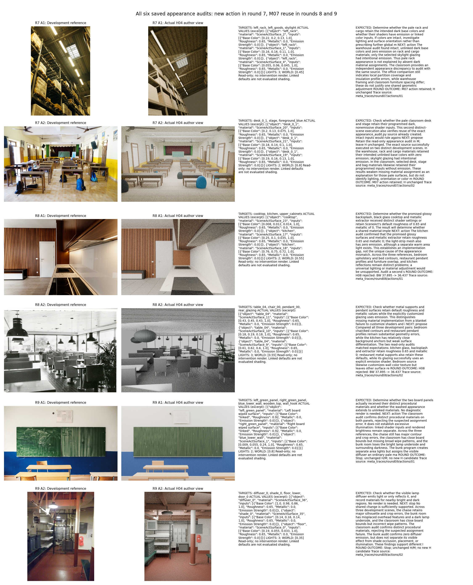

# M07 源码与执行轨迹审查

本报告只读取本轮已有源码、diff、真实动作输入输出和验证记录；没有调用模型或 Blender。审查覆盖全部六次 appearance_audit 执行，按第7、8、9轮时间顺序展示，不按效果挑选案例。

M07 与 M000 的 `meta.py` 完全相同；初始策略提示也未改变。真实差异是新增39行的 `actions/appearance_audit.py`，并在 `actions_index.json` 注册动作。它是研究动作库扩展，不是规划入口改写或普通代码整理。Astra在第7轮提出并保留了此M-only后代，共享H仍为H04。索引里残留的 `created_pending_reuse` 是目录元数据，不能当作实际执行结论；以下调用轨迹才是执行证据。

动作接收明确的 `object_ids`，检查这些对象及其Mesh后代的材质槽、Principled/Emission节点默认值与linked标志、材质在组内的使用次数，同时读取真实灯光、World背景、色彩管理、曝光和gamma。对象不存在时写missing。它不改几何、相机、材质或灯光，不渲染，不求解链接节点网络，也不测量像素亮度、可见性或唯一原因。`mesh_count`实际按所选对象树的材质槽累加，同一Mesh重复槽可能重复计数；没有读取全局`material.users`，也没有建立跨对象依赖图。因此这不是完整的共享材质回归测试。World和灯光字段也是配置读数，不能当作最终渲染照明测量。

## 第7轮：动作创建与两场景复用

仓库 left_rack/left_goods/skylight 与教室 desk_0_1/stage/foreground_blue 的两次真实执行，观察到部分暗色材质仍完整、零发光，因而未把渲染发白直接归因于未赋材质。随后提交仅保留动作的M-only变更；这证明动作能够复用，不证明质量改进。

## 第8轮：动作 → 共享H补丁 → 负验证结果

问题：厨房画面缺乏预期的玻璃/金属区分，但也存在照明、方向与几何解释。M07指定 cooktop/kitchen/upper_cabinets；实际节点中选定材质保留约0.65 roughness、0 metallic。下一步并非认定唯一原因，而是在餐厅 table_04/chair_00/pendant_00/rear_glazing 上作第二次只读检查，观察到多种表面仍为默认响应，同时部分玻璃已显式发光。

随后M提出H08：在 `policy.py` 增加MATERIAL_GUIDANCE，要求实现图像支持的材质差异、检查共享材质用户、必要时复制材质，并打印最终Shader值。它改变了跨图重建提示和实现检查指导，没有直接替场景设置一组统一材质参数；代码执行入口与迭代预算不变。

独立Selection三图的H08 BW均值为 36.436896，父H04为 37.895230，差值 -1.458333，未达到冻结的+2分晋升门槛，故拒绝。三图执行/必要功能资格通过不等于视觉收益。这条链说明观测与后续补丁一致，不能证明动作因果有效；本例没有产生更好的H。

## 第9轮：观测反驳假设，停止研发

M07指定教室 left_green_panel/right_green_panel/blue_lower_wall/wooden_top/wall_hook。实际测量确认两个面板分配不同的程序材质，Base Color是linked。后续M决策据此拒绝了当时怀疑的分配错误；审查只将它解释为不同材质绑定已落实，不能据此排除所有材质错配或证明纹理、节点输出与参考图对应正确。默认颜色不能当成最终纹理颜色。后续转向宿舍 diffuser_0/shade_0/floor/lower/door_0，确认灯罩扩散面Emission Strength为0而场景另有Area灯。

M最终认为这些信息仍无法区分遮挡、位置与照明效应，不支持跨图统一修改，选择stop。第9轮是unchanged，没有生成新的H候选，没有Selection拒绝或通过事件，不应包装为“又一次修复成功”。

## 能证明与不能证明的内容

能证明：新动作源码真实保存；第7轮两场景执行后被保留；第8、9轮又实际执行四次，执行副本与M07源码一致；真实观测进入后续M决策。共六次只读检查，额外诊断渲染为0。

不能证明：M07比M000更强、主动干预的因果收益、一般递归能力提升。没有同一陌生H起点和相同档案下的已完成冻结回放。H08验证下降，H09未改动；动作被调用、动作数增长和M路径出现在父版本中均不足以证明能力增强。

最终保留的H04在第4轮已产生，早于第7轮M07诞生，因此H04的终测收益不能归因于M07。第10轮仍以M07为父版本，但没有执行新增appearance动作；它的H10候选Selection BW为 34.889277，也被拒绝。M07出现后的第8–10轮没有任何H更新被保留。这是本条轨迹的负结果，不能据此证明M07普遍弱于M000。

原始数据：[完整审查JSON](../metrics/M07_review.json)、[逐动作CSV](../metrics/M07_action_review.csv)。源码与轨迹：`initial_m/`、`candidates/C07/M.diff`、`candidates/C07/M/`、`meta_traces/round07..09/actions/`、`candidates/C08/H.diff`、`candidates/C08/proposal.json`、`candidates/C09/proposal.json`、`rounds/07..09/record.json`。

图中只有已有开发参考/真实重建和原生测量文字，没有新生成的干预图或因果示意图。离线重跑：`python audit_m07.py`。
