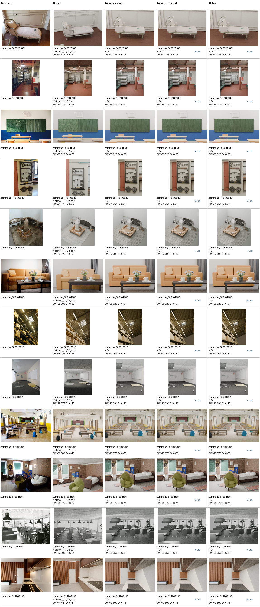
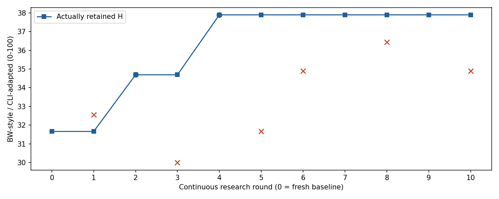
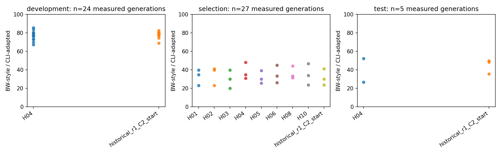
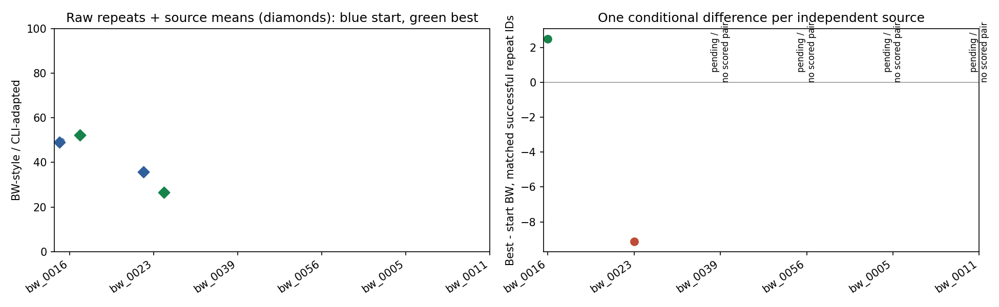
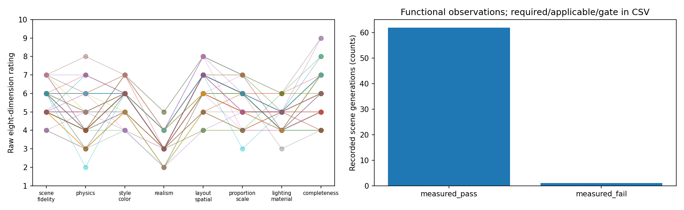
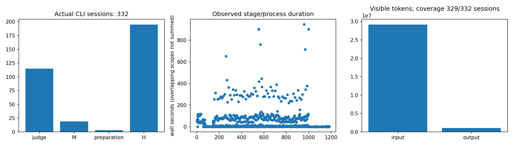
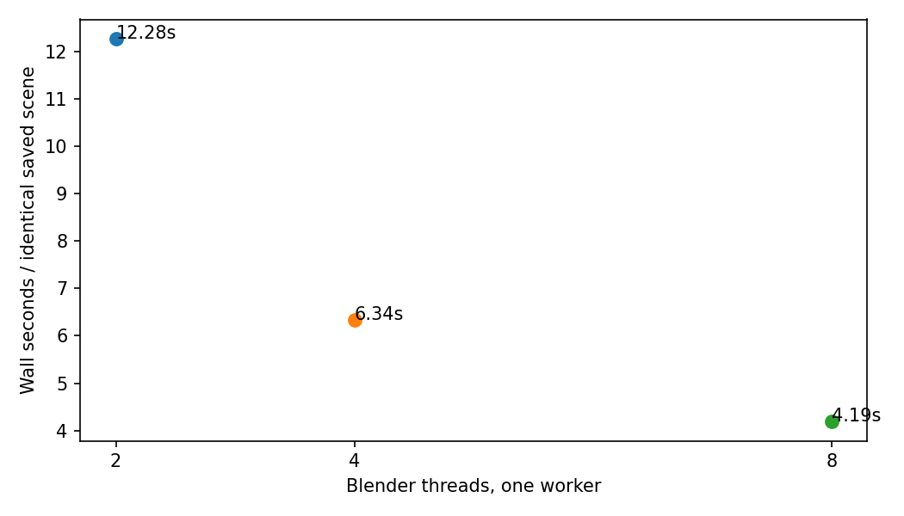
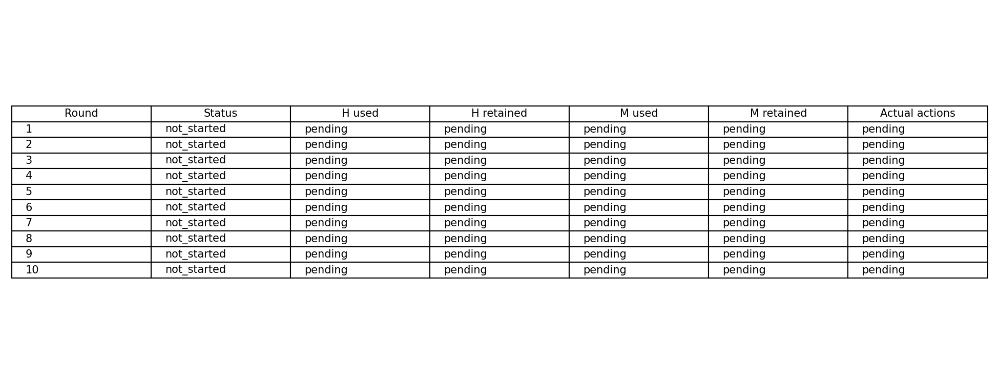
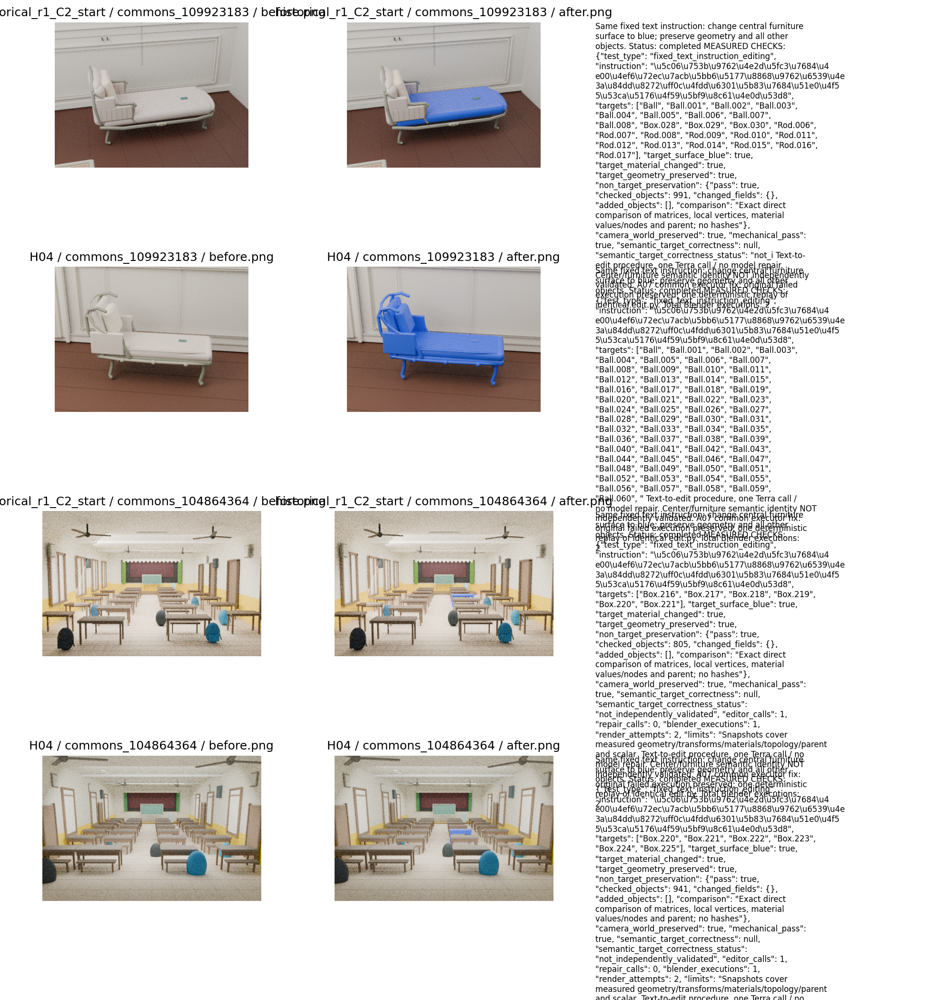
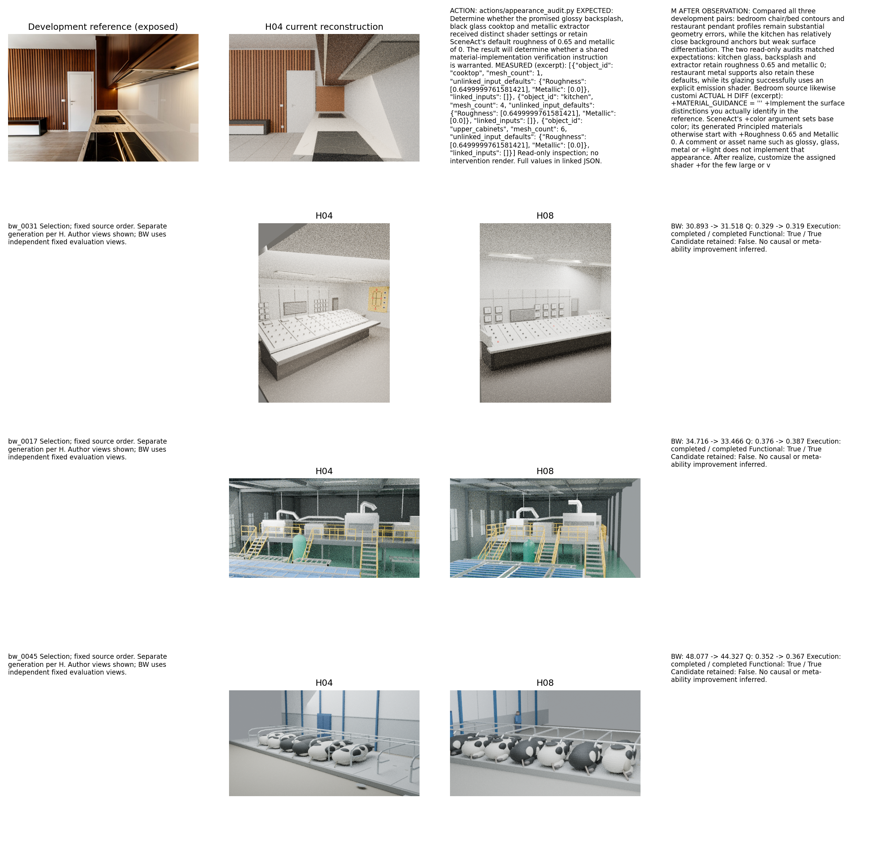

# Scene-RSI V3 中文实验报告

[A01实际平台修订](../PROTOCOL_AMENDMENT_01.md)：公开附件已统一转发，原偏离文档保留为历史；M0未变，修订在首个BW正式任务和首轮正式M前完成，10个已生成H产物按相同信息条件复用。


本轮状态：generation；正式研发完成 10/10 轮。保存了 63 条正式场景记录、当前有效评价协议 56 次BW测量；修订前已测BW记录 12 条另行保留。终测 partially_completed（已完成记录 6）。实际CLI会话 332 次（包括准备阶段），usage可见 329/332。

当前manifest来源数：development=12、selection=3、reserved_unused_budget_A02=1、test=6、meta_replay=2；Selection绝对覆盖按实际冻结配置，不沿用旧4图口径。

终测每来源每端点计划 2 次生成；依据 test_repeat_plan.json，预算分支已冻结。 H_best与H_start相同时复用同一版本的真实产物，不增加独立生成数。

独立来源配对：2/6 来源有双方成功且实测的生成对，合计 2 对生成；来源等权条件BW差 -3.312。全预定来源的端到端BW效用差 pending，完整效用覆盖 1/6；缺失评价和pending不当零。

主根渲染预算扣额 render_budget_charged=858，主根+独立回放根联合扣额=858，分别读取两根render_attempts.jsonl且不重复相加；functional()一次保守预扣3帧，N/A时实际可能更少，因此不将原render_attempts字段解释为精确帧数。实际全局尝试数和完成数保持unknown/null。render_evidence.csv逐目录选择一种记录来源，避免stage事件、逐视角metadata与ledger重复相加。 早期CPU基准6次命令（3次成功、3次初始导入失败）已在冻结前补扣，原补扣证据保留。

所有结果均为 BW-style / CLI-adapted，不是官方榜单分数。开发历史图已暴露；同模型研发与评审存在偏差。未完成项保留pending/null；没有真实冻结元回放时不宣称元能力改善。进程树RSS为0.1秒采样下界；嵌套阶段墙钟和CPU作用域有重叠，不相加冒充总耗时。

A02评价器修订保留14条前后记录；旧状态{'completed': 12, 'eval_failed': 2}，旧原因核对{'scored': 12, 'operator_pause_before_judge': 1, 'missing_delivery_evidence': 1}；新状态{'completed': 13, 'pending_current_evaluation': 1}。旧评分与失败、实际judge会话完整保留于evaluator_revision.csv及before_A02原件；新协议缺测保持pending/null。旧12张dev BW不供正式M，最终端点才统一重评；这些变化属于评价证据修复，不是H算法改进。

[评价修订逐记录表](../metrics/evaluator_revision.csv) · [A02协议修订](../PROTOCOL_AMENDMENT_02.md) · [A03灯光证据与操作员中断记录](../PROTOCOL_AMENDMENT_03.md) · [A04无损证据编码修复](../PROTOCOL_AMENDMENT_04.md) · [A05网络恢复与冻结续跑](../PROTOCOL_AMENDMENT_05.md)

请求模型与可确认路由分开见 cli_audit.csv；没有路由元数据时 observed_model=unknown。费用未知，不宣称降本。

## 十轮实际状态

| round | status | H retained | M retained | type |
|---|---|---|---|---|
| 1 | completed | historical_r1_C2_start | M000 | H-only |
| 2 | completed | H02 | M000 | H-only |
| 3 | completed | H02 | M000 | H-only |
| 4 | completed | H04 | M000 | H-only |
| 5 | completed | H04 | M000 | H-only |
| 6 | completed | H04 | M000 | H-only |
| 7 | completed | H04 | M07 | M-only |
| 8 | completed | H04 | M07 | H-only |
| 9 | completed | H04 | M07 | unchanged |
| 10 | completed | H04 | M07 | H-only |



历史开发图按预定顺序全部展示，n=12来源；这些图片为研发已暴露数据，不是泛化证据。同一H版本复用同一产物标reuse，失败或未运行保留空位。

来源：[manifest.json](../manifest.json)、[metrics/scenes.csv](../metrics/scenes.csv)、[metrics/rounds.csv](../metrics/rounds.csv)；生成脚本：[analyze.py](../analyze.py)。



蓝线记录实际保留版本的晋升时验证评分，圆点为接受候选、叉号为未接受候选；后续边界复评原始记录另见scenes.csv中的bw_judgments，不反向覆盖历史决策点。资格恢复晋升不自动代表配对视觉增益。不对未运行轮次填零；连续轨迹不是十次独立重复。

来源：[metrics/rounds.csv](../metrics/rounds.csv)、[round0.json](../round0.json)；生成脚本：[analyze.py](../analyze.py)。



当前有效评价协议下各划分逐生成 BW 点；开发 preview 与正式 Selection/Test 分开。修订前评分完整另存evaluator_revision.csv，不混作同协议提升。缺测和未开始不显示零分。统计单位为生成产物，独立场景数另见CSV。

来源：[metrics/scenes.csv](../metrics/scenes.csv)、[metrics/evaluator_revision.csv](../metrics/evaluator_revision.csv)；生成脚本：[analyze.py](../analyze.py)。



按真实独立来源聚合重复生成；左图保留全部实测原始点与每来源条件均值，右图仅在同一repeat双方都成功且取得BW时计算差异。失败原始BW仍为null；失败计零的端到端效用另列CSV，评价服务失败与pending不填零。同一H复用不是独立生成。没有置信区间或显著性声明。

来源：[metrics/paired_test_sources.csv](../metrics/paired_test_sources.csv)、[metrics/paired_test_generations.csv](../metrics/paired_test_generations.csv)、[metrics/scenes.csv](../metrics/scenes.csv)；生成脚本：[analyze.py](../analyze.py)。



当前有效评价协议的逐产物八维评分与实际功能测量计数；修订前评分另存evaluator_revision.csv。未测不算失败，也不算通过。required/applicable/measured_pass/gate_pass原始对象完整保留于CSV。机械编辑不等于文字编辑能力。

来源：[metrics/scenes.csv](../metrics/scenes.csv)、[metrics/evaluator_revision.csv](../metrics/evaluator_revision.csv)；生成脚本：[analyze.py](../analyze.py)。



实际会话、阶段/进程墙钟原始点和可见token总量。timing.csv中进程树与metric阶段可能嵌套，不加和。主根渲染预算扣额为858，主根+独立回放根联合扣额为858，包含功能检查的保守预扣；它不是精确实际帧数。实际总尝试/完成数未知，分来源记录见render_evidence.csv。parent RSS是生命周期高水位；费用未知。

来源：[metrics/cli_audit.csv](../metrics/cli_audit.csv)、[metrics/timing.csv](../metrics/timing.csv)、[metrics/render_evidence.csv](../metrics/render_evidence.csv)、[render_attempts.jsonl](../render_attempts.jsonl)、[preparation/cpu_benchmark_budget_correction.json](../preparation/cpu_benchmark_budget_correction.json)；生成脚本：[analyze.py](../analyze.py)。



同一历史场景、同一512×512/Cycles16配置的2/4/8线程微基准，各一次；不是算法速度比较。首次psutil导入错误3次均保留，不纳入成功吞吐。

来源：[preparation/cpu_benchmark_corrected_import/cpu_benchmark.json](../preparation/cpu_benchmark_corrected_import/cpu_benchmark.json)；生成脚本：[analyze.py](../analyze.py)。


按时间选择第一条完成的正式研究动作，无论成功或失败；图像和观测均来自该动作。动作执行本身不证明原因唯一或H改善，后续决策、diff和迁移结果需合并审查。

来源：[metrics/actions.csv](../metrics/actions.csv)、[meta_traces/round07/actions/01/observation.json](../meta_traces/round07/actions/01/observation.json)、[metrics/rounds.csv](../metrics/rounds.csv)、[candidates/C07/proposal.json](../candidates/C07/proposal.json)、[candidates/C07/M.diff](../candidates/C07/M.diff)、[candidates/C07/H.diff](../candidates/C07/H.diff)；生成脚本：[analyze.py](../analyze.py)。



H与M分别记录实际使用、保留和动作观测次数。不变代码不作为后代，M可执行或被使用不等于能力改善；末轮尚未再执行的M不能声称已发挥作用。

来源：[metrics/rounds.csv](../metrics/rounds.csv)、[metrics/actions.csv](../metrics/actions.csv)；生成脚本：[analyze.py](../analyze.py)。



预先固定的两张开发图、共同起点与H_best；同一文字编辑器、同一指令和调用/执行上限，展示全部四个预定编辑。快照测量目标颜色、几何与非目标保持，真实中心家具语义身份仍未独立验证。不同于直接预定义机械操作；未完成与失败留空，不用其他案例替代。

来源：[metrics/semantic_edit_summary.csv](../metrics/semantic_edit_summary.csv)、[semantic_edit.py](../semantic_edit.py)；生成脚本：[analyze.py](../analyze.py)。



十轮结束后按时间选择最早具有真实动作与共享H候选的研发回合，不按收益挑选；展示全部三张Selection来源。上行是实际开发参考、重建、原生测量与后续代码修改；下行是不同来源的真实产物与指标。只说明程序研发链运行；独立生成的差异不能证明动作的因果收益。只读材质检查没有干预渲染，也不自动确认亮度的唯一原因。

来源：[metrics/shared_patch_case.json](../metrics/shared_patch_case.json)、[meta_traces/round08/actions/01/observation.json](../meta_traces/round08/actions/01/observation.json)、[candidates/C08/proposal.json](../candidates/C08/proposal.json)、[candidates/C08/H.diff](../candidates/C08/H.diff)、[metrics/scenes.csv](../metrics/scenes.csv)、[metrics/actions.csv](../metrics/actions.csv)、[metrics/rounds.csv](../metrics/rounds.csv)；生成脚本：[analyze.py](../analyze.py)。

## 重画命令

```bash
__SCENEEVOLVE_REPRO__/work/.venv/bin/python __EXPERIMENT_ROOT__/analyze.py report
```

本命令只读取保存的记录、图片和配置，不运行模型或Blender。续跑入口由主runner提供，不由报告触发。
