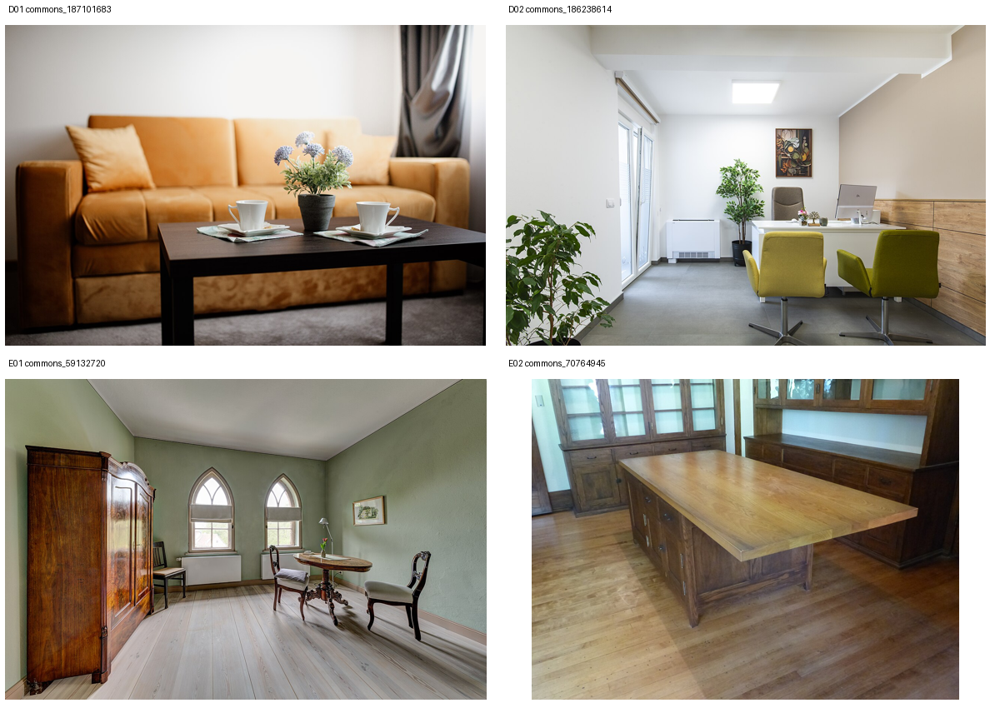
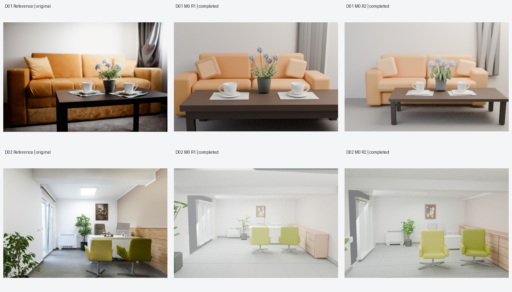
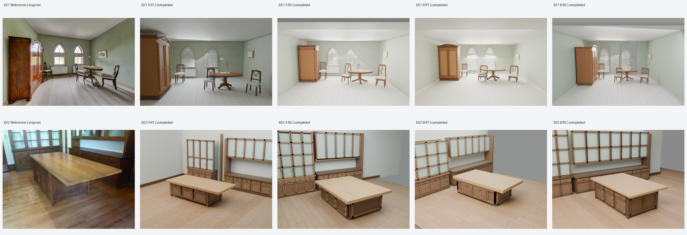

# 教师一次自修改：固定学生、人工看图

本轮只做一次 M0→M1 教师共享策略修改，计划12次独立从零重建：两张开发图各两回合（4次），两张比较图 × 两教师 × 两回合（8次）。学生保持固定；没有自动质量评价。

当前技术状态以 [逐项CSV](metrics/tasks.csv) 和 [中文报告](reports/REPORT_ZH.md) 为准。M1若可执行且实际用于比较，仍等待人类判断，不自动晋升为最佳教师。



原图来源、作者及许可见 [SOURCE_ATTRIBUTION.md](SOURCE_ATTRIBUTION.md)。全部图像为历史样本，不宣称新盲测。首图沙发环境以家具组合为主体，不泛称所有图均为完整房间。

下载完整Release附件并解压，打开 `teacher_self_evolution_human_pilot/reports/index.html`。原图和渲染均使用本地相对路径，离线可用；GitHub本身不直接运行HTML。页面默认匿名A/B，展开区可查看Hint、内部版本、源码diff与真实错误，支持导出人工意见JSON。

## 入口

使用既有含Pillow的Python环境。离线重画不调用模型或Blender：

```bash
python runner.py report
```

在原服务器实验目录中续跑（仅未完成项；已终态成功/失败均不重抽；不创建M2或第三轮指导）：

```bash
python launch.py resume
```

发生进程中断时保留当前阶段，禁止把已启动的学生整个重抽；续跑入口会要求核对其实际阶段。接口自测为 `python preflight.py`，只使用stub，不占12项、不产生实验结果。

固定配置及源码见 [冻结协议](protocol.md)、[config.json](config.json)、[code_snapshots/preformal](code_snapshots/preformal)。实际运行的CLI适配器及SceneAct来自V3后端，保留backend/LICENSE。模型gpt-6.1-terra/medium与gpt-6-astra/medium全部走CLI，费用和底层精确请求未知。

共享CPU8核/32GB，单个Blender×8线程，CPU Cycles768长边/32samples，原图比例，最多两次内部构建。单条演化轨迹、四图、无自动质量分数；不支持统计显著性或普遍元能力增强结论。

原始 task status.json 中 `state` 字段继承了冻结计划的初始值；实际运行状态看 `status`。派生表仅使用 `status`，不将尚未运行、失败或交付混淆。日志原样保留。

图像附件的匿名暂存副本不重复打包；每次 request.json 保留真实 `--image` 参数及 `original_images_for_audit`，对应原图和当前任务渲染均已归档。公开文本仅替换本机用户路径前缀，原日志留在服务器；模型角色、调用、失败、预算和科学数据不删改。

CLI原始日志沿用适配器的 `role=H` 标识；在本轮它专指固定学生 S，不表示共享重建流程发生演化。教师指导、自修改与技术修复使用独立role；成本表保留原标识。

依赖版本见 preparation/environment_versions.json。离线报告需要Python、Pillow及PyYAML（由复用data模块导入）；真实执行还使用既有psutil、Blender 4.2.10、SceneAct和Codex CLI。无需下载任何模型权重；本轮没有安装或升级包。公开配置中的 `${PROJECT_ROOT}` / `${USER_HOME}` 为本机路径脱敏标记，实际可执行续跑使用服务器原目录；跨机器重新实验必须明确配置本地工具路径并建立新记录，不能覆盖这份冻结结果。

成本由全部 request.json、session.json 和 render_attempts.jsonl 重新计算；ledger.json 是调用前的预算检查快照，不应单独当作最终消费量。重画入口不会调用模型或重新构建场景。

## 本次实际交付

计划12、启动12、交付12，终态失败0；内部构建24次，其中失败5次，均按相同的一次修复额度处理并保留。7/12项的第二次学生调用实际附带中间渲染，其余首建失败后仅做代码错误修复。所有最终版本为第二次构建，没有第三次学生看图机会。

M0唯一一次提案生成可执行M1，无技术修复；M1已执行4次比较指导。实际改动是共享提示策略，尚待人工判断。模型调用37/60，渲染19/24，没有自动质量分数。




图像按冻结顺序展示；全部原始点为四个来源和12次反馈相关的逻辑任务，不当作12个独立来源。[完整离线附件](https://github.com/i025/scene/releases/download/teacher-self-evolution-human-pilot-2026-11-15/teacher_self_evolution_human_pilot_full.tar.gz)（发布确认以仓库上传摘要及收据为准）。
